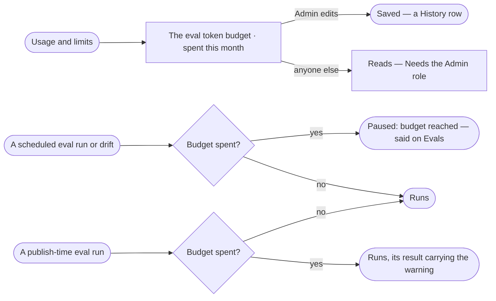

# AG-59 · Keep tests and evals within their token budget

**As** an Admin **I want** one monthly token budget for every test, eval and drift run in the deployment, read beside
what they spent and apart from what agents spend **so that** checking agents and skills never eats the work they do,
and a publish is never blocked because the checks ran out.

Tasks: [task.md](task.md) · Feature: [AG-F10](../../feature.md)

## Who can

| Lens | Can | Otherwise sees |
|---|---|---|
| Admin | Set, change or clear the deployment's eval token budget | — |
| Modeller | Read the budget and what is spent | Editing disabled — *Needs the Admin role* |
| Operator | Read the budget and what is spent | Editing disabled — *Needs the Admin role* |

## Flow

## Acceptance criteria

| # | Given | When | Then |
|---|---|---|---|
| AG-59.1 | Control Plane › Usage and limits | anyone opens it | the deployment's monthly eval token budget reads beside what tests, evals and drift spent this month, apart from what agents spent; *No eval budget* when none is set; Evals on every sheet reads the same spent-of-budget line |
| AG-59.2 | The budget spent | a scheduled eval run or drift would start | it settles *paused: budget* and Evals says so; a publish-time run still runs, its result carrying the warning |
| AG-59.3 | An Admin | they set or change the budget | it saves and a History row names the old and new value; anyone else reads it, editing disabled — *Needs the Admin role* |
| AG-59.4 | A new month | it starts | what is spent reads from zero and paused scheduled runs take their next firing |
| AG-59.5 | The judge and the starter set | they are called | the judge's tokens count on the budget; the Assistant's proposed cases do not |

## Screens

| Surface | Lens | First use | Empty after a filter | Loading | Has data | Failed | Agent working or proposing | No access |
|---|---|---|---|---|---|---|---|---|
| The eval token budget | Admin | settings.usage · No eval budget | — | settings.usage · Loading | settings.usage · Eval token budget | settings.usage · Could not load | — | — |
| The eval token budget | Operator | settings.usage · No eval budget | — | settings.usage · Loading | settings.usage · Read only | settings.usage · Could not load | — | settings.usage · Read only |
| A skill's run paused on budget | Admin | — | — | — | agents.skill · Budget paused | agents.skill · Budget paused | — | — |
| A skill's run paused on budget | Operator | — | — | — | agents.skill · Budget paused | agents.skill · Budget paused | — | agents.skill · Budget paused |
| An agent's run paused on budget | Admin | — | — | — | agents.agent · Budget paused | agents.agent · Budget paused | — | — |
| An agent's run paused on budget | Operator | — | — | — | agents.agent · Budget paused | agents.agent · Budget paused | — | agents.agent · Budget paused |
