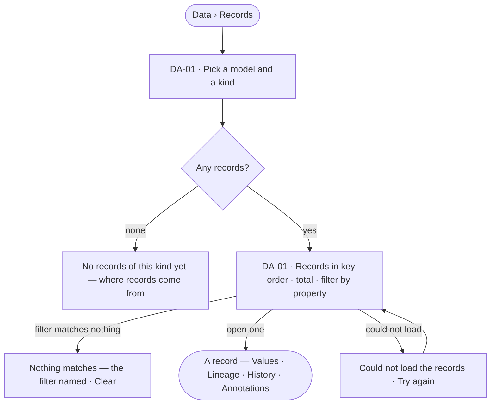

# Records by kind

> Every record of a kind, paged by its key, filtered by its properties, and one record opened whole.
> The decision it helps make: *which records are there, and what does one of them say?*

## User journey

## Stories

| ID | Story | Status |
|---|---|---|
| DA-01 | [Browse the records of a kind](stories/DA-01-browse-the-records-of-a-kind/story.md) | idea |

## Rules

| Rule | Detail |
|---|---|
| Records are read through the model | Only kinds of a published model are listed; what the database holds outside any model is Model's health, not Data |
| A view of the graph applies | A kind or property a view hides is absent here as it is everywhere |
| The engine counts | The total is the engine's, never counted by Studio |

## Access

| Act | Role (`.claude/team/TEAM.md` §7) | Everyone else sees |
|---|---|---|
| Read records, their lineage and history | Operator — every member | — |
| Open a record on a board | Operator — every member | — |

## States

| State | What the person sees |
|---|---|
| First use | No records of this kind yet: why, and that records arrive from the graph database or a board's save |
| Empty after a filter | Nothing matches: the filter named, and *Clear* |
| Loading | Rows load in key order; the total arrives with them |
| Has data | Rows with the kind's key and its first properties; the total the engine counted |
| Failed | *Could not load the records* and *Try again* |
| Agent working or proposing | — |
| No access | A kind a view of the graph hides is absent from the picker |

## Data touched

| Record | Read or write |
|---|---|
| Nodes and relationships of one kind | Read |
| The published model's kinds, keys and properties | Read |

## Decisions

| Decision | Detail |
|---|---|
| Key order | Records page in the order of their kind's key, so a page is stable between visits |
| Open on a board | A record opens on a new board from here, with its neighbours one step out |

## Open questions

| Question | Who answers |
|---|---|
| — | — |

## Not building

| Item | Why not |
|---|---|
| Free-text search across every kind | ⌘K finds records by name; Data is by kind |
| Editing in the grid | Edits are a fix (DA-F03) or a board's save (EX-F06) |
