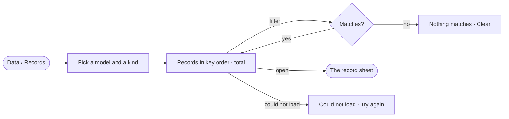

# DA-01 · Browse the records of a kind

**As** an analyst **I want** every record of a kind, filtered by its properties and opened whole **so that** I know what the Graph holds before I ask it anything.

Tasks: [task.md](task.md) · Feature: [DA-F01](../../feature.md)

## Who can

| Lens | Can | Otherwise sees |
|---|---|---|
| Admin | Browse, filter and open the records of any kind | — |
| Operator | Browse, filter and open the records of any kind a view of the graph lets them see | Kinds a view hides are absent |

## Flow

## Acceptance criteria

| # | Given | When | Then |
|---|---|---|---|
| DA-01.1 | A kind with records | *Records* opens on it | they page in key order with the engine's total |
| DA-01.2 | A filter on a property | it matches nothing | *Nothing matches* names the filter, with *Clear* |
| DA-01.3 | A record in the list | it is opened | its sheet shows every value the published model gives its kind |
| DA-01.4 | A kind with no records | it is picked | the page says there are none yet and where records come from |
| DA-01.5 | A kind a view of the graph hides | an Operator opens the picker | the kind is absent |
| DA-01.6 | The records cannot be read | the page opens | *Could not load the records* shows with *Try again* |

## Screens

| Surface | Lens | First use | Empty after a filter | Loading | Has data | Failed | Agent working or proposing | No access |
|---|---|---|---|---|---|---|---|---|
| Records | Admin | data.records · No records yet | data.records · Nothing matches | data.records · Loading | data.records | data.records · Could not load | — | — |
| Records | Operator | data.records · No records yet | data.records · Nothing matches | data.records · Loading | data.records | data.records · Could not load | — | data.records · Kind hidden |
