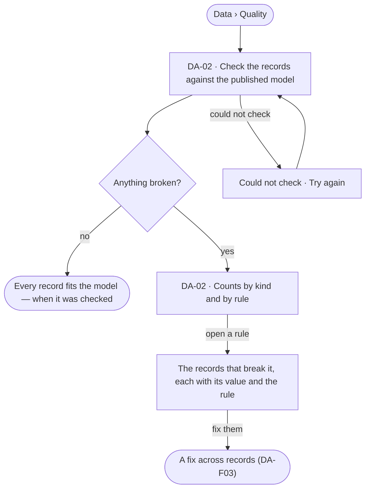

# Quality against the model

> Every record that breaks the published model — a missing key, a value outside its constraint, a relationship the model does not allow — counted by kind and listed by rule.
> The decision it helps make: *which records are not fit to rely on, and which to fix first?*

## User journey

## Stories

| ID | Story | Status |
|---|---|---|
| DA-02 | [See the records that break the model](stories/DA-02-see-the-records-that-break-the-model/story.md) | idea |

## Rules

| Rule | Detail |
|---|---|
| The published model is the bar | A record is checked against its kind's keys, constraints and allowed relationships in the published version, never a draft |
| Quality is record by record | How the model and the database differ kind by kind is Model's health (MO-F04) |
| A check is a run | It streams, can be stopped and leaves a trace like any run |

## Access

| Act | Role (`.claude/team/TEAM.md` §7) | Everyone else sees |
|---|---|---|
| Read records, their lineage and history | Operator — every member | — |
| Run a check | Operator — every member | — |

## States

| State | What the person sees |
|---|---|
| First use | No records of this kind yet: why, and that records arrive from the graph database or a board's save |
| Empty after a filter | Nothing matches: the filter named, and *Clear* |
| Loading | Rows load in key order; the total arrives with them |
| Has data | Counts by kind and rule; each rule opens its records |
| Failed | *Could not load the records* and *Try again* |
| Agent working or proposing | A check running: what it has read so far, and *Stop* |
| No access | Kinds a view hides are left out of the counts, and the page says so |

## Data touched

| Record | Read or write |
|---|---|
| Nodes and relationships | Read |
| The published model's constraints and rules | Read |
| The check's run and its counts | Write |

## Decisions

| Decision | Detail |
|---|---|
| Counts are stored | The engine stores each check's counts when it settles; Studio shows them, never derives them |
| Nothing is fixed here | Quality finds; a fix is DA-F03 |

## Open questions

| Question | Who answers |
|---|---|
| Should a check run on a schedule? Recommend: on demand first; a schedule is an agent's job (AG-F07) | Ravi |

## Not building

| Item | Why not |
|---|---|
| Fixing in place from the list | A fix is previewed and run as one (DA-F03) |
| Checks the model does not state | Quality reads the model's own constraints and rules, nothing else |
