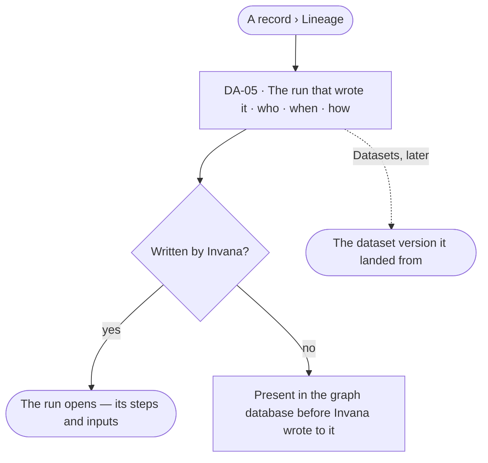

# Lineage

> Where a record came from: the run that wrote it — a load, a board's save, a fix or a merge — who ran it, and, once Datasets is taken up, the dataset version it landed from.
> The decision it helps make: *can I trust where this record came from?*

## User journey

## Stories

| ID | Story | Status |
|---|---|---|
| DA-05 | [Trace a record to what wrote it](stories/DA-05-trace-a-record-to-what-wrote-it/story.md) | idea |

## Rules

| Rule | Detail |
|---|---|
| Lineage is the run | Every record Invana writes says which run wrote it; the run says who, when and from what |
| The database's own records | A record Invana never wrote reads *Present in the graph database before Invana wrote to it* — never a guess |
| Datasets later | Lineage to a dataset version comes with Datasets; until then a record's lineage ends at its run |

## Access

| Act | Role (`.claude/team/TEAM.md` §7) | Everyone else sees |
|---|---|---|
| Read records, their lineage and history | Operator — every member | — |

## States

| State | What the person sees |
|---|---|
| First use | — |
| Empty after a filter | — |
| Loading | The record's lineage loads with its sheet |
| Has data | The run that wrote it, or *Present in the database before Invana wrote to it* |
| Failed | *Could not load lineage* and *Try again* |
| Agent working or proposing | — |
| No access | A run the person may not read is named, not opened: *a run by an agent you cannot see* |

## Data touched

| Record | Read or write |
|---|---|
| A record's provenance — the run that wrote it | Read |
| Runs | Read |

## Decisions

| Decision | Detail |
|---|---|
| Written once | A record's lineage is stamped when it is written and never changes; later changes are its History |

## Open questions

| Question | Who answers |
|---|---|
| — | — |

## Not building

| Item | Why not |
|---|---|
| Lineage on every value | Provenance is per record; property changes are its History |
