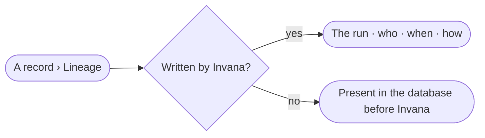

# DA-05 · Trace a record to what wrote it

**As** an analyst **I want** to see what wrote a record — which run, by whom, and when **so that** I know whether to trust it.

Tasks: [task.md](task.md) · Feature: [DA-F05](../../feature.md)

## Who can

| Lens | Can | Otherwise sees |
|---|---|---|
| Admin | Read any record's lineage and open its run | — |
| Operator | Read any record's lineage; open runs they may read | A run they may not read is named, not opened |

## Flow

## Acceptance criteria

| # | Given | When | Then |
|---|---|---|---|
| DA-05.1 | A record written by a board's save | *Lineage* opens | it names the run, who ran it and when, and the run opens from it |
| DA-05.2 | A record Invana never wrote | *Lineage* opens | it reads *Present in the graph database before Invana wrote to it* |
| DA-05.3 | A run by an agent the Operator may not read | *Lineage* opens | the run is named, not opened |
| DA-05.4 | Lineage cannot be read | the tab opens | *Could not load lineage* shows with *Try again* |

## Screens

| Surface | Lens | First use | Empty after a filter | Loading | Has data | Failed | Agent working or proposing | No access |
|---|---|---|---|---|---|---|---|---|
| A record · Lineage | Admin | — | — | data.record · Loading | data.record · Lineage | data.record · Could not load | — | — |
| A record · Lineage | Operator | — | — | data.record · Loading | data.record · Lineage | data.record · Could not load | — | data.record · Run not readable |
