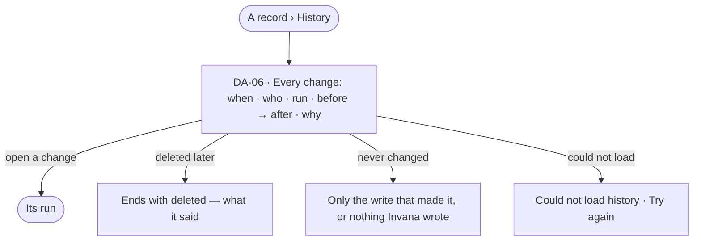

# Record history

> Every change to one record — who made it, in which run, what changed and why — read from the Graph's History.
> The decision it helps make: *has this record been changed, by whom, and was the change right?*

## User journey

## Stories

| ID | Story | Status |
|---|---|---|
| DA-06 | [Read a record and every change to it](stories/DA-06-read-a-record-and-every-change-to-it/story.md) | idea |

## Rules

| Rule | Detail |
|---|---|
| History is one store | The record's history is the Graph's History (AC-F06), filtered to the record — never a second log |
| Every write lands there | A board's save, a fix, a merge and a load each write their changes to History |

## Access

| Act | Role (`.claude/team/TEAM.md` §7) | Everyone else sees |
|---|---|---|
| Read records, their lineage and history | Operator — every member | — |

## States

| State | What the person sees |
|---|---|
| First use | A record Invana never changed: *No changes made in Invana* |
| Empty after a filter | — |
| Loading | History loads with the record's sheet |
| Has data | Changes newest first: when · who · run · before → after · why |
| Failed | *Could not load history* and *Try again* |
| Agent working or proposing | — |
| No access | A change by someone the person may not see reads *a member you cannot see* |

## Data touched

| Record | Read or write |
|---|---|
| History, filtered to one record | Read |

## Decisions

| Decision | Detail |
|---|---|
| The same rows as History | What a record's History shows and what History shows for it are the same rows |

## Open questions

| Question | Who answers |
|---|---|
| — | — |

## Not building

| Item | Why not |
|---|---|
| A per-dataset change log | With Datasets parked, a record's history is its History |
