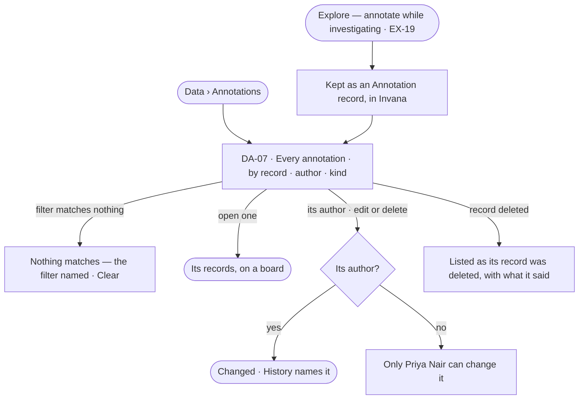

# Annotations

> Every annotation in the Graph in one place — what people and the assistant said about the records — kept by Invana as records of the built-in *Annotation* kind, found by record, author or kind, and edited or removed by its author.
> The decision it helps make: *which annotations still hold, and which should go?*

## User journey

## Stories

| ID | Story | Status |
|---|---|---|
| DA-07 | [Find and manage the Graph's annotations](stories/DA-07-find-and-manage-the-graphs-annotations/story.md) | idea |

## Rules

| Rule | Detail |
|---|---|
| A built-in kind | An annotation is a record of the built-in *Annotation* kind: its text, author, the records it is about, the value then, and its evidence |
| Kept by Invana | Annotation records are kept by Invana, never in the customer's graph database; a read-only database can be annotated |
| Explore creates, Data keeps | Annotating is done on a board (EX-F06); finding, reading, editing and removing all of them is here |
| Never counted as data | Annotations are not records of the Graph's own models: never counted in Quality, never exported with records |

## Access

| Act | Role (`.claude/team/TEAM.md` §7) | Everyone else sees |
|---|---|---|
| Read every annotation | Operator — every member | — |
| Edit or delete an annotation | Its author | Off — *Only Priya Nair can change it* |

## States

| State | What the person sees |
|---|---|
| First use | *Nothing annotated yet* — annotations are made on a board in Explore |
| Empty after a filter | Nothing matches: the filter named, and *Clear* |
| Loading | Rows load newest first |
| Has data | Each annotation: what it says, its records, author, when |
| Failed | *Could not load annotations* and *Try again* |
| Agent working or proposing | The assistant's annotations a person added show as the assistant's; proposals still in a conversation are not listed |
| No access | Annotations on kinds a view hides are absent |

## Data touched

| Record | Read or write |
|---|---|
| Annotation records | Read · write by their author |
| The records they are about | Read |

## Decisions

| Decision | Detail |
|---|---|
| The built-in Annotation kind is not a model a person shapes | It is Invana's; it never appears on the model map |
| Only the author changes it | Others read it; an Admin may delete any, with a reason kept in History |

## Open questions

| Question | Who answers |
|---|---|
| Is the Annotation kind shown in Model, read-only? Recommend: no — it is Invana's, shown only here | Ravi |

## Not building

| Item | Why not |
|---|---|
| Threads, replies, mentions | A conversation about data is the assistant's |
| Annotations written to the graph database | They are Invana's |
