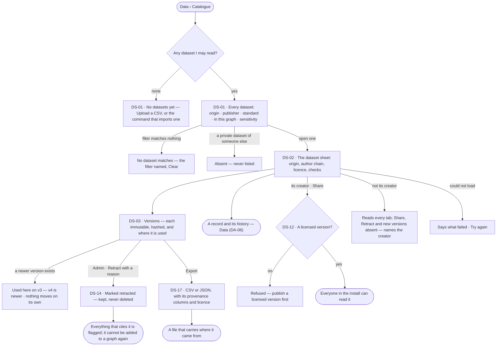

# Datasets and their versions

> One catalogue of every dataset in the install, each labelled by where it came from, licensed, and kept in immutable
> versions — retracted when its source withdraws it, refreshed into new versions while everyone who used it stays on
> the one they chose. The decision it helps make: *can I rely on this data, and which exact version does my result
> rest on?*

## User journey



```mermaid
sequenceDiagram
  actor A as Admin
  participant S as Studio
  participant E as Engine
  actor O as Who uses it
  A->>S: Retract v3 · reason
  S->>E: the retraction
  E->>E: marks v3 retracted — when, who, why — and keeps it
  E-->>S: v3 with what cites it
  O->>S: opens a graph that added v3, or a version derived from it
  S-->>O: flagged — v3 is retracted, with its reason
  E->>E: a scheduled refresh reads the source
  E-->>S: v5 minted when the content changed; nothing that used v4 moves
```

## Stories

| ID | Story | Status |
|---|---|---|
| DS-01 | [Find a dataset to reuse](stories/DS-01-find-a-dataset-to-reuse/story.md) | later |
| DS-02 | [Read a dataset and how far to trust it](stories/DS-02-read-a-dataset-and-how-far-to-trust-it/story.md) | later |
| DS-03 | [Versions and where each is used](stories/DS-03-versions-and-where-each-is-used/story.md) | later |
| DS-12 | [Share a dataset with the install](stories/DS-12-share-a-dataset-with-the-install/story.md) | later |
| DS-14 | [Retract a version and flag what cites it](stories/DS-14-retract-a-version-and-flag-what-cites-it/story.md) | later |
| DS-17 | [Export a version with its provenance](stories/DS-17-export-a-version-with-its-provenance/story.md) | later |

## Access

Datasets sit above Graphs, so their acts are owned by the dataset's creator or the install Admin, not by a Graph role.

| Act | Role (`.claude/team/TEAM.md` §7) | Everyone else sees |
|---|---|---|
| Read the catalogue, a dataset shared with the install, its versions, records and change log | Operator — every member of the install | — |
| Read a private dataset | Its creator · Admin | Absent everywhere — never listed, never *no access* |
| Change a dataset's title, description and sensitivity · share it | Its creator · Admin | Absent, not disabled; a line names the creator |
| Retract a version | Admin (`is_superuser`) | *Retract* absent; a retracted version reads the same for everyone |
| Export a version | Anyone who can read the dataset — a read; carrying confidential or personal data, or made by a key or an agent, a send ([An export](../../../../os/access/product.md#decisions)) | — |
| Set a refresh schedule | Its creator, from the CLI | Read only in Studio for everyone |

## States

| State | What the person sees |
|---|---|
| First use | *No datasets yet — datasets are tables shared across the install, in versions*, with *Upload a CSV* and the command that imports one |
| Empty after a filter | *No dataset matches* — the filters named, with *Clear filters* |
| Loading | The catalogue's rows and the sheet's tabs hold their shape as skeletons |
| Has data | Datasets with origin, publisher, current version, licence and sensitivity; a dataset's sheet on *About* |
| Failed | What could not be read, in a sentence, with *Try again*; a refused act names why — no licence, retracted, not the creator |
| Agent working or proposing | — |
| No access | A private dataset is absent; a read-only dataset hides its writes and names its creator |

## Rules

| Rule | Detail |
|---|---|
| Install-wide | A dataset belongs to no Graph. A Graph reaches one only by adding a version of it to a model (DS-F03) |
| The address is `publisher/name` | Two lowercase slugs, unique as a pair and fixed at create; the publisher defaults to the creator's username, an official dataset names its organisation. A version is `publisher/name@v` |
| Origin is set once | `official · collected · generated · observed · derived`, chosen at create and never changed; records inherit it |
| Who the author is, by origin | *official* — the publishing organisation · *collected* — each page's author, the agent *collected by* · *generated* — the agent and its run · *observed* — the person · *derived* — the run that computed it, citing its inputs |
| Versions are immutable | Licence (required), author chain, columns, record count, source, inputs and why are fixed; a fix is a new version. Creating a dataset mints nothing — the first import is v1 |
| Identical content mints nothing | A version is hashed over its records; one whose hash equals the current version's is refused as *unchanged* |
| Every record has a key | Read from the key column; a missing or repeated key refuses the whole version, naming the first five. Values are scalars — a dataset is tables |
| Provenance where it differs | Dataset-level origin, author chain and licence are required; a record keeps its own only where it differs; a property change is a change-log entry, never stored in place |
| Author chain | At least one *original* author, except an `observed` dataset, whose author is the importing person. A `derived` version names at least one input version the person may read |
| Sensitivity | `public < internal < confidential < personal` on the dataset; a column may be tighter, never looser — a looser column is refused naming it |
| Private or the install | A private dataset is absent to everyone but its creator; sharing needs a licensed version |
| Retracted is kept | A retracted version stays readable, is never deleted and is not un-retracted; it cannot be added to a graph or named as an input again |
| Consumers stay pinned | A refresh mints a new version; nothing that used an older one moves until a person moves it, and each is told a newer one exists |
| The engine counts | Record counts, provenance exceptions, where a version is used and its flags are served by the engine; Studio formats them |

## Data touched

| Record | Read or write |
|---|---|
| Dataset — address, title, origin, key column, visibility, sensitivity, refresh schedule | Read · write |
| Dataset version — licence, author chain, columns, count, hash, source, inputs, why, retraction | Read · write |
| Dataset record — key, values, its own provenance | Read |
| Where a version is used — the graphs that added it, versions derived from it | Read |
| Events — create, version, update, retract | Write |

## Decisions

| Decision | Detail |
|---|---|
| Tabs are the sheet's | A dataset opens as a sheet over Data: *About · Versions · Records · Sharing*; a tab survives a reload |
| A dataset's record reads one crumb deeper | Data › Catalogue › the dataset › the record |
| Engine counts provenance exceptions | The provenance block shows how many records differ from the dataset and lists the first page |
| A record's change log is read from versions | For one key, each version whose values or provenance differ from the one before is an entry; who, when and why are that version's, the who named from the dataset's history |
| Flags are read, not stored | Where a version is used, and whether its inputs are retracted, are computed on each read |
| Where used is what the reader may see | Graphs the reader is not in are absent; an Admin sees all |
| Refresh is a scheduled import | It copies the current version's licence and author chain, *why* reads *scheduled refresh*, and identical content mints nothing. Studio shows the schedule read-only |
| Retraction is the Admin's | The publisher may ask for one; only an install Admin retracts, with a reason of at most 500 characters |
| Sharing is two places for now | *Only me · everyone in the install*; a lab waits for a lab record |

## Open questions

| Question | Who answers |
|---|---|
| — | — |

## Not building

| Item | Why not |
|---|---|
| A lab or team visibility | No lab record exists; private and the install until one does |
| Deleting a dataset or a version | Versions are cited; a withdrawn one is retracted |
| Un-retract | A mistaken retraction is answered by a new version |
| Per-cell provenance | Record level plus the change log covers it |
| Sharing across installs | The open registry, later |
| Notifications and Inbox items on retraction | The retraction event is the signal until Inbox carries it |
| Flags on findings, decisions and reports | They join *where used* when those records cite versions |
| A refresh that fetches a URL | The engine never reads a caller-named path or URL; the CLI reads a local file |
| Images, sequences, spectra | Each needs its own viewer |
