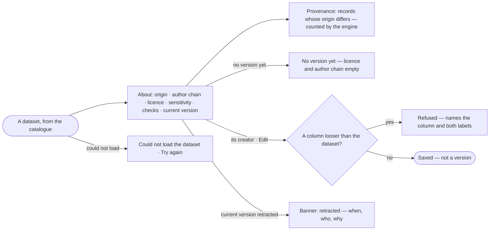

# DS-02 · Read a dataset and how far to trust it

**As** an analyst **I want** to read a dataset with its origin, author chain, licence, sensitivity and checks
**so that** I know how far to trust it before an answer rests on it.

Tasks: [task.md](task.md) · Feature: [DS-F01](../../feature.md)

## Who can

| Lens | Can | Otherwise sees |
|---|---|---|
| Admin | Read every dataset; change any dataset's title, description and sensitivity | — |
| Operator | Read any dataset they may read; change title, description and sensitivity of a dataset they created | On a dataset they did not create, the edit acts are absent and a line names its creator |

## Flow

## Acceptance criteria

| # | Given | When | Then |
|---|---|---|---|
| DS-02.1 | A dataset with a current version | its sheet opens | *About* shows `publisher/name`, origin, the key column, current version, licence, the author chain step by step (original authors · collected by · modified by · validated by), sensitivity and the checks it claims |
| DS-02.2 | A dataset some records of which come from elsewhere | the person reads its provenance | it shows how many records differ in origin from the dataset — the engine's count over the whole version — and lists the first of them with their own origin, source and note |
| DS-02.3 | A dataset with no version yet | its creator opens it | licence and author chain read empty with *No version yet*; nothing else is offered as if a version existed |
| DS-02.4 | A dataset whose creator edits the sensitivity | a column is set looser than the dataset | it is refused, naming the column and both labels |
| DS-02.5 | A title, description or sensitivity edit | it is saved | no version is minted; the change is in the dataset's history |
| DS-02.6 | A dataset the Operator did not create | they open it | every tab reads; *Edit*, *Share* and *Retract* are absent and a line names the creator |
| DS-02.7 | A current version that is retracted | the sheet opens | a banner on *About* reads it is retracted, with when, who and the reason |
| DS-02.8 | The dataset cannot be read | the sheet opens | it says it could not load, with *Try again* |

## Screens

| Surface | Lens | First use | Empty after a filter | Loading | Has data | Failed | Agent working or proposing | No access |
|---|---|---|---|---|---|---|---|---|
| A dataset · About | Admin | data.dataset · No version yet | — | data.dataset · Loading | data.dataset | data.dataset · Could not load | — | — |
| A dataset · About | Operator | data.dataset · No version yet | — | data.dataset · Loading | data.dataset | data.dataset · Could not load | — | data.dataset · Read only |
| Edit a dataset | Admin | — | — | — | data.dataset · Edit | data.dataset · Column looser refused | — | — |
| Edit a dataset | Operator | — | — | — | — | — | — | data.dataset · Read only |
