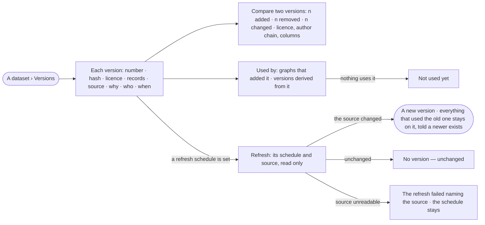

# DS-03 · Versions and where each is used

**As** an analyst **I want** a dataset's immutable versions, where each one is used, and new versions minted by its
refresh without moving anyone **so that** a result can be reproduced from the exact data it rested on.

Tasks: [task.md](task.md) · Feature: [DS-F01](../../feature.md)

## Who can

| Lens | Can | Otherwise sees |
|---|---|---|
| Admin | Read every version, its diff and where it is used in every graph | — |
| Operator | Read every version and its diff; where it is used, in the graphs they are a member of | Graphs they are not in are absent from *Used by*, never counted as hidden |

## Flow

## Acceptance criteria

| # | Given | When | Then |
|---|---|---|---|
| DS-03.1 | A dataset with versions | *Versions* opens | each version lists its number, content hash, licence, record count, source, inputs, why, who published it and when, newest first, the current one marked |
| DS-03.2 | Two versions | the person compares them | the engine's summary reads *n added · n removed · n changed*, with licence, author chain and columns side by side |
| DS-03.3 | A version | the person opens *Used by* | it lists the graphs, models and kinds that added it and the dataset versions derived from it, only in graphs the reader is in — an Admin sees all |
| DS-03.4 | A version nothing uses | *Used by* opens | it reads *Not used yet* |
| DS-03.5 | A version minted with the same records as the current one | it is imported | it is refused as *unchanged* and no version is listed |
| DS-03.6 | A dataset with a refresh schedule | *Versions* opens | the schedule and its source show read only, with the command that changes them |
| DS-03.7 | A refresh whose source changed | it runs | a new version is minted with *why* reading *scheduled refresh*, the licence and author chain of the version before; nothing that used an older version moves |
| DS-03.8 | A graph that added v3 when v4 is current | the person reads where v3 is used | it reads *v4 is newer* and nothing is moved for them |
| DS-03.9 | A refresh whose source cannot be read | it runs | it fails naming the source; no version is minted and the schedule stays |

## Screens

| Surface | Lens | First use | Empty after a filter | Loading | Has data | Failed | Agent working or proposing | No access |
|---|---|---|---|---|---|---|---|---|
| A dataset · Versions | Admin | data.dataset · No version yet | — | data.dataset · Versions loading | data.dataset · Versions | data.dataset · Could not load | — | — |
| A dataset · Versions | Operator | data.dataset · No version yet | — | data.dataset · Versions loading | data.dataset · Versions | data.dataset · Could not load | — | — |
| Used by | Admin | data.dataset · Not used yet | — | data.dataset · Versions loading | data.dataset · Used by | data.dataset · Could not load | — | — |
| Used by | Operator | data.dataset · Not used yet | — | data.dataset · Versions loading | data.dataset · Used by | data.dataset · Could not load | — | — |
| Compare two versions | Admin | — | — | data.dataset · Versions loading | data.dataset · Compare versions | data.dataset · Could not load | — | — |
| Compare two versions | Operator | — | — | data.dataset · Versions loading | data.dataset · Compare versions | data.dataset · Could not load | — | — |
