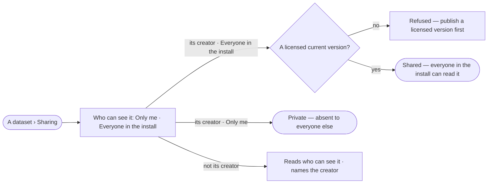

# DS-12 · Share a dataset with the install

**As** a data curator **I want** to share a dataset I made with everyone in the install **so that** knowledge one
lab made is reused by the others.

Tasks: [task.md](task.md) · Feature: [DS-F01](../../feature.md)

## Who can

| Lens | Can | Otherwise sees |
|---|---|---|
| Admin | Share or make private any dataset | — |
| Operator | Share or make private a dataset they created | On a dataset they did not create, *Sharing* reads who can see it; *Share* is absent and a line names the creator |

## Flow

## Acceptance criteria

| # | Given | When | Then |
|---|---|---|---|
| DS-12.1 | A dataset its creator opens | *Sharing* opens | it offers *Only me* and *Everyone in the install*, the current one chosen |
| DS-12.2 | A dataset with no version | its creator shares it with the install | it is refused: *publish a licensed version first* |
| DS-12.3 | A dataset with a licensed current version | its creator shares it with the install | everyone in the install can find and read it; the change is in its history |
| DS-12.4 | A shared dataset made private again | another person opens its address | it reads *not found*, and it leaves their catalogue |
| DS-12.5 | An Operator who did not create the dataset | they open *Sharing* | it reads who can see it; *Share* is absent and a line names the creator |

## Screens

| Surface | Lens | First use | Empty after a filter | Loading | Has data | Failed | Agent working or proposing | No access |
|---|---|---|---|---|---|---|---|---|
| A dataset · Sharing | Admin | data.dataset · Sharing private | — | data.dataset · Loading | data.dataset · Sharing | data.dataset · Share refused | — | — |
| A dataset · Sharing | Operator | data.dataset · Sharing private | — | data.dataset · Loading | data.dataset · Sharing | data.dataset · Share refused | — | data.dataset · Sharing read only |
