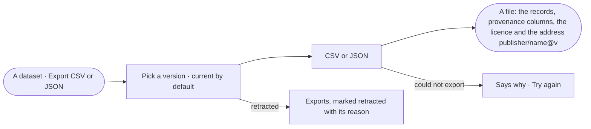

# DS-17 · Export a version with its provenance

**As** anyone who can read a dataset **I want** to export one exact version as CSV or JSON with its provenance
**so that** the data leaves with its licence and its source.

Tasks: [task.md](task.md) · Feature: [DS-F01](../../feature.md)

## Who can

| Lens | Can | Otherwise sees |
|---|---|---|
| Admin | Export any version of any dataset | — |
| Operator | Export any version of a dataset they may read | — |

## Flow

## Acceptance criteria

| # | Given | When | Then |
|---|---|---|---|
| DS-17.1 | A dataset with versions | the person picks *Export CSV or JSON* | they choose a version — the current by default — and a format |
| DS-17.2 | A chosen version | it is exported | the file holds every record with provenance columns (origin, source, note), and names `publisher/name@v`, the licence and the content hash |
| DS-17.3 | A record with its own provenance | it is exported | its own origin, source and note fill its provenance columns; others carry the dataset's |
| DS-17.4 | A retracted version | it is exported | the file is marked retracted, with the reason |
| DS-17.5 | An export that fails | it runs | it says why, with *Try again*; no partial file is offered |

## Screens

| Surface | Lens | First use | Empty after a filter | Loading | Has data | Failed | Agent working or proposing | No access |
|---|---|---|---|---|---|---|---|---|
| Export a version | Admin | — | — | data.dataset · Exporting | data.dataset · Export | data.dataset · Export failed | — | — |
| Export a version | Operator | — | — | data.dataset · Exporting | data.dataset · Export | data.dataset · Export failed | — | — |
