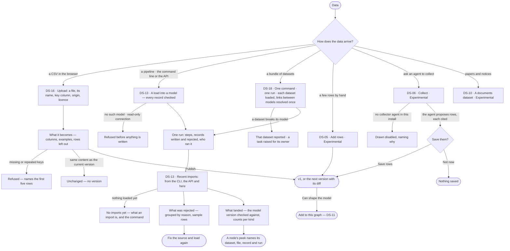

# Bring data in

> Every way data arrives — a CSV uploaded in the browser, a pipeline's load from the command line or the API, a
> bundle of datasets that only make sense together, a few rows by hand, rows an agent collects — and one place to see
> what landed, what was rejected and why. The decision it helps make: *is this load right, or do I fix the source?*

## User journey

Journeys this feature is a step of: [J01 · From an empty install to a first answer](../../../../journeys/J01-from-an-empty-install-to-a-first-answer.md)



```mermaid
sequenceDiagram
  actor P as Curator
  participant S as Studio
  participant E as Engine
  participant A as Collector agent
  P->>S: Collect — what to gather, from which sources
  S->>E: the request
  E->>A: the collection run
  A-->>S: proposed rows, a citation on each; gaps it estimated, kept apart
  P->>S: Save rows
  S->>E: a version of a collected dataset · estimates as a separate generated one
  E-->>S: the versions, and How it got here — its sources and steps
```

## Stories

| ID | Story | Status |
|---|---|---|
| DS-16 | [Upload a CSV and publish it](stories/DS-16-upload-a-csv-and-publish-it/story.md) | later |
| DS-13 | [See every import and what it rejected](stories/DS-13-see-every-import-and-what-it-rejected/story.md) | later |
| DS-18 | [Load a bundle as one run](stories/DS-18-load-a-bundle-as-one-run/story.md) | later |
| DS-05 | [Add a few rows by hand](stories/DS-05-add-a-few-rows-by-hand/story.md) | later |
| DS-06 | [Collect a dataset with an agent](stories/DS-06-collect-a-dataset-with-an-agent/story.md) | later |
| DS-10 | [Keep papers and notices as a documents dataset](stories/DS-10-keep-papers-and-notices-as-a-documents-dataset/story.md) | later |

## Access

| Act | Role (`.claude/team/TEAM.md` §7) | Everyone else sees |
|---|---|---|
| Upload a CSV as a new dataset — the person becomes its creator | Operator — every member of the install | — |
| Upload the next version of a dataset · add rows by hand | The dataset's creator · Admin | The dataset is not offered in *Upload*; *Add rows* absent, naming the creator |
| Load into a model from the command line, the API or a bundle | `modeller` · shown as *Can shape the model* | Refused before anything is written, naming who may load |
| Read recent imports, what each rejected and what landed | Operator — every member of the graph the import ran in | Imports in graphs the person is not in are absent, counted as not readable |
| Collect with an agent | Operator — every member of the install | Drawn disabled while the install has no collector agent |
| Cancel a load | Who started it, where they started it | Studio offers no cancel: a load is stopped where it was started |

## States

| State | What the person sees |
|---|---|
| First use | *Upload*: a drop zone and what a dataset needs. *Recent imports*: *No imports yet* with what an import is and the command to run one |
| Empty after a filter | *No imports match* — the filters (status · dataset · model · time) named, with *Clear filters* |
| Loading | The preview reads *Reading the file…*; import rows and tiles hold their shape |
| Has data | A preview of what the file becomes; imports newest first with rows written and rejected; a run's outcome, steps, what was rejected, its log and what landed |
| Failed | A refused upload names the rows or the reason; a failed load shows its diagnosis and the next step where its counts are |
| Agent working or proposing | Collect: the agent's progress, then rows it proposes, each with its citation, waiting for *Save rows* |
| No access | A dataset the person did not create is not offered for a new version; *Collect* is disabled naming why while no collector exists |

## Rules

| Rule | Detail |
|---|---|
| Invana is a destination | Something else extracts and transforms; what arrives is a dataset that already conforms to a model. Invana builds no source connectors and no mapping grammar |
| A load names its model | Every load says the model its records go into; nothing is inferred from a file |
| Checked one record at a time | One bad record never fails a load and is never dropped silently; each rejection names its record, field and reason |
| Everything written traces back | Every node and relationship a load writes carries its model, record, file and run |
| A load is a run | It streams its steps, retries, times out and is cancelled like every other run, with the same trace, and records who ran it and the command it came from |
| The version it was checked against | A load records the model version it checked against when it started and never switches mid-run |
| No dangling relationships | A relationship whose end does not resolve is rejected naming both ends |
| Loading again updates | Records are matched by the model's keys; the same file twice updates, never duplicates, and the report says updated versus created |
| A bundle is one run | A bundle's datasets load together, links between models resolve once over everything that landed, and a broken dataset raises a task for its owner without discarding the others |
| A bundle is checked before it loads | Each dataset against its own model, then the rules between them — offline, before anything is written |
| The fast path is marked | A bulk load writes without checking and without provenance; it is listed among imports as *bulk load*, saying what it did not do |
| Two ways to make a version | *Upload* in the browser and the import command mint the same version; every dialog prints its command twin |
| Estimates never mix in | Rows an agent estimates land in a separate `generated` dataset, never in the collected one |
| A load is governed | A load is checked against the graph's rules before it writes; a rule that refuses its model ends it *cannot answer* naming the rule, before anything is written |
| The engine counts | Rows written and rejected, the imports, running and failed tiles and *imports a day* are the engine's; Studio formats them |

## Data touched

| Record | Read or write |
|---|---|
| Dataset and dataset version | Write — upload, rows by hand, collect |
| A load's run — kind, steps, who ran it, the command, the model version checked against | Write · read |
| The load's report — per record accepted or rejected, with field and reason | Write · read |
| The run's log | Write · read |
| Nodes and relationships in the graph, with their provenance | Write |
| A task for the owner of a broken source | Write |

## Decisions

| Decision | Detail |
|---|---|
| Imports live in Data › Upload | *Recent imports — from the CLI, the API and here*: one row per run, its graph named, newest first; a row opens the run as a sheet |
| Imports span the graphs the person is in | Each readable graph's import and bulk runs are merged newest first; a graph whose runs cannot be read is counted in the status, never left out silently |
| Rejections group by reason | One bad column is one line with its count and sample rows, not thousands |
| A run's page reads in audit order | Outcome · Steps · What was rejected · Log · What landed |
| What landed names its version | Counts per kind sit beside *Checked against Model@v3* |
| A node traces to its record | A node's peek reads dataset · file · record · run; a node a bulk load wrote says it carries no provenance |
| One run surface | An import's trace is the same step view an answer's run uses |
| Purged rows say so | A run past retention keeps its counts and says its rows are gone |
| The browser reads the file | Rows left out for having no key are listed in the version's report |
| Rows by hand mint a version | The current records plus the new rows publish as the next version; a new row never overwrites a key; above 5,000 records the form points to the command |
| Not built yet | *Collect with an agent*, documents datasets and adding rows by telling the assistant have no engine run; *Collect* is drawn disabled, naming why |
| Experimental | Rows by hand, collecting and documents datasets carry an *Experimental* badge on their acts and page heads |

## Open questions

| Question | Who answers |
|---|---|
| — | — |

## Not building

| Item | Why not |
|---|---|
| Source connectors, cursors, a mapping grammar | Whatever already extracts the data does it better |
| Inferring a model from a file | The dataset states its model; a guessed schema is one nobody chose |
| Streaming ingest | A batch with a report is what a person can audit |
| Transforming data on the way in | Whatever produced the data transforms it better |
| Upsert strategy settings | Identity comes from the model's keys |
| Re-running a rejected subset from Studio | The source owns its fixes; loading again is idempotent |
| A bundle authoring screen | A bundle's manifest is a file beside the data, checked offline and reviewed like code |
| Re-running one dataset of a bundle | Load that dataset on its own; it is idempotent |
| Bundles that depend on each other | A bundle is the unit that loads and links together; two that depend on each other are one bundle |
| One report for a whole bundle | What was rejected is per dataset, because that is what a person fixes; the run rolls the counts up |
| Editing records where imports are read | A record is edited on the board in Edit mode |
| Log search across every run | A run's log is read inside that run |
| Streamed or chunked upload over HTTP | Bulk loads go through the command line |
