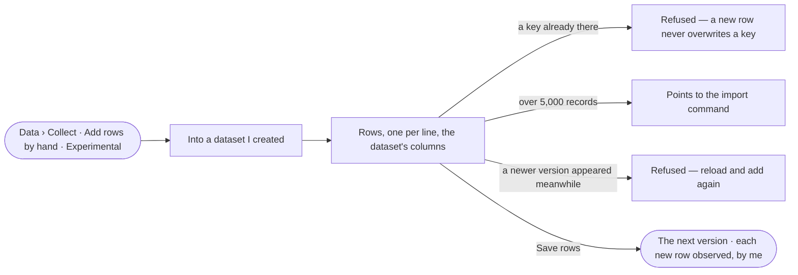

# DS-05 · Add a few rows by hand

**As** a field researcher curating my own data **I want** to add a few observations by hand **so that** my own
evidence enters the trail, authored by me.

Tasks: [task.md](task.md) · Feature: [DS-F02](../../feature.md)

## Who can

| Lens | Can | Otherwise sees |
|---|---|---|
| Admin | Add rows to any dataset | — |
| Operator | Add rows to a dataset they created | Datasets they did not create are not offered; *Add rows* absent on their sheet, naming the creator |

## Flow

## Acceptance criteria

| # | Given | When | Then |
|---|---|---|---|
| DS-05.1 | Data › Collect | it opens | *Add rows by hand* carries an *Experimental* badge and offers only datasets the person created |
| DS-05.2 | A chosen dataset | the person adds rows | the form has the dataset's columns; *Save rows* waits until each row has its key |
| DS-05.3 | Rows saved | they publish | the current records plus the new rows publish as the next version, the person its author |
| DS-05.4 | A dataset whose origin is not `observed` | rows are saved | each new row carries its own provenance — observed, by the person |
| DS-05.5 | A new row whose key already exists | it is saved | it is refused naming the key; a new row never overwrites one |
| DS-05.6 | A dataset with more than 5,000 records | the form opens | it points to the import command instead |
| DS-05.7 | A newer version published since the form opened | rows are saved | it is refused, asking the person to reload and add again |

## Screens

| Surface | Lens | First use | Empty after a filter | Loading | Has data | Failed | Agent working or proposing | No access |
|---|---|---|---|---|---|---|---|---|
| Add rows by hand | Admin | data.collect · No dataset to add to | — | data.collect · Saving rows | data.collect | data.collect · Rows refused | — | — |
| Add rows by hand | Operator | data.collect · No dataset to add to | — | data.collect · Saving rows | data.collect | data.collect · Rows refused | — | data.collect · Not the creator |
