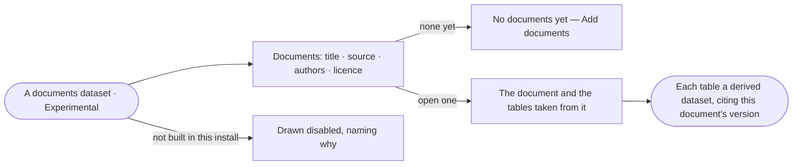

# DS-10 · Keep papers and notices as a documents dataset

**As** a researcher curating what I read **I want** papers and notices kept as a documents dataset, with the tables
taken from them as derived datasets **so that** what I read is cited like what I measured.

Tasks: [task.md](task.md) · Feature: [DS-F02](../../feature.md)

## Who can

| Lens | Can | Otherwise sees |
|---|---|---|
| Admin | Read any documents dataset; add documents to any | — |
| Operator | Read a documents dataset they may read; add documents to one they created | *Add documents* absent on one they did not create, naming its creator |

## Flow

## Acceptance criteria

| # | Given | When | Then |
|---|---|---|---|
| DS-10.1 | An install without documents datasets | the person looks for them | they are drawn disabled with an *Experimental* badge, naming why |
| DS-10.2 | A documents dataset | it opens | each document lists its title, source, authors and licence, versioned like any dataset |
| DS-10.3 | A documents dataset with nothing in it | its creator opens it | it reads *No documents yet* with *Add documents* |
| DS-10.4 | A table taken from a document | it is kept | it is a `derived` dataset whose version names the document's version as its input |
| DS-10.5 | A derived table whose document version is retracted | it is read | it is flagged *retracted* with the reason |

## Screens

| Surface | Lens | First use | Empty after a filter | Loading | Has data | Failed | Agent working or proposing | No access |
|---|---|---|---|---|---|---|---|---|
| A documents dataset | Admin | data.dataset · No documents yet | — | data.dataset · Loading | data.dataset · Documents | data.dataset · Could not load | — | — |
| A documents dataset | Operator | data.dataset · No documents yet | — | data.dataset · Loading | data.dataset · Documents | data.dataset · Could not load | — | data.dataset · Read only |
