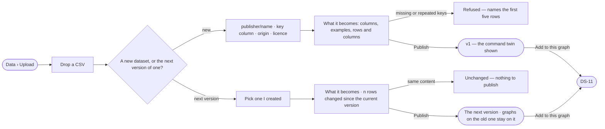

# DS-16 · Upload a CSV and publish it

**As** a data curator **I want** to upload a CSV in the browser, see what it becomes, publish it and add it to this
graph — or upload the next version of a dataset and see its diff **so that** my files become data without the
command line.

Tasks: [task.md](task.md) · Feature: [DS-F02](../../feature.md)

## Who can

| Lens | Can | Otherwise sees |
|---|---|---|
| Admin | Upload a new dataset, or the next version of any dataset; add it to this graph | — |
| Operator | Upload a new dataset, or the next version of one they created | Datasets they did not create are not offered as *the next version of*; *Add to this graph* needs *Can shape the model* — without it the version publishes and a line names who may add it |

## Flow

## Acceptance criteria

| # | Given | When | Then |
|---|---|---|---|
| DS-16.1 | Data › Upload with no file | it opens | a drop zone says what a dataset needs — a header row, a key column, an origin and a licence |
| DS-16.2 | A CSV dropped | the browser reads it | it shows the file's rows and columns and *What it becomes*: each column, an example value and what it becomes, before anything is published |
| DS-16.3 | A new dataset | the person names it | they give `publisher/name` (the publisher defaults to their username), the key column, the origin and the licence; *Publish* waits until all are set |
| DS-16.4 | Rows without a key, or two rows with one key | the person publishes | the version is refused, naming the first five rows; nothing is published |
| DS-16.5 | A valid file | the person publishes | v1 is minted, the person is the dataset's creator, and the dialog shows the command that does the same |
| DS-16.6 | A dataset the person created | they upload its next version | *What it becomes* reads how many rows changed since the current version, and that answers citing the current version keep it until moved |
| DS-16.7 | A file whose records equal the current version's | it is published | it reads *Unchanged — nothing to publish* and no version is minted |
| DS-16.8 | A published version and a person with *Can shape the model* | they pick *Add to this graph* | the add opens on that version (DS-11) |
| DS-16.9 | An Operator without *Can shape the model* | they publish | the version publishes; *Add to this graph* is absent and a line names who may add it |
| DS-16.10 | A file the browser cannot read as CSV | it is dropped | it says why, with *Choose another* |

## Screens

| Surface | Lens | First use | Empty after a filter | Loading | Has data | Failed | Agent working or proposing | No access |
|---|---|---|---|---|---|---|---|---|
| Upload | Admin | data.upload · Drop a file | — | data.upload · Reading the file | data.upload | data.upload · Refused rows | — | — |
| Upload | Operator | data.upload · Drop a file | — | data.upload · Reading the file | data.upload | data.upload · Refused rows | — | data.upload · Add needs the model grant |
| The next version | Admin | — | — | data.upload · Reading the file | data.upload · Next version | data.upload · Unchanged | — | — |
| The next version | Operator | — | — | data.upload · Reading the file | data.upload · Next version | data.upload · Unchanged | — | data.upload · Not the creator |
