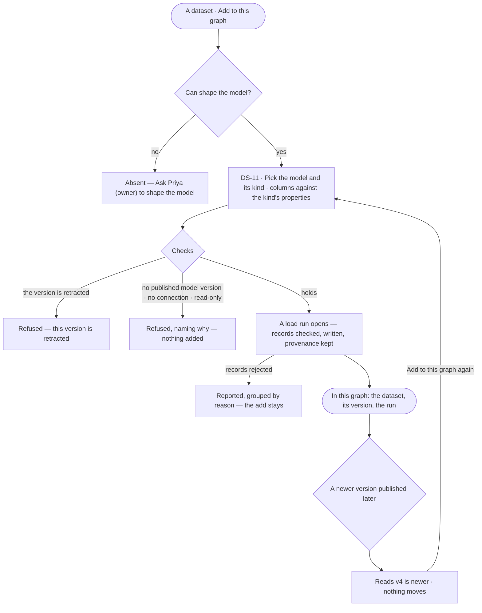
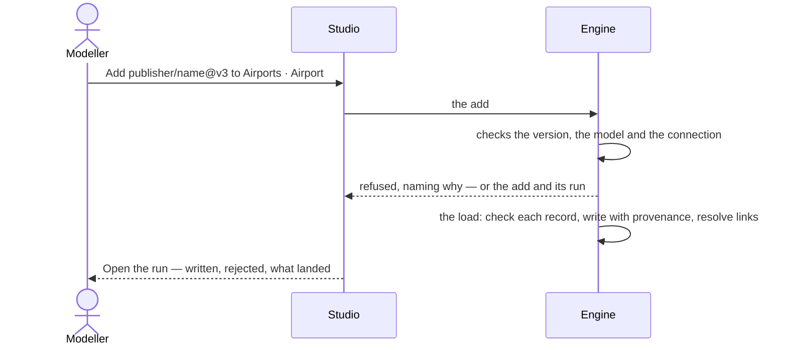

# Add a dataset to this graph

> A Graph takes one exact version of an install-wide dataset into one of its models, as a kind; the add is an ordinary
> load, so its records land checked, with provenance, and its run is the one every load has. The decision it helps
> make: *which version of which dataset does this graph's answers rest on?*

## User journey

Journeys this feature is a step of: [J01 · From an empty install to a first answer](../../../../journeys/J01-from-an-empty-install-to-a-first-answer.md)

## Stories

| ID | Story | Status |
|---|---|---|
| DS-11 | [Add a dataset version to this graph](stories/DS-11-add-a-dataset-version-to-this-graph/story.md) | later |

## Access

| Act | Role (`.claude/team/TEAM.md` §7) | Everyone else sees |
|---|---|---|
| See which datasets and versions this graph has added | Operator — every member | — |
| Add a dataset version to this graph · add it again at another version | `modeller` · shown as *Can shape the model* | Absent; *Ask Priya (owner) to shape the model* |

## States

| State | What the person sees |
|---|---|
| First use | This graph has added no dataset: *Nothing added yet — open a dataset and Add to this graph* |
| Empty after a filter | — |
| Loading | The model and kind pickers read *Loading models…*; the add waits |
| Has data | Each added dataset with its version, model, kind and run, flagged when retracted or when a newer version exists |
| Failed | A refused add names why — retracted, no published model version, no connection, read-only; a load that rejects records reports them as any import does |
| Agent working or proposing | — |
| No access | *Add to this graph* absent, naming who may shape the model |

## Rules

| Rule | Detail |
|---|---|
| One exact version | A graph adds a version, never a whole dataset, so a result reproduces from exact data |
| One per model, dataset and kind | Adding the same dataset into the same model and kind again moves it to the new version and records the version it moved from |
| An add is a load | Checking, provenance, links between models and the trace are the load's (DS-F02) |
| A retracted version cannot be added | One added earlier stays and is flagged |
| Nothing moves on its own | A newer version is announced on the add; only a person adding again moves it |
| Refused before it starts | No published model version, no connection or a read-only one refuses the add, naming why, and nothing is recorded |
| Adding again is a fresh run | Adding the version already added loads it again — idempotent writes, a new run |

## Data touched

| Record | Read or write |
|---|---|
| An added dataset — graph, model, kind, version, run, who, when | Read · write |
| Dataset version and its records | Read |
| The model's published version and its kinds | Read |
| The load's run and report | Write |
| Events — the add, with the version it moved from | Write |

## Decisions

| Decision | Detail |
|---|---|
| Studio adds the current version | The dialog lists this graph's models and their published kinds; the key column becomes the kind's id; success links to the load's run |
| Where a version is used is its adds | A version's *Used by* and its effect after are read from the add events of that version, in every graph — so a moved add still counts where it was |
| Adds land in a node kind | A dataset is a table keyed by one column |

## Open questions

| Question | Who answers |
|---|---|
| — | — |

## Not building

| Item | Why not |
|---|---|
| Removing an added dataset, or its records | Once loaded the records are the model's; removing data from a graph is not a load |
| Adding into a relationship kind | A dataset is a table of records keyed by one column |
| Adding a whole dataset rather than a version | A result reproduces from an exact version |
| Moving to a newer version automatically | Consumers stay pinned |
