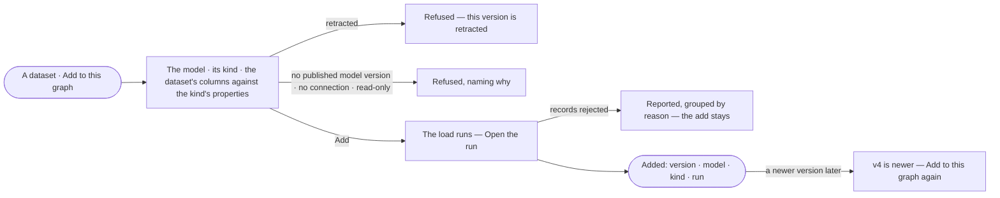

# DS-11 · Add a dataset version to this graph

**As** a modeller **I want** to add one version of a dataset into a kind of my graph's model **so that** its tables
become a graph I can ask, traceable to the exact version.

Tasks: [task.md](task.md) · Feature: [DS-F03](../../feature.md)

## Who can

| Lens | Can | Otherwise sees |
|---|---|---|
| Admin | Add any readable dataset version to any model of the graph; add it again at another version | — |
| Operator | See which datasets and versions this graph has added | *Add to this graph* absent; *Ask Priya (owner) to shape the model*. With *Can shape the model*: as Admin |

## Flow

## Acceptance criteria

| # | Given | When | Then |
|---|---|---|---|
| DS-11.1 | A person with *Can shape the model* on a dataset they may read | they pick *Add to this graph* | the dialog adds the current version, lists this graph's models with their published kinds, and shows each column of the dataset against the chosen kind's properties, the key column as the kind's id |
| DS-11.2 | A chosen model and kind | the person adds | a load run opens and the dialog links to it; the run checks each record, writes with provenance and reports what it rejected |
| DS-11.3 | A retracted version | it is added | it is refused: *this version is retracted* |
| DS-11.4 | A model with no published version, a graph with no connection, or a read-only one | the add is made | it is refused naming why, and nothing is recorded as added |
| DS-11.5 | A load that rejects records | it ends | the add stays; the rejections are reported grouped by reason as any import's are |
| DS-11.6 | A dataset already added into that model and kind | it is added at another version | the add moves to the new version and records the one it moved from |
| DS-11.7 | A newer version of an added dataset | this graph's adds are read | the add reads *v4 is newer*; nothing moves until a person adds again |
| DS-11.8 | An Operator without *Can shape the model* | they open a dataset | *Add to this graph* is absent and *Ask Priya (owner) to shape the model* reads in its place |
| DS-11.9 | A finished add | the person opens *How it got here* on its run | it shows the version loaded, the model version it was checked against and each step's counts |

## Screens

| Surface | Lens | First use | Empty after a filter | Loading | Has data | Failed | Agent working or proposing | No access |
|---|---|---|---|---|---|---|---|---|
| Add to this graph | Admin | data.catalogue · Add to this graph | — | data.catalogue · Loading models | data.catalogue · Add to this graph | data.catalogue · Add refused | — | — |
| Add to this graph | Operator | — | — | — | — | — | — | data.catalogue · Ask to shape the model |
| The load it opens | Admin | — | — | agents.run · Import running | agents.run · Import | agents.run · Import failed | — | — |
| The load it opens | Operator | — | — | agents.run · Import running | agents.run · Import | agents.run · Import failed | — | — |
| In this graph | Admin | data.catalogue · Nothing added yet | — | data.catalogue · Loading | data.catalogue · In this graph | data.catalogue · Could not load | — | — |
| In this graph | Operator | data.catalogue · Nothing added yet | — | data.catalogue · Loading | data.catalogue · In this graph | data.catalogue · Could not load | — | — |
