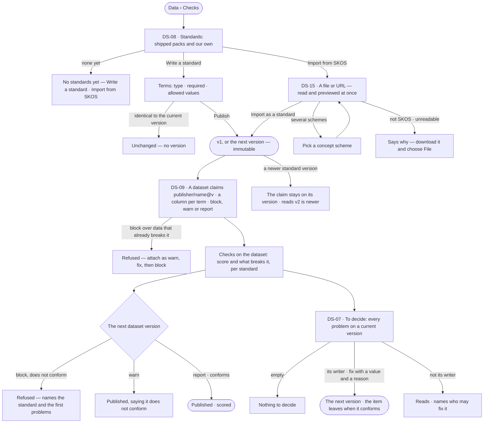

# Standards and checks

> A library of standards — shared, versioned sets of terms with their types, allowed values and required fields —
> written in Invana or imported from a SKOS vocabulary; a dataset claims one exact version and is scored against it on
> every version, blocking, warning or reporting what breaks it; what breaks it waits in one queue to be fixed. The
> decision it helps make: *does this data follow the rules our field agreed, and what must be fixed before anyone
> relies on it?*

## User journey

## Stories

| ID | Story | Status |
|---|---|---|
| DS-08 | [Keep a library of standards](stories/DS-08-keep-a-library-of-standards/story.md) | later |
| DS-15 | [Import a standard from a SKOS vocabulary](stories/DS-15-import-a-standard-from-a-skos-vocabulary/story.md) | later |
| DS-09 | [Hold a dataset to a standard](stories/DS-09-hold-a-dataset-to-a-standard/story.md) | later |
| DS-07 | [Decide what breaks the standards](stories/DS-07-decide-what-breaks-the-standards/story.md) | later |

## Access

| Act | Role (`.claude/team/TEAM.md` §7) | Everyone else sees |
|---|---|---|
| Read every standard, its versions, who claims it and the queue of problems on readable datasets | Operator — every member of the install | — |
| Write a standard or import one from SKOS — the person becomes its creator | Operator — every member of the install | — |
| Publish the next version of a standard | Its creator · Admin | *New version* absent, naming the creator |
| Add a shipped pack | Admin | — |
| Attach or detach a standard on a dataset · fix a problem in the queue | The dataset's creator · Admin | *Attach* and *Fix* absent; a line names the dataset's creator |

## States

| State | What the person sees |
|---|---|
| First use | *No standards yet — a standard is a shared set of terms datasets claim*, with *Write a standard* and *Import from SKOS*; a dataset that claims none reads *No standards claimed* |
| Empty after a filter | *No standard matches* — the filter named, with *Clear* |
| Loading | Rows and scores hold their shape; a SKOS preview reads *Reading the vocabulary…* |
| Has data | Standards with their versions, the datasets that claim them and their mode; a dataset's lowest score; problems to decide |
| Failed | A refused publish, attach or import names why; a queue that cannot be read for some datasets counts them as not readable |
| Agent working or proposing | — |
| No access | Writes on someone else's standard or dataset are absent, naming the creator |

## Rules

| Rule | Detail |
|---|---|
| A standard is shared | Install-wide and always readable; a private one would be a constraint |
| Standard or constraint | A range or vocabulary used once is a constraint on a model's property (MO-F02); one many datasets share is a standard, which a constraint may reference |
| A version is immutable | Hashed over its terms; an identical one is refused as *unchanged* |
| A term | Name (unique in the version) · type `text · integer · number · boolean · date` · required · allowed values, each a code with a label · description |
| A claim pins a version | A newer standard version never moves a dataset's claim; the claim names the newer one and the creator attaches it |
| Columns map by name | A term defaults to the column of the same name; a required term with no column is *missing* on every record — never guessed |
| Scored per record | A record conforms when no term has a problem; the score is conforming over records; a version with no records scores 1 |
| Three problems | *missing* (required and empty, or no column) · *not allowed* (not one of the codes) · *wrong type* |
| Block · warn · report | Block refuses a non-conforming version, writing nothing; warn publishes it and says so; report records the score only |
| Block must be true | Attaching *block* over a current version that already breaks the standard is refused — attach as warn, fix, then block |
| A fix is a new version | A problem lives on a current version; fixing it publishes the next one, with the reason as its *why*; the item leaves when the version conforms |
| A SKOS scheme is a standard | Concepts become terms and values: `prefLabel` the names and labels, `notation` the codes, `broader` the hierarchy; each keeps its source IRI |
| The engine never fetches | The browser or the CLI reads a file or URL and sends its text; the engine reads only what it is sent |
| Rules read checks | A rule that requires a dataset to conform reads its claim and score; a dataset that does not claim the standard fails it (MO-F06) |
| The engine counts | Scores, problem counts beyond the 50 kept, claims per standard and the queue's totals are the engine's |

## Data touched

| Record | Read or write |
|---|---|
| Standard and its versions — terms, hash, why | Read · write |
| A dataset's claim — standard version, mapping, mode | Read · write |
| Checks per dataset version and standard version — records, conforming, score, problems | Read · write (engine) |
| Dataset versions — a fix publishes the next | Write |
| Events — standard create and version, attach, detach | Write |

## Decisions

| Decision | Detail |
|---|---|
| Checks is one tab of Data | *Standards in use* (with mode) · *Import a SKOS vocabulary* · *To decide*; a dataset's own score is its sheet's *Checks* |
| Packs are applied, not browsed | A shipped pack — Plant Trait Ontology, MIAPPE, Darwin Core, ISO 3166, IAB Content Taxonomy — is a standard file an Admin applies; there is no registry to check for newer packs |
| Conformance is stored, not versioned | One score per dataset version and standard version, recomputed in place when the mapping changes; at most 50 problems kept, the count the whole |
| The queue is standard problems | Conflicts with official data need a validator agent, so *Use official* is not offered |
| The lowest score leads | A dataset's *Checks* tile shows its lowest current score and how many standards it claims |
| SKOS preview first | Reading a vocabulary previews at once — scheme, concepts, levels, the name it publishes under, the mapping, terms, notes and skips; *Import as a standard* waits for a preview |
| Several schemes are a choice | A file with several schemes offers a picker; one import is one scheme |
| The SKOS name is editable | It defaults to the slug of the scheme's title; the publisher is the person |
| Experimental | Standards, their checks and SKOS import carry an *Experimental* badge; constraints on a model's properties stay core |

## Open questions

| Question | Who answers |
|---|---|
| — | — |

## Not building

| Item | Why not |
|---|---|
| The shipped packs' content | Curating the files is content work; a pack is applied like any standard file |
| Model properties referencing a standard's values | That is a constraint (MO-F02) |
| Standards in the change log | Versions and their hashes are readable already |
| Sensitivity or licence checks here | Sensitivity is the dataset's; licences are a rule |
| SKOS related and mapping properties as links | A standard has no links; listed in the import report |
| SKOS alternative labels as accepted synonyms | Checks match codes; listed in the report |
| SKOS collections and SKOS-XL labels | Listed, not imported |
| Several schemes into several standards at once | One import, one scheme |
| Export back to SKOS | Import only |
