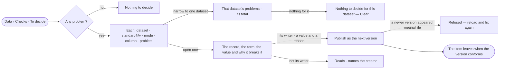

# DS-07 · Decide what breaks the standards

**As** a data curator **I want** one queue of every record that breaks a standard its dataset claims, to fix with a
value and a reason **so that** data is checked before anyone relies on it, and no fix is silent.

Tasks: [task.md](task.md) · Feature: [DS-F04](../../feature.md)

## Who can

| Lens | Can | Otherwise sees |
|---|---|---|
| Admin | Read every problem on every dataset; fix any | — |
| Operator | Read every problem on datasets they may read; fix those on datasets they created | *Fix* absent on a dataset they did not create, naming its creator |

## Flow

## Acceptance criteria

| # | Given | When | Then |
|---|---|---|---|
| DS-07.1 | No problem on any readable dataset | *To decide* opens | it reads *Nothing to decide* |
| DS-07.2 | Problems on current versions | *To decide* opens | each lists the dataset, the standard version, the mode, the column and the problem; the total is the engine's — every problem, not only the 50 kept per claim |
| DS-07.3 | The queue | the person narrows it to one dataset | only that dataset's problems list, with its own total; one with none reads *Nothing to decide for this dataset* and offers *Clear* |
| DS-07.4 | One problem | the person opens it | it shows the record, the term, the value and why it breaks the standard |
| DS-07.5 | The dataset's creator on a problem | they fix it with another value and a reason | the next version is published with the reason as its *why*, and the record's change log names the fix |
| DS-07.6 | A newer version published since the item opened | the fix is published | it is refused, asking the person to reload and fix again |
| DS-07.7 | A fixed version that conforms | the queue reloads | the item has left it |
| DS-07.8 | Datasets whose problems cannot be read | the queue opens | they are counted as not readable, never left out silently |
| DS-07.9 | An Operator on a dataset they did not create | they open a problem | it reads; *Fix* is absent and a line names the creator |

## Screens

| Surface | Lens | First use | Empty after a filter | Loading | Has data | Failed | Agent working or proposing | No access |
|---|---|---|---|---|---|---|---|---|
| To decide | Admin | data.checks · Nothing to decide | data.checks · Nothing for this dataset | data.checks · Loading | data.checks | data.checks · Could not load | — | — |
| To decide | Operator | data.checks · Nothing to decide | data.checks · Nothing for this dataset | data.checks · Loading | data.checks | data.checks · Could not load | — | — |
| A problem | Admin | — | — | data.checks · Loading | data.checks · Problem | data.checks · Fix refused | — | — |
| A problem | Operator | — | — | data.checks · Loading | data.checks · Problem | data.checks · Fix refused | — | data.checks · Problem read only |
