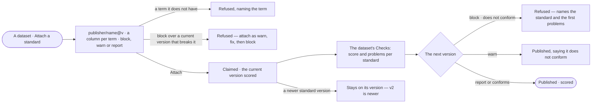

# DS-09 · Hold a dataset to a standard

**As** a data curator **I want** a dataset to claim a standard as block, warn or report, and see its score on every
version **so that** bad rows are caught at the door.

Tasks: [task.md](task.md) · Feature: [DS-F04](../../feature.md)

## Who can

| Lens | Can | Otherwise sees |
|---|---|---|
| Admin | Attach, change or detach a standard on any dataset; read every score | — |
| Operator | Attach, change or detach a standard on a dataset they created; read the scores of any dataset they may read | *Attach* and *Detach* absent on a dataset they did not create, naming its creator |

## Flow

## Acceptance criteria

| # | Given | When | Then |
|---|---|---|---|
| DS-09.1 | A dataset its creator opens | they attach a standard | they pick a version (the current by default), a column for each term — same-named columns preselected — and *block*, *warn* or *report* |
| DS-09.2 | A mapping that names a term the standard lacks | it is saved | it is refused, naming the term |
| DS-09.3 | A required term with no column | the version is scored | every record has that term *missing*; no column is guessed |
| DS-09.4 | *Block* over a current version that does not conform | it is attached | it is refused: *attach as warn, fix, then block* |
| DS-09.5 | A claim | the dataset's *Checks* opens | each standard shows its version, mode, records, conforming, the score and its problems — *missing · not allowed · wrong type* — up to the first 50, with the whole count |
| DS-09.6 | A *block* claim | a version that does not conform is imported | it is refused, naming the standard and the first problems; nothing is written |
| DS-09.7 | A *warn* claim | a version that does not conform is imported | it is published and the person is told it does not conform |
| DS-09.8 | A *report* claim | a version that does not conform is imported | it is published and scored, with nothing said |
| DS-09.9 | A standard that publishes a newer version | the claim is read | it stays on its version and reads *v2 is newer* |
| DS-09.10 | A claim whose mapping or mode changes | it is saved | the current version's score is recomputed |
| DS-09.11 | A dataset with claims | its *About* opens | its *Checks* tile shows its lowest current score and how many standards it claims |
| DS-09.12 | A dataset that claims nothing | *Checks* opens | it reads *No standards claimed*, with *Attach a standard* for its creator |
| DS-09.13 | An Operator on a dataset they did not create | they open *Checks* | scores read; *Attach* and *Detach* are absent and a line names the creator |

## Screens

| Surface | Lens | First use | Empty after a filter | Loading | Has data | Failed | Agent working or proposing | No access |
|---|---|---|---|---|---|---|---|---|
| Attach a standard | Admin | data.checks · Attach a standard | — | data.checks · Loading | data.checks · Attach a standard | data.checks · Attach refused | — | — |
| Attach a standard | Operator | — | — | — | — | — | — | data.dataset · Checks read only |
| A dataset · Checks | Admin | data.dataset · No standards claimed | — | data.dataset · Checks loading | data.dataset · Checks | data.dataset · Could not load | — | — |
| A dataset · Checks | Operator | data.dataset · No standards claimed | — | data.dataset · Checks loading | data.dataset · Checks | data.dataset · Could not load | — | data.dataset · Checks read only |
| A version refused by a block claim | Admin | — | — | — | — | data.dataset · Blocked by a standard | — | — |
| A version refused by a block claim | Operator | — | — | — | — | data.dataset · Blocked by a standard | — | — |
