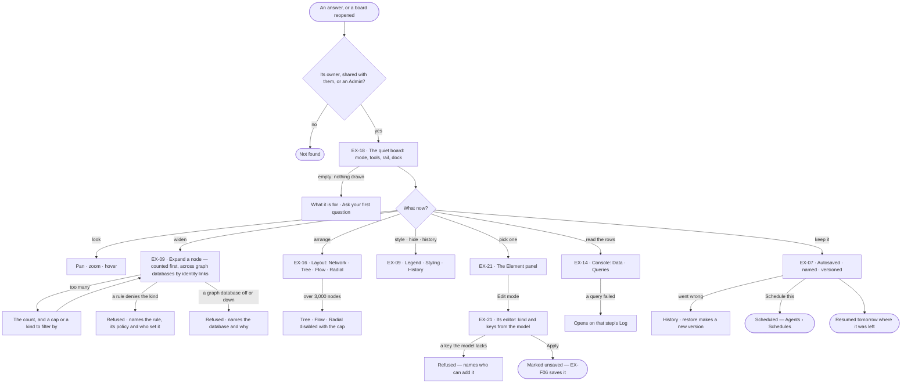
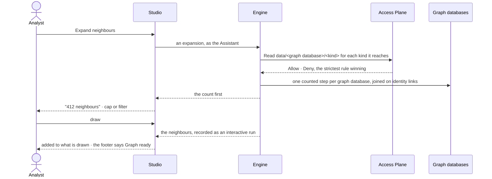

# The board and its canvas

> Where an answer is looked at: a quiet, kept board that draws what the Graph holds — every graph database, stitched —
> lets the analyst move around it, pick things out and read the rows behind it, so they can judge what the answer says
> before deciding what to do with it.
> The decision it helps make: *does this answer say what it seems to, and is it worth acting on?*

## User journey

## Stories

| ID | Story | Status |
|---|---|---|
| EX-18 | [A quiet board](stories/EX-18-a-quiet-board/story.md) | idea |
| EX-09 | [Shape the board by hand](stories/EX-09-shape-the-board-by-hand/story.md) | idea |
| EX-16 | [Switch the layout](stories/EX-16-switch-the-layout/story.md) | idea |
| EX-21 | [See and edit one element](stories/EX-21-see-and-edit-one-element/story.md) | idea |
| EX-14 | [Read the rows and the queries](stories/EX-14-read-the-rows-and-the-queries/story.md) | idea |
| EX-07 | [Keep a board](stories/EX-07-keep-a-board/story.md) | idea |

## Access

Who may do what is the [role table](../../../../os/access/features/AC-F02-access-policies/feature.md#the-role-table):
*board* is *Acts* for Operator, Modeller and Admin — within the agents the person may use, those agents' Access
Policies, and what the person owns ([AC-F07](../../../../os/access/features/AC-F07-ownership/feature.md)). Board reads
run as the built-in Assistant; saving edits is *Edit on the board* ([EX-F06](../EX-F06-annotate-and-edit-the-data/feature.md)).

| Act | Who | Everyone else sees |
|---|---|---|
| Open a board · look, pan, zoom, select | Its owners, the users and teams it is shared with ([EX-15](../EX-F02-share-and-present-an-answer/stories/EX-15-share-an-answer/story.md)), an Admin | *Not found* |
| Expand a node · count the kinds | Anyone who opens the board and may use the Assistant, within its Access Policies | A kind a rule denies: refused, naming the rule · no Assistant: *{person} may not use Assistant — ask an Admin* |
| Change the layout · style · hide · switch modes | Anyone who opens the board — a change is kept only by its owners and Admins; a reader's changes last the visit | — |
| Create a board · rename, delete, restore a version | Create: every signed-in person, who owns it. The rest: its owners · an Admin | Disabled — *Only its owners or an Admin* |
| Add owners · hand a board over | Its owners · an Admin ([AC-F07](../../../../os/access/features/AC-F07-ownership/feature.md)) | Owners read |
| Read the console · re-run a query step | Whoever may read the conversation's runs — the person behind them and Admins ([CP-F10](../../../../os/control/features/CP-F10-runs-and-how-the-agents-are-doing/feature.md)) | Steps of runs they may not read: that they ran, status and tokens |
| Open the Element panel · stage an edit in Edit mode | Anyone who opens the board | — |
| Save staged edits to a graph database | Modeller · Admin, on a read + write graph database, through the Record editor ([EX-F06](../EX-F06-annotate-and-edit-the-data/feature.md)) | Save disabled — *Needs the Modeller role — ask an Admin* |
| Schedule the question | Anyone, through an agent they may use ([AG-F07](../../../agents/features/AG-F07-schedules/feature.md)) | — |

## States

| State | What the person sees |
|---|---|
| First use | No board yet: one question box — *What do you want to know?* — and the person's own kept boards, if any |
| Empty after a filter | Every kind hidden in the Legend: *All kinds hidden · Show all* |
| Loading | The footer's message line counts the solve (*Laying out 2159 nodes · 80 / 149*); past 400 ms one toast with *Cancel*. The board stays usable |
| Has data | The drawing, the row, the rail, the dock, the footer's counts |
| Failed | What failed in a sentence and the next act — a failed query opens the console on its Log; a graph database off or down is named; the board is untouched |
| Agent working or proposing | An answer drawing onto the board: the reply is live in the thread, the board adds what it brings |
| No access | A board the person neither owns nor is shared with is *Not found*; on a board they open, an act they may not take is disabled, naming the owners, the role or the rule |

## Rules

| Rule | Detail |
|---|---|
| Drawing adds | An answer, an expansion and a reopened board add to what is drawn; nothing replaces it |
| One selection | A click, a shift-click, a lasso or a box makes the same selection on every board |
| Colour by kind | Every node and relationship kind has a default colour from its name — the theme's `--color-data-N` slot its name hashes to, read by one function for the drawing and the Legend's dots; a colour set in Styling overrides it, and the Legend's dot always matches the drawing. Colour is never part of a layout |
| Size by connections | On by default: a node's radius grows with the square root of its connections, from 8 to 28 px. It is worked out on every draw and never saved; while it is on it wins over a kind's size in Styling; switching it re-runs the layout |
| Counted before drawn | An expansion or a large answer states its count before it draws, and a cap the person can raise |
| Missing is shown | An element gone from its graph database stays drawn, marked missing, with when it was last seen |
| Stitched, never copied | An expansion runs one step per graph database the node reaches and joins them on identity links ([SE-F06](../../../semantics/features/SE-F06-links-and-mappings/feature.md)); a neighbour in another graph database draws like any other, its database named in the Element panel |
| A rule refuses, never hides silently | The board is never told what an Access Policy keeps from the Assistant. An expansion into a kind a rule denies is refused naming the rule, never answered with zero neighbours |
| Sensitive is still read | A sensitive property ([SE-F03](../../../semantics/features/SE-F03-meaning/feature.md)) draws on the board and in the panel; the board sends nothing to an AI model |
| Off is named | A read that needs a graph database switched off is refused naming who switched it off; one that is down is refused naming it ([CP-F05](../../../../os/control/features/CP-F05-graph-databases/feature.md)) |
| Dense results thin, never cut | Past 200 relationships edges fade to an opacity of √(200 / n), never below 0.15; a hovered, selected or highlighted relationship is drawn solid. From 500, below 50% zoom, an even sample of about 1 in 10 is drawn — every hub keeps its share — and the footer says *About 1 in 10 relationships drawn · zoom in for all* |
| Hidden is a flag | Hiding a node hides its relationships; showing it restores a relationship only when that relationship is not itself hidden and its other end is visible. Hiding never filters the data |
| The row | Top-left: the mode picker, then *Select ▾* (Select · Lasso · Box, keys V · L · M), then the mode's tools — Edit: *Add node* · *Connect*; Annotate: *Annotate* · *Highlight* · *Group* ([RC-13](../../../records/features/RC-F07-annotations/stories/RC-13-annotate-the-records-on-a-board/story.md)); in Edit and Annotate *Undo · Redo · Redraw*. Nothing else: layout, expand, undo and export are verbs on the menus |
| The rail | Top-right, vertical: Legend · Styling · History, then Element, Annotations (Annotate), Changes (in Edit, and in any mode while something is unsaved), a line, Export (⇧⌘E). One panel at a time floats left of it — title · count · its acts · ✕. Legend lists the drawn kinds with counts; a click hides a kind, struck through with *Show all*; its switches for minimap, graph and background are on the board's menu. *Size by connections* is a switch at the top of Styling |
| The menus | **Board**: Layout… · Fit · Select all · Undo · Redo · minimap, grid, lock, full screen · Export image… · Export data…; in Edit *Add a node here*, in Annotate *Annotate here*. **Node**: Expand neighbours (also a double-click) · Select neighbours · Centre on it · Hide · Hide every *kind* · Style *kind*… · Copy id; in Edit Edit node · Duplicate · Delete. **Relationship**: Select its two nodes · Hide · Hide every *kind*. **Selection**: Expand all · Hide · Layout the selection… · Export the selection… · Clear. **Minimap**: Hide minimap |
| The dock | Bottom-left: the minimap (200 × 116) over one bar — − · the zoom field · + · Fit, and a lock while the view is locked. The field takes a typed percent (Enter applies, Esc cancels, ↑ ↓ step) and offers 50% · 100% · 200% · Fit; − and + step 10 · 25 · 33 · 50 · 67 · 75 · 87 · 100 · 125 · 150 · 200 · 300 · 400. Hidden in Focus and Present |
| Export | A rail panel, Image or Data. Image: whole board · in view · selection; PNG (1× 2× 3×) or SVG; the theme's background or transparent; annotations in or out; a preview. Data: whole board or selection, as the board file (reopens with data, layout, styling and history) or CSV (nodes and relationships, a column per property). The file name follows the choices |
| The tabs | Main's tab row holds the open boards and *+*, nothing else; *Rename* and *Close* are on a tab's menu |
| One place per piece of chrome | Top-left the row; top-right the rail and its one floating panel; bottom-left the dock; bottom-centre the presenter, only while presenting. The rail and the dock show only in the work modes |
| The footer | Left: the graph databases drawn from · `195 nodes · 312 relationships` (opens Data) · `4 queries` (opens Queries, with a dot when one failed) · the message line. Right: `3 selected` · the view chip `87% · 1,240, −380` (a click copies it) · the renderer and frame rate. The message is plain text, never a link. The footer counts what the board draws; the Legend and the kind counts count the graph databases — `26 nodes` in the footer and `24,477 nodes` in the Legend are both true |
| Inspect is the default | The Element panel states what an element is; it edits only in Edit mode, and only against the model |
| Leans on | Ontology — the published model gives kinds, keys and colours; identity links stitch graph databases (SE-F06) · Access Policies (AC-F02) · ownership (AC-F07) · graph databases, their switches and health (CP-F05) · runs (CP-F10) · EX-F03 — answers that draw onto the board · EX-F06 — saving edits · RC-F07 — annotations · Agents › Schedules — *Schedule this* |

## Data touched

| Record | Read or write |
|---|---|
| Board — name, owners, layout, styling, what is drawn | Read · write (autosave, by its owners) |
| Board version — one per meaningful change, with what changed | Read · write |
| Shares — who a board, or one of its snapshots, is shared with ([EX-F02](../EX-F02-share-and-present-an-answer/feature.md)) | Read · write |
| Graph records and their counts by kind, from each graph database | Read, as the Assistant, within its Access Policies |
| Runs — each expansion and each query step | Write (an expansion), read (the console) |
| The published model's kinds and keys | Read |

## Engine

The low-level design: what this feature stores, serves and refuses. Conventions — naming, errors, lists, events — are
[system-design.md](../../../../system-design.md) §§ 6–8; this section only fills them in.

### Records

| Table | Columns | Notes |
|---|---|---|
| `explore_boards` | `kind` · `subject_id?` · `session_id?` · `created_by_id` · `title` · `instructions` (what it is for) · `settings` · `styling` · `view_state` · `filters` · `snapshot` · `positions` · `source_query` · `banner` (its last picture) · `pinned` · `archived` | Unique (`kind`, `subject_id`); `session_id` unique where set. `subject_id` names a run, skill, rule or model by kind — a string, never a foreign key. Owners are rows of `access_owners` ([AC-F07](../../../../os/access/features/AC-F07-ownership/feature.md#engine)); `created_by_id` never cascades. `title` · `instructions` · `settings` · `styling` · `view_state` · `filters` live as long as the board and no re-query writes them; the next query, expansion or load rewrites `snapshot` · `positions` · `banner`. `settings` holds what the kind's builder takes besides its subject — the renderer, a declared board's open view, the walkthrough (EX-F02), the annotation view (RC-F07) |
| `explore_board_versions` | `board_id` · `created_by_id` · `message_id?` · `cause` (`query` · `expand` · `load` · `manual` · `report`) · `label` · `snapshot_gz` · `source_query` · `styling` · `settings` · `banner` · `node_count` · `edge_count` | Immutable; lists and reads without its board. A declared board's versions are its reports, `cause = report`, stored merged with the numbers inside them; a snapshot (EX-15) is one |
| `explore_board_shares` | `board_id` · `version_id?` (a snapshot) · `principal_kind` (`user` · `team`) · `principal_id` · `shared_by_id` · `shared_at` | Unique (`board_id`, `version_id`, `principal_kind`, `principal_id`). No `version_id` shares the live board and its conversation; a `version_id` shares that snapshot only |

### Reads

| Record | Owner |
|---|---|
| Runs — each read and save opens one; who may read a run's content | [CP-F10](../../../../os/control/features/CP-F10-runs-and-how-the-agents-are-doing/feature.md#engine) · [AC-F09](../../../../os/access/features/AC-F09-what-left-the-platform/feature.md#engine) |
| The built-in workflows `expand-neighbours` · `count-types` · `resolve-elements` and the functions they call | [AG-F06](../../../agents/features/AG-F06-plans-and-workflows/feature.md#engine) |
| The Assistant and its Access Policies — what a read may reach · the role check | [AC-F02](../../../../os/access/features/AC-F02-access-policies/feature.md#engine) |
| Owners of a board | [AC-F07](../../../../os/access/features/AC-F07-ownership/feature.md#engine) |
| Users and teams a board is shared with — who they are, who is on a team | [AC-F03](../../../../os/access/features/AC-F03-directory/feature.md#engine) |
| Graph databases, their switches, mode and health | [CP-F05](../../../../os/control/features/CP-F05-graph-databases/feature.md#engine) |
| Identity links between kinds of two graph databases | [SE-F06](../../../semantics/features/SE-F06-links-and-mappings/feature.md#engine) |
| The published model's kinds and keys | [SE-F02](../../../semantics/features/SE-F02-change-and-publish-a-model/feature.md#engine) |
| Schedules — *Schedule this* | [AG-F07](../../../agents/features/AG-F07-schedules/feature.md#engine) |
| A conversation and its turns — the board's `session_id` | [EX-F03](../EX-F03-ask-a-question/feature.md#engine) |

### Routes

| Route, after `/api/v1/explore` | Does | Story |
|---|---|---|
| `GET /boards` · `POST /boards` | List the boards the reader may open — `limit` (30, up to 100) · `offset` · `sort` (`updated` · `created`) · `include_archived` · `kind` · `session_id` · `owned` · `shared` · create one, owned by the creator | EX-07 |
| `GET /boards/{board}` · `PATCH /boards/{board}` · `DELETE /boards/{board}` | Read · rename, restyle, pin, archive, save what it draws · delete with its versions and shares | EX-07 |
| `GET /boards/{board}/versions` · `POST /boards/{board}/versions` · `GET /boards/{board}/versions/{version}` | A board's versions · save one · read one | EX-07 · EX-09 |
| `GET /boards/{kind}/{subject}/versions` · `POST /boards/{kind}/{subject}/versions` · `GET /boards/{kind}/{subject}/versions/{version}` | A declared board's reports · keep one, creating or finding the board's row · read one | EX-15 |
| `GET /boards/{board}/shares` · `PUT /boards/{board}/shares` · `DELETE /boards/{board}/shares/{share}` | Who the board and its snapshots are shared with · share with users and teams `{version_id?, principals[{kind, id}]}` · stop sharing | EX-15 |
| `POST /expand` | A node's neighbours — the variant (all · by relationship kind · by neighbour kind) is a field, with direction, page size and property filters; counted first; across graph databases by identity links | EX-09 |
| `POST /resolve` | Which elements of a reopened board are still in their graph databases | EX-09 |
| `GET /type-counts` | Every node and relationship kind with its count, per graph database, as the Assistant | EX-09 |

### Events

| Event | When |
|---|---|
| `explore.boards.create` · `explore.boards.update` · `explore.boards.delete` | A board is made · changed · deleted |
| `explore.boards.share` · `explore.boards.unshare` | A board or a snapshot is shared with users or teams · a share is taken back |
| `explore.reads.expand` | An expansion runs |

### Refusals

| Status | When | Sentence | Criterion |
|---|---|---|---|
| 404 | A board, a version or its shares, read by someone who neither owns it, is shared with it, nor is an Admin | *Not found.* | EX-07.15 |
| 403 | Rename, change, delete or restore by someone who neither owns the board nor is an Admin | *Only its owners or an Admin can change this board.* | EX-07.16 |
| 409 | A second board for a conversation | *This conversation already has a board.* | EX-07.13 |
| 409 | A second board of a kind for the same subject | *{kind} {subject} already has a board.* | API only — Studio keeps a report through the versions route, which finds the row |
| 422 | A `kind` the registry does not list | *{kind} is not a board kind.* | API only — Studio saves only registered kinds |
| 403 | An expansion or a count into a kind a rule denies the Assistant | *{agent} may not Read data/{graph database}/{kind} — {rule} on {policy}, set by {person}.* | EX-09.3 |
| 403 | A board read by a person who may not use the Assistant | *{person} may not use {agent} — ask an Admin.* | EX-09.18 |
| 409 | A read that needs a graph database switched off | *{name} is off — switched off by {person} {when}.* | EX-09.19 |
| 409 `expand_queued` · `count_queued` | A limit queued the read; carries its `run_id` | *Queued behind {n} runs — nothing drawn yet.* | EX-09.16 |
| 409 `expand_failed` · `count_failed` | The read's run failed — a graph database down among the causes, named; carries its `run_id` | *{the run's message}* | EX-09.17 |

### CLI

| Command | Does |
|---|---|
| — | No command of its own |

### Mechanisms

| Mechanism | How |
|---|---|
| Board kinds | One registry in the engine, a row per kind: `renders` (`canvas` · `declared`), `subject_required`, what `subject_id` names. Drawn: `data` · `model` · `plan` · `workflow` (a plan's steps) · `envelope` · `lineage`. Declared: `run` · `task_run` · `plan_runs` · `compare` ([CP-F10](../../../../os/control/features/CP-F10-runs-and-how-the-agents-are-doing/feature.md)) · `skill` · `skill_usage` ([AG-F04](../../../agents/features/AG-F04-skills/feature.md)) · `rule` · `requests` ([SE-F07](../../../semantics/features/SE-F07-rules/feature.md)) · `models` ([SE-F02](../../../semantics/features/SE-F02-change-and-publish-a-model/feature.md)). There is no `agent` kind — an agent opens as its own page. A new kind is written here first, never added in code |
| What a gesture writes | `model` stages add · connect · delete; `plan` writes a dependency when a card is dropped on a card; `data` stages add · connect · edit · delete in Edit mode (EX-F06). `workflow`, `envelope`, `lineage` and every declared kind only select. A declared board is drawn from a closed set of panels |
| Who opens a board | `may_open_board(person, board)`: true when the person owns it, is an Admin, or is named by a share — directly or through a team they are on at request time. Every board, version and share route calls it; false answers *Not found* |
| Who changes a board | Owners and Admins; a reader's styling, hiding and layout last their visit and are never written |
| First owner | The person who creates a board, or the person behind the run that made it ([AC-F07](../../../../os/access/features/AC-F07-ownership/feature.md#mechanisms)) |
| A live declared board has no row | It is built from its subject on every open; the first report kept creates its row. A board whose subject is gone stays and reads *this run is gone* |
| Restore forks | Restoring reads a version and saves it as a new one; there is no restore route. Opening a version as its own board makes a new board and conversation, owned by the person who opened it |
| History cap | Each board keeps its newest `INVANA_BOARD_HISTORY_LIMIT` versions (30; `0` keeps all), pruned as a new one is written; a shared snapshot is never pruned |
| Page ids | A board opens as the page `kind:id` live and `kind:id@version` frozen |
| Reads run as the Assistant | `POST /expand` runs `expand-neighbours` (`graph.read.get_neighbors`, trigger `canvas`); `/type-counts` runs `count-types` (`graph.read.types_count`, `canvas`); `/resolve` runs `resolve-elements` (`graph.read.resolve`, `system`). Each runs as the built-in Assistant for the person, checked against its Access Policies before any graph database is read; it spends no token budget, is never counted against an agent's runs at once, and is hidden in Control Plane › Runs unless *Show interactive runs* is on |
| One step per graph database | An expansion or a count runs one step per graph database the node's kind and its identity links reach, each in that database's language and its driver's read mode; neighbours across databases are joined on identity links ([SE-F06](../../../semantics/features/SE-F06-links-and-mappings/feature.md#engine)). A kind the rules deny is refused before its step, and the whole read is refused rather than answered with what is left |
| The turn is written first | An expansion in a conversation writes its turn — *Expand neighbours of "Acme Ltd"* — before its run opens; one that returned nothing is still a turn |
| Type counts | Per graph database: `nodes` · `edges` as `[{name, count}]`, biggest first · `counted` (`false` when the database cannot count; every kind still listed, `count: null`) · `total_nodes` · `total_edges`, summed once in the engine, `null` when any kind is uncounted · `run_id` |
| Missing is marked | Reopening calls `/resolve`; an element gone from its graph database is returned as missing with when it was last seen, never dropped |
| Studio mirrors the registry | Per drawn kind, Studio adds what its nodes and relationships stand for, its footer words, whether a gesture writes, the panel holding its detail and whether it has Layers (`data` only); the API schema keeps the two in step |
| The console's address | `?console=` — `data` · `data:<node·relationship>:<kind>:<page>` · `queries` · `queries:<reply id>`; absent or stale reads as collapsed. It moves on its own beside the left section's path and `?right=`, and never collides with `?page=`. The console has no route: it reads the board and its conversation's runs |

## System impact

| HLD section | Change | NFRs |
|---|---|---|
| § 6 Data and storage | Three tables in Invana's own store; no new store | — |
| § 8 APIs and events | The routes and events above, under `explore` | — |
| § 10 AI and agents | Board reads run built-in workflows as the Assistant, checked against its Access Policies, with no token budget; one step per graph database, joined on identity links | NFR-PERF-6 |

## Decisions

| Decision | Detail |
|---|---|
| The board is quiet | On screen only the mode and its tools, what must be seen (minimap, zoom) and the rail. Every verb on a thing is on its right-click menu and on ⌘K; the footer says *Right-click anything for its actions · ⌘K for every command* until the first right-click. Long-press, Shift+F10 and the context-menu key open the same menu |
| Modes | Work modes: **Explore** (look, ask, expand) · **Edit** (add, change, delete data, EX-F06) · **Annotate** ([RC-13](../../../records/features/RC-F07-annotations/stories/RC-13-annotate-the-records-on-a-board/story.md)). View modes: **Focus** (⌘\\ — the drawing alone) · **Present** (EX-F02). One at a time; Esc returns to Explore. The mode is the viewer's, never saved with the board. Edit rings the board in the primary colour, Annotate in the warning colour |
| An expansion is a run | What a person saw, and so reasoned from, is recorded like any read — as the Assistant, ledgered, with no token budget, hidden among interactive runs by default |
| A layout is a preset | The person picks a card — Network · Tree ↓ · Flow → · Radial — and layout, edges, labels and spacing change together. The board keeps its preset and options across every answer, and a switch is one undo step |
| A force layout does not animate its settle | Network draws once at its settled positions; switching presets glides under 2,000 nodes, in 400 ms or less, and snaps above |
| Network's force settings | Nodes keep a hard floor apart of each node's drawn radius plus 22 px for its label below; about 150 steps (`alphaDecay 0.035`, `alphaMin 0.005`); repulsion −600, reaching no further than 600 px; relationships rest at 150 px. They hold to about 2,000 nodes |
| Boards are saved and versioned | Autosave never overwrites history; restoring a version makes a new one; settings belong to the board and outlive its data |
| A board restores from what it holds | Reopening paints what was drawn and asks the graph databases nothing; only a board with nothing saved re-runs its last query |
| The console reads, never writes | It shows what is drawn and what ran; queries are typed in the assistant's composer (EX-F03) |
| Studio is strict about the model | A kind comes from the model's kinds, a key from that kind's keys; the engine refuses anything else whatever Studio sends |
| A board is its owners' | Its maker owns it; it opens for its owners, whoever it is shared with and Admins. A person who leaves keeps nothing from others — an Admin hands their boards over ([AC-23](../../../../os/access/features/AC-F03-directory/stories/AC-23-deactivate-a-person-who-leaves/story.md)) |
| One board per conversation | A conversation's board is looked up, never made twice; a version opened as its own board starts its own conversation |
| History keeps the last 30 versions | Older ones are let go as new ones are saved, and History says so; an install may set a different number |
| Counts are the engine's | The Legend's counts are a run as the Assistant; a database that cannot count shows kinds without numbers, and no total is summed from parts |

## Open questions

| Question | Who answers |
|---|---|
| — | — |

## Not building

| Item | Why not |
|---|---|
| Per-element colour and size saved on the element | Colour by kind and the board's styling cover it |
| Physics tuning controls · raw layout-engine options | Four named presets with options beat ten knobs |
| User-authored layout presets | Nobody has asked for a fifth |
| A preset that changes colour | Colour is the theme's |
| A vertical toolbar | It takes the board's left edge, where labels need room |
| An *excluded* mark for what a rule keeps out | The board is never told what a rule keeps from the Assistant |
| Sorting, filtering or exporting the console's rows · an editable query box in it | The console's order is the board's; export belongs to Share (EX-F02); queries are typed in the composer |
| Queries of other conversations in the console | Control Plane › Runs is the journal |
| Plans and other steps in the console · a REPL or terminal | A run's page owns the run; the console lists queries, and nothing here is a shell |
| A console tab per kind of board | Data and Queries are true of every board |
| Editing inline on the drawing | A drawing is not a form; the Element panel edits |
| Folders of boards | A list with search is enough |
| Real-time co-editing of a board | One editor with history, last write wins |
| Converting a board's kind | A drawn board and a dashboard share no state |
| A row for every board opened | It would mirror runs and be written before every read; a live declared board has no row until a report is kept |
| A stored `renders` or `is_declared` column | A copy of the registry that could disagree with it |
| Autosave on a declared board | It holds nothing of its own; a report is kept deliberately, once |
| A report of a report · *Reports* on a frozen page | A report is already frozen; the list belongs to the live board it is of |
| Deleting or renaming a report | Versions are append-only; a kept reading somebody linked is not tidy-up |
| A board copied between graph databases | A board draws the stitched Graph; it is never a copy of records |
