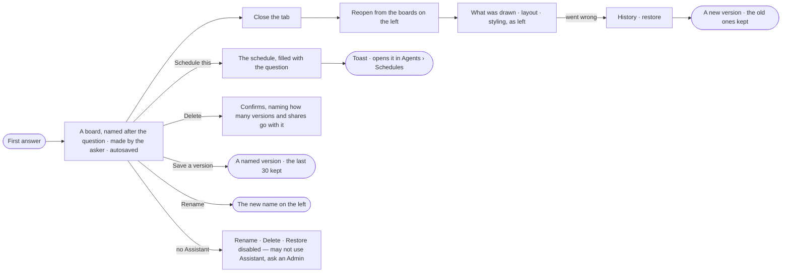

# EX-07 · Keep a board

**As** an analyst **I want** my board kept — named, saved as I go, with its history, the organisation's and made by me — and the
question scheduled when it should keep running **so that** I resume tomorrow rather than reconstruct, and a good
question keeps working.

Tasks: [task.md](task.md) · Feature: [EX-F01](../../feature.md)

## Who can

The board is *Acts* for Operator, Modeller and Admin ([the role table](../../../../../../os/access/features/AC-F02-access-policies/feature.md#the-role-table)), through an agent granted to the person. A board is the organisation's, made by a person; making it grants nothing.

| Lens | Can | Otherwise sees |
|---|---|---|
| Admin | Create boards; rename, delete, restore any board; schedule the question through an agent they may use | — |
| Operator | The same; a Modeller the same | Without the Assistant: *Rename*, *Delete* and *Restore* disabled — *{person} may not use Assistant — ask an Admin*. A link to a board that does not exist: *Not found* |

## Flow

## Acceptance criteria

| # | Given | When | Then |
|---|---|---|---|
| EX-07.1 | A conversation with no board | its first answer draws | a board is made, named after the question, made by the person who asked, and listed on the left |
| EX-07.2 | A board being worked on | they draw, lay out or style | it is saved without a save button, and each meaningful change is a version saying what changed |
| EX-07.3 | A board closed yesterday | the person reopens it | what was drawn, its layout and its styling are as they were left, and no graph database is asked again |
| EX-07.4 | A board's settings | a new answer draws | the layout, styling and visible kinds the board holds still apply |
| EX-07.5 | A board | a person deletes it | they are asked to confirm, told how many versions and shares go with it |
| EX-07.6 | Two tabs on one board | both change it | both read the same saved state; the last write wins and is a version |
| EX-07.7 | A settled answer | the person picks *Schedule this* | the schedule opens filled with the question and the agent that answered; saving it confirms with a toast that opens it in Agents › Schedules |
| EX-07.8 | A person who may not use any agent that can answer | they reach *Schedule this* | it is disabled — *{person} may not use {agent} — ask an Admin* |
| EX-07.9 | No board kept yet | Explore opens | the question box shows alone, with no list of boards invented under it |
| EX-07.10 | A board | a person picks *Rename* on its tab's menu | its name and what it is for change, and the list on the left shows the new name |
| EX-07.11 | A board worth marking | a person picks *Save a version* in History and names it | a version with that name is kept beside the autosaved ones |
| EX-07.12 | A board with 30 versions | a new version is saved | the oldest is let go, and History says *Keeps the last 30 versions* |
| EX-07.13 | A conversation that already has a board | it is opened from the left, a link or ⌘K | its one board opens; a second board is never made for it |
| EX-07.14 | Two boards open as tabs | the person switches between them | each keeps its camera, layout, selection and open panel |
| EX-07.15 | A link to a board that does not exist, or was deleted | a person opens it | it reads *Not found*, never naming the board or who made it |
| EX-07.16 | A person who may not use the Assistant | they open a board's tab menu | *Rename* and *Delete* are disabled — *{person} may not use Assistant — ask an Admin*; the engine refuses the same through the API |
| EX-07.17 | The boards on the left | the person reads them | the boards they made list first, then *Shared with me*, each naming who made it |

## Screens

| Surface | Lens | First use | Empty after a filter | Loading | Has data | Failed | Agent working or proposing | No access |
|---|---|---|---|---|---|---|---|---|
| Boards on the left | Admin | explore.ask | explore.board · No board matches | explore.board · Loading | explore.board | explore.board · Failed | — | — |
| Boards on the left | Operator | explore.ask | explore.board · No board matches | explore.board · Loading | explore.board | explore.board · Failed | — | — |
| History · Save a version · Rename | Admin | — | — | — | explore.board | explore.board · Failed | — | — |
| History · Save a version · Rename | Operator | — | — | — | explore.board | explore.board · Failed | — | explore.board · Not an owner |
| Schedule this | Admin | — | — | — | explore.share · Schedule | explore.share · Failed | — | — |
| Schedule this | Operator | — | — | — | explore.share · Schedule | explore.share · Failed | — | explore.share · No access |
