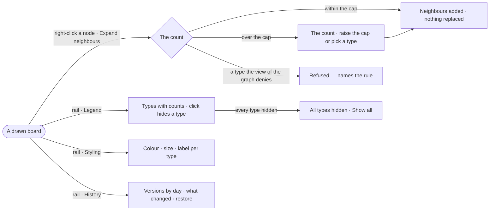

# EX-09 · Shape the board by hand

**As** an analyst **I want** manual tools on demand — expand, style, hide, the legend and the board's history
**so that** I shape the board by hand when the answer needs more than it drew.

Tasks: [task.md](task.md) · Feature: [EX-F01](../../feature.md)

## Who can

| Lens | Can | Otherwise sees |
|---|---|---|
| Admin | Expand, hide, style, read and restore the board's history | — |
| Operator | As Admin — every member shapes a board | — |

## Flow

## Acceptance criteria

| # | Given | When | Then |
|---|---|---|---|
| EX-09.1 | A drawn node | the person picks *Expand neighbours* or double-clicks it | its neighbours are counted first, then added to what is drawn; nothing drawn is removed |
| EX-09.2 | A node with more neighbours than the cap | the person expands it | the count shows before anything draws, with the option to raise the cap or expand by one type |
| EX-09.3 | A board under a view of the graph that denies a type | the person expands into that type | the expansion is refused naming the rule — *this view has no Publisher* — never answered with zero neighbours |
| EX-09.4 | The Legend open | the person clicks a type | that type hides on this board, its row struck through with *Show all*; counts do not change and nothing re-runs |
| EX-09.5 | Styling open | the person sets a type's colour, size or label | the board repaints at once, the Legend's dot matches it, and the board keeps it after the panel closes |
| EX-09.6 | Styling open | the person turns *Size by connections* on | each node is sized by its connections, a hub reading as a hub, and the layout runs again |
| EX-09.7 | History open | it lists the board's versions | they are grouped by day, newest first, each saying what changed |
| EX-09.8 | An old version | the person restores it | a new version is made from it, and every earlier version is still listed |
| EX-09.9 | A node gone from the graph since it was drawn | the board reopens | the node stays drawn, marked missing, with when it was last seen |
| EX-09.10 | A dense result zoomed out | over 500 relationships are drawn below 50% zoom | about 1 in 10 is drawn and the footer says *About 1 in 10 relationships drawn · zoom in for all* until every edge is drawn again |

## Screens

| Surface | Lens | First use | Empty after a filter | Loading | Has data | Failed | Agent working or proposing | No access |
|---|---|---|---|---|---|---|---|---|
| Right-click · Expand | Admin | — | — | explore.board.menu · Loading | explore.board.menu | explore.board.menu · Failed | — | — |
| Right-click · Expand | Operator | — | — | explore.board.menu · Loading | explore.board.menu | explore.board.menu · Failed | — | — |
| Legend · Styling · History | Admin | — | explore.board · Empty after a filter | — | explore.board | — | — | — |
| Legend · Styling · History | Operator | — | explore.board · Empty after a filter | — | explore.board | — | — | — |
