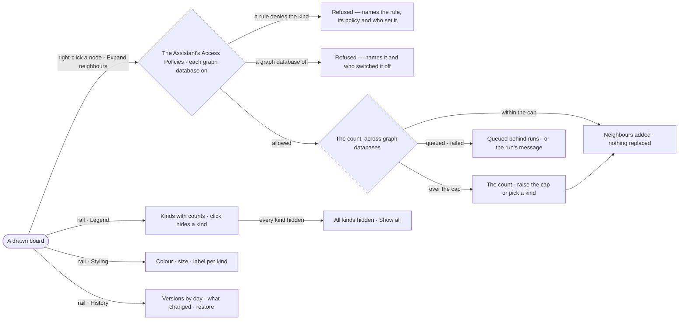

# EX-09 · Shape the board by hand

**As** an analyst **I want** manual tools on demand — expand, style, hide, the legend and the board's history
**so that** I shape the board by hand when the answer needs more than it drew.

Tasks: [task.md](task.md) · Feature: [EX-F01](../../feature.md)

## Who can

| Lens | Can | Otherwise sees |
|---|---|---|
| Admin | Expand, hide, style on any board; read and restore any board's history; reads run as the Assistant, within its Access Policies | A kind a rule denies the Assistant: the expansion refused, naming the rule |
| Operator | Expand, hide and style on a board they open, and keep it on boards they own; read and restore the history of boards they own; a Modeller the same | On a board shared with them: restore disabled — *Only its owners or an Admin*; styling and hiding last their visit. Without the Assistant: *{person} may not use Assistant — ask an Admin* |

## Flow

## Acceptance criteria

| # | Given | When | Then |
|---|---|---|---|
| EX-09.1 | A drawn node | the person picks *Expand neighbours* or double-clicks it | its neighbours are counted first, then added to what is drawn; nothing drawn is removed |
| EX-09.2 | A node with more neighbours than the cap | the person expands it | the count shows before anything draws, with the option to raise the cap or expand by one kind |
| EX-09.3 | A rule that denies the Assistant Read on `data/crm/Supplier` | the person expands into Supplier | the expansion is refused naming the rule — *Assistant may not Read data/crm/Supplier — {rule} on {policy}, set by {person}* — never answered with zero neighbours |
| EX-09.4 | The Legend open | the person clicks a kind | that kind hides on this board, its row struck through with *Show all*; counts do not change and nothing re-runs |
| EX-09.5 | Styling open | the person sets a kind's colour, size or label | the board repaints at once, the Legend's dot matches it, and the board keeps it after the panel closes — for its owners; on a shared board it lasts the visit |
| EX-09.6 | Styling open | the person turns *Size by connections* on | each node is sized by its connections, a hub reading as a hub, and the layout runs again |
| EX-09.7 | History open | it lists the board's versions | they are grouped by day, newest first, each saying what changed |
| EX-09.8 | An old version, and an owner of the board or an Admin | they restore it | a new version is made from it, and every earlier version is still listed |
| EX-09.9 | A node gone from its graph database since it was drawn | the board reopens | the node stays drawn, marked missing, with when it was last seen |
| EX-09.10 | A dense result zoomed out | over 500 relationships are drawn below 50% zoom | about 1 in 10 is drawn and the footer says *About 1 in 10 relationships drawn · zoom in for all* until every edge is drawn again |
| EX-09.11 | A drawn node | the person picks *Expand…* | a card offers direction, relationship kind, neighbour kind, how many, and a property to match; the count shows before anything draws |
| EX-09.12 | A Customer in `sales` with identity links to Customers in `crm` | the person expands it | its neighbours in both graph databases are counted and drawn, each in the Element panel naming its graph database |
| EX-09.13 | A graph database that cannot count by kind | the Legend opens | every drawn kind is listed without a number, and no total is made up from a partial sum |
| EX-09.14 | The Legend open | the person picks *Count again* | the kinds are counted again as the Assistant, as a run, and nothing drawn changes |
| EX-09.15 | Styling open | the person sets a relationship kind's width, or labels a node kind by a key, its id or its kind | the board repaints at once and keeps it |
| EX-09.16 | A limit on runs at once reached | the person expands a node or counts the kinds | it says the read is queued behind other runs and draws nothing until it runs |
| EX-09.17 | An expansion or a count whose run fails — a graph database down among the causes | it settles | the run's message shows, naming the graph database when one is down, with its run, and nothing drawn changes |
| EX-09.18 | A person who may not use the Assistant | they expand a node or count the kinds | it is refused — *{person} may not use Assistant — ask an Admin* — and nothing draws |
| EX-09.19 | A graph database switched off | an expansion or a count needs it | it is refused — *crm is off — switched off by {person} {when}* — and nothing draws |
| EX-09.20 | A board shared with an Operator | they open History | they read every version; *Restore* is disabled — *Only its owners or an Admin* |

## Screens

| Surface | Lens | First use | Empty after a filter | Loading | Has data | Failed | Agent working or proposing | No access |
|---|---|---|---|---|---|---|---|---|
| Right-click · Expand | Admin | — | — | explore.board.menu · Loading | explore.board.menu | explore.board.menu · Failed | — | — |
| Right-click · Expand | Operator | — | — | explore.board.menu · Loading | explore.board.menu | explore.board.menu · Failed | — | — |
| Legend · Styling · History | Admin | — | explore.board · Empty after a filter | — | explore.board | — | — | — |
| Legend · Styling · History | Operator | — | explore.board · Empty after a filter | — | explore.board | — | — | — |
