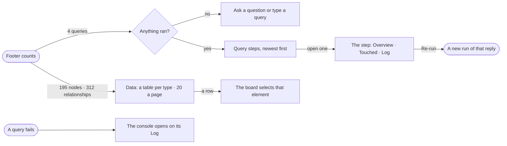

# EX-14 · Read the rows and the queries

**As** an analyst **I want** the data on the board and every query this conversation ran, in a console under the
board **so that** I can read the rows and check what ran without losing the picture.

Tasks: [task.md](task.md) · Feature: [EX-F01](../../feature.md)

## Who can

| Lens | Can | Otherwise sees |
|---|---|---|
| Admin | Read Data and Queries; re-run a query step | — |
| Operator | As Admin — re-run is for their own conversation's steps | — |

## Flow

## Acceptance criteria

| # | Given | When | Then |
|---|---|---|---|
| EX-14.1 | A drawn board | the person clicks `195 nodes · 312 relationships` in the footer | the console opens under the board on Data, the left section and the assistant staying full height |
| EX-14.2 | Data open | the person picks a type | its table shows that type's own properties as columns, 20 a page, with the full count — *1–20 of 120* |
| EX-14.3 | A table open | the person switches to JSON | the same 20 records show as the JSON they arrived in |
| EX-14.4 | A table open | the person picks a row | the board selects that element |
| EX-14.5 | A conversation with queries | the person clicks `4 queries` | every query step of this conversation is listed newest first: its status, the query, language, when, how long, rows and the question that ran it |
| EX-14.6 | A query step | the person opens it | it shows the step as the run shows it — Overview · Touched · Log — with *All queries* and *Re-run* |
| EX-14.7 | A query that failed | it settles | the console opens on that step's Log and the footer's `queries` carries a dot; there is no toast |
| EX-14.8 | A query that returned no rows | its row is listed | it reads `0 rows`, and its detail still shows the query — never a failure |
| EX-14.9 | Nothing has run | Queries opens | it says to ask a question or type a query |
| EX-14.10 | The console open on a type and page | the page reloads | the same tab, type, page and step are open, the rows read from the board and the runs, never re-run |
| EX-14.11 | The console open | the person clicks the open count again | the console collapses, and stays collapsed across a reload |

## Screens

| Surface | Lens | First use | Empty after a filter | Loading | Has data | Failed | Agent working or proposing | No access |
|---|---|---|---|---|---|---|---|---|
| Console · Data | Admin | explore.board.console · Nothing drawn | — | explore.board.console · Loading | explore.board.console | — | explore.board.console · Running | — |
| Console · Data | Operator | explore.board.console · Nothing drawn | — | explore.board.console · Loading | explore.board.console | — | explore.board.console · Running | — |
| Console · Queries | Admin | explore.board.console · Nothing ran | — | explore.board.console · Loading | explore.board.console · Queries | explore.board.console · Query failed | explore.board.console · Running | — |
| Console · Queries | Operator | explore.board.console · Nothing ran | — | explore.board.console · Loading | explore.board.console · Queries | explore.board.console · Query failed | explore.board.console · Running | — |
