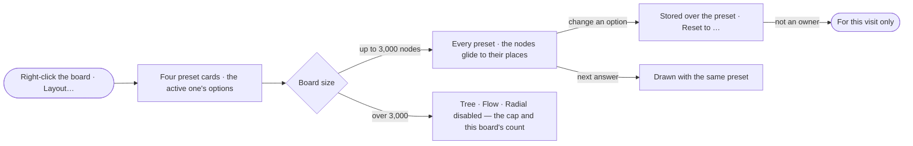

# EX-16 · Switch the layout

**As** an analyst **I want** to switch the board between Network, Tree, Flow and Radial and tune each **so that** one
answer reads as a network, a hierarchy or a flow.

Tasks: [task.md](task.md) · Feature: [EX-F01](../../feature.md)

## Who can

| Lens | Can | Otherwise sees |
|---|---|---|
| Admin | Pick a preset, change its options, reset it — kept on any board | — |
| Operator | The same, kept on boards they own; a Modeller the same | On a board shared with them the layout changes for their visit and is not kept |

## Flow

## Acceptance criteria

| # | Given | When | Then |
|---|---|---|---|
| EX-16.1 | A drawn board | the person right-clicks the board and picks *Layout…* | a card opens at the pointer with four presets — Network · Tree ↓ · Flow → · Radial — and the active one's options |
| EX-16.2 | The Layout card | the person picks a preset | layout, edges, labels and spacing change together; colours do not; what was selected stays selected |
| EX-16.3 | A board under 2,000 nodes | the preset changes | the nodes glide to their new places in 400 ms or less; a larger board snaps |
| EX-16.4 | Tree or Flow active | the person opens the options | *Direction* (↓ → ← ↑), *Edges* (Straight · Curved · Orthogonal), *Spacing* (Compact · Comfortable · Roomy) and *Root* (Automatic · Selection) are offered; Radial offers *Centre* instead of *Root* |
| EX-16.5 | An option changed by an owner or an Admin | the card is open | the change is kept on the board and *Reset to …* appears; picking it restores the preset's defaults |
| EX-16.6 | A board with a preset | a new answer or an expansion draws | it is laid out with the board's preset and options, never a fixed default |
| EX-16.7 | A board of 24,477 nodes | the Layout card opens | Tree, Flow and Radial are disabled, each saying *Draws up to 3,000 nodes · this board has 24,477*; Network still runs |
| EX-16.8 | A preset switched | the person presses ⌘Z | the board returns to the previous preset in one step |
| EX-16.9 | Tree or Flow with *Root* on Automatic | it lays out | the root is the drawn nodes no relationship points into, else the selection, else the most connected node |
| EX-16.10 | A board laid out with curved or orthogonal edges | it switches to Network | the edges draw straight; a route is never saved on a relationship |
| EX-16.11 | The Layout card | the person picks each preset in turn | Network is a force layout with straight edges and labels below; Tree ↓ is a layered layout top to bottom with orthogonal edges and labels below; Flow → is a layered layout left to right with curved, routed edges and labels to the right; Radial is a radial layout with edges curving outward and labels outward |
| EX-16.12 | Tree, Flow or Radial laying out | the footer's message line reads | it says *Laying out 2,159 nodes · Flow →* with no step count, because the layered and radial layouts report no progress; Network counts its steps (EX-F01 › States) |
| EX-16.13 | A drawn cycle | Tree or Flow lays it out | one relationship of the cycle is drawn reversed so the layers can be ranked; the relationship itself is unchanged |
| EX-16.14 | A board shared with a person who does not own it | they switch the preset and reload | the board opens on its owners' preset; nothing they changed was kept |

## Screens

| Surface | Lens | First use | Empty after a filter | Loading | Has data | Failed | Agent working or proposing | No access |
|---|---|---|---|---|---|---|---|---|
| The Layout card | Admin | — | — | explore.board.menu · Loading | explore.board.menu | explore.board.menu · Too large | — | — |
| The Layout card | Operator | — | — | explore.board.menu · Loading | explore.board.menu | explore.board.menu · Too large | — | — |
