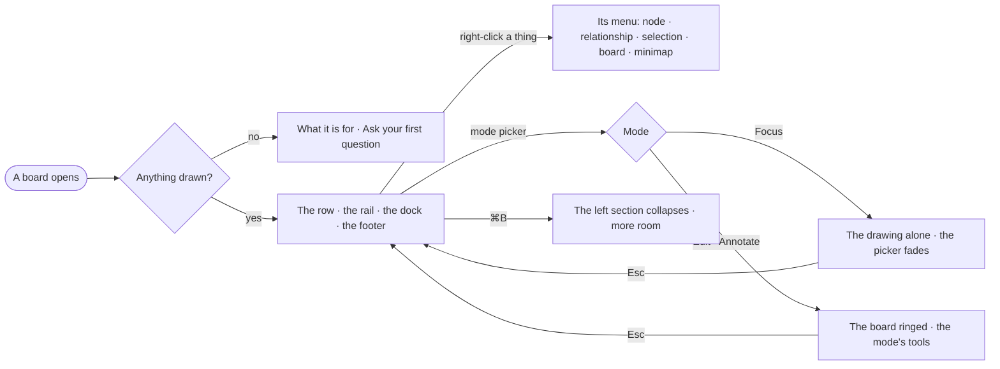

# EX-18 · A quiet board

**As** an analyst **I want** a quiet board — a mode, its tools, the rail and the dock — with every other act on
right-click **so that** the graph is the loudest thing on screen.

Tasks: [task.md](task.md) · Feature: [EX-F01](../../feature.md)

## Who can

| Lens | Can | Otherwise sees |
|---|---|---|
| Admin | Every mode, every tool, every menu item | — |
| Operator | As Admin: look, pick a mode, open every menu | Edit and Annotate open; what needs a grant inside them is disabled with its reason (EX-F06) |

## Flow

## Acceptance criteria

| # | Given | When | Then |
|---|---|---|---|
| EX-18.1 | A board with an answer drawn | it opens | top-left shows the mode picker, then *Select ▾* (Select · Lasso · Box), then the mode's tools; top-right the rail; bottom-left the minimap over the zoom bar — and nothing else over the drawing |
| EX-18.2 | A board in Explore | the person right-clicks a node | the node's menu opens at the pointer — Expand neighbours · Select neighbours · Centre on it · Hide · Hide every *type* · Style *type*… · Copy id |
| EX-18.3 | A board | the person right-clicks the empty board | the board's menu opens — Layout… · Fit · Select all · Undo · Redo · minimap, grid, lock, full screen · Export image… · Export data… |
| EX-18.4 | A menu with a destructive item | it opens | the destructive item is last, in red, and running it says *⌘Z to undo* |
| EX-18.5 | The person has not right-clicked yet | the board is open | the footer's message line says *Right-click anything for its actions · ⌘K for every command* |
| EX-18.6 | A board in any mode | the person picks Focus, or presses ⌘\\ | only the drawing shows; the picker fades until the pointer moves; Esc returns to Explore |
| EX-18.7 | A board in Edit or Annotate | it is open | the board is ringed — Edit in the primary colour, Annotate in the warning colour — and the mode is not saved with the board |
| EX-18.8 | No board open | the person opens Explore | the board is one question box, *What do you want to know about airways?*, with their kept boards under it — never a blank grid |
| EX-18.9 | The board is slow to draw a large answer | the solve runs past 400 ms | the footer counts it and one toast says the graph appears when it settles, with *Cancel* |
| EX-18.10 | An Operator | they open every menu | every look and arrange item works; an item that needs a grant is disabled with its reason |
| EX-18.11 | An answer of 100,000 nodes | it draws | the count shows first, and pan and zoom keep answering while it draws |

## Screens

| Surface | Lens | First use | Empty after a filter | Loading | Has data | Failed | Agent working or proposing | No access |
|---|---|---|---|---|---|---|---|---|
| The board | Admin | explore.ask | explore.board · Empty after a filter | explore.board · Loading | explore.board | explore.board · Failed | explore.board · Agent working | — |
| The board | Operator | explore.ask | explore.board · Empty after a filter | explore.board · Loading | explore.board | explore.board · Failed | explore.board · Agent working | explore.board · No access |
| The left section collapsed | Admin | — | — | — | explore.board.left_closed | — | — | — |
| The left section collapsed | Operator | — | — | — | explore.board.left_closed | — | — | — |
| A right-click menu | Admin | — | — | — | explore.board.menu | — | — | — |
| A right-click menu | Operator | — | — | — | explore.board.menu | — | — | explore.board.menu · No access |
