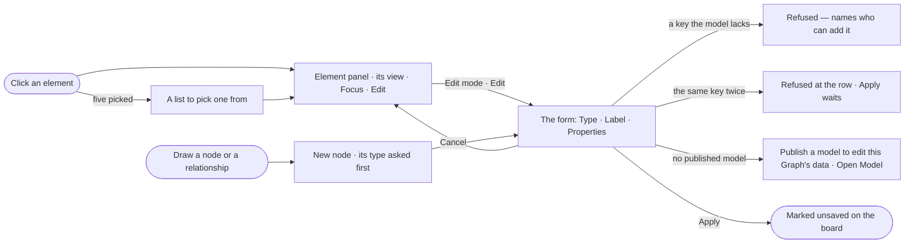

# EX-21 · See and edit one element

**As** an analyst **I want** to see one node, relationship or group, and edit it with only the keys its type has in
the model **so that** what I add matches the Graph's model, so it can be saved and asked about.

Tasks: [task.md](task.md) · Feature: [EX-F01](../../feature.md)

## Who can

| Lens | Can | Otherwise sees |
|---|---|---|
| Admin | Read any element; in Edit, change it, add one, and apply the change to the board | — |
| Operator | As Admin — an edit stays on the board until saved | Saving to the graph needs *Can work on projects* (EX-20) |

## Flow

## Acceptance criteria

| # | Given | When | Then |
|---|---|---|---|
| EX-21.1 | A drawn board | the person clicks a node | the Element panel opens on that node: swatch, name, type, the id with copy, its properties, its relationships by direction and type, and its group |
| EX-21.2 | A relationship clicked | the panel opens | it shows the relationship's properties and its two ends, From and To, each framing its node when clicked |
| EX-21.3 | Five elements selected | the person opens the panel | it lists the five to pick one from; it never shows more than one element at a time |
| EX-21.4 | A node open in Edit mode | the person picks *Edit* | the view is replaced in place by the form — Type, Label, Properties, then Cancel · Apply |
| EX-21.5 | The form open | the person picks *Add property* | only the keys of the node's type not yet set are offered; each value's placeholder is the key's kind (text · number · date) |
| EX-21.6 | The form open | the person types a key the model does not have | it is refused, naming who can add it — an owner, in Model |
| EX-21.7 | The form open | the person adds a key a second time | the second row is refused and Apply waits until it is fixed |
| EX-21.8 | The form open | the person changes the type | the new type's keys become the rows; keys the new type lacks are struck through and dropped on Apply |
| EX-21.9 | Edit mode | the person draws a node or a relationship | it opens as *New node* or *New relationship*, its type asked first; Cancel takes it off the board |
| EX-21.10 | A Graph with no published model | the person opens the form | it says *Publish a model to edit this Graph's data* with *Open Model* |
| EX-21.11 | An element whose type or key is not in the model | its panel opens | the key stays, tagged *not in the model*; the type can be changed to one the model has |
| EX-21.12 | An Operator without *Can work on projects* | they apply an edit | it is marked on the board; saving it to the graph is disabled with *You can change this board, not the graph* |
| EX-21.13 | A relationship open in Edit mode | the person looks for its type | the type is fixed, with *To change it, delete it and draw it again* |
| EX-21.14 | A node open in the panel | it shows | where it came from shows under its properties — the load and the run that wrote it, each opening its page |

## Screens

| Surface | Lens | First use | Empty after a filter | Loading | Has data | Failed | Agent working or proposing | No access |
|---|---|---|---|---|---|---|---|---|
| Element panel · view | Admin | explore.board.menu · Nothing picked | — | explore.board.menu · Loading | explore.board.menu | — | — | — |
| Element panel · view | Operator | explore.board.menu · Nothing picked | — | explore.board.menu · Loading | explore.board.menu | — | — | — |
| Element panel · form | Admin | explore.board.edit · No model | — | explore.board.edit · Loading the model | explore.board.edit | explore.board.edit · Refused | — | — |
| Element panel · form | Operator | explore.board.edit · No model | — | explore.board.edit · Loading the model | explore.board.edit | explore.board.edit · Refused | — | explore.board.edit · No access |
