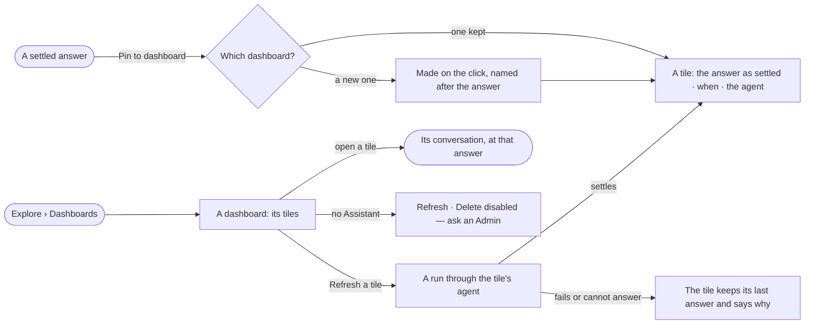

# EX-34 · Watch the answers I rely on, on a dashboard

**As** an analyst **I want** the answers I come back to pinned as tiles on a dashboard, each saying when it was
answered and refreshed in one click **so that** I read where things stand at a glance instead of asking the same
questions every morning.

Tasks: [task.md](task.md) · Feature: [EX-F01](../../feature.md)

## Who can

A dashboard is *Acts* for Operator, Modeller and Admin, as a board is ([the role table](../../../../../../os/access/features/AC-F02-access-policies/feature.md#the-role-table)).
It is the organisation's, made by a person; a tile refreshes through the agent that answered it, so it reads only what
that agent may Read.

| Lens | Can | Otherwise sees |
|---|---|---|
| Admin | Create, rename and delete dashboards; pin an answer; refresh, reorder and unpin tiles | — |
| Operator | The same, through the agents they may use; a Modeller the same | Without the Assistant: *Pin to dashboard*, *Refresh* and *Delete* disabled — *{person} may not use Assistant — ask an Admin*. A tile whose agent they may not use: its answer reads, *Refresh* is disabled — *{person} may not use {agent} — ask an Admin* |

## Flow

## Acceptance criteria

| # | Given | When | Then |
|---|---|---|---|
| EX-34.1 | A settled answer | the person picks *Pin to dashboard* | they pick a dashboard or make one on the click, and the answer joins it as a tile showing the answer as it settled, when, and the agent that answered |
| EX-34.2 | Dashboards kept | the person opens Explore › Dashboards | the dashboards they made list first, then *Shared with me*, each naming who made it and how many tiles it holds |
| EX-34.3 | A tile | the person picks *Refresh* | the question runs again through the tile's agent as a new run, and the tile shows the new answer and when |
| EX-34.4 | A refresh that fails or cannot answer | it settles | the tile keeps its last answer, marked with when it was answered, and says in a sentence why the refresh did not |
| EX-34.5 | A tile | the person opens it | its conversation opens at that answer, with *How it got here* one click away |
| EX-34.6 | A person who may not use the Assistant | they open a dashboard | its tiles read; *Pin to dashboard*, *Refresh* and *Delete* are disabled — *{person} may not use Assistant — ask an Admin*; the engine refuses the same through the API |
| EX-34.7 | No dashboard kept | Explore › Dashboards opens | it reads *Pin an answer to start a dashboard*, with no dashboard invented |
| EX-34.8 | A tile's number | it is shown | it is the number the run stored; Studio formats it and never works it out |

## Screens

| Surface | Lens | First use | Empty after a filter | Loading | Has data | Failed | Agent working or proposing | No access |
|---|---|---|---|---|---|---|---|---|
| Dashboards on the left | Admin | explore.dashboards · No dashboards yet | explore.dashboards · No dashboard matches | explore.dashboards · Loading | explore.dashboards | explore.dashboards · Could not load | — | — |
| Dashboards on the left | Operator | explore.dashboards · No dashboards yet | explore.dashboards · No dashboard matches | explore.dashboards · Loading | explore.dashboards | explore.dashboards · Could not load | — | explore.dashboards · No Assistant |
| A dashboard | Admin | explore.dashboard · No tiles yet | — | explore.dashboard · Loading | explore.dashboard | explore.dashboard · Refresh failed | explore.dashboard · Refreshing | — |
| A dashboard | Operator | explore.dashboard · No tiles yet | — | explore.dashboard · Loading | explore.dashboard | explore.dashboard · Refresh failed | explore.dashboard · Refreshing | explore.dashboard · Agent not theirs to use |
| Pin to dashboard | Admin | explore.dashboard · Pin · New dashboard | — | — | explore.dashboard · Pin | explore.dashboard · Pin failed | — | — |
| Pin to dashboard | Operator | explore.dashboard · Pin · New dashboard | — | — | explore.dashboard · Pin | explore.dashboard · Pin failed | — | explore.dashboard · No Assistant |
