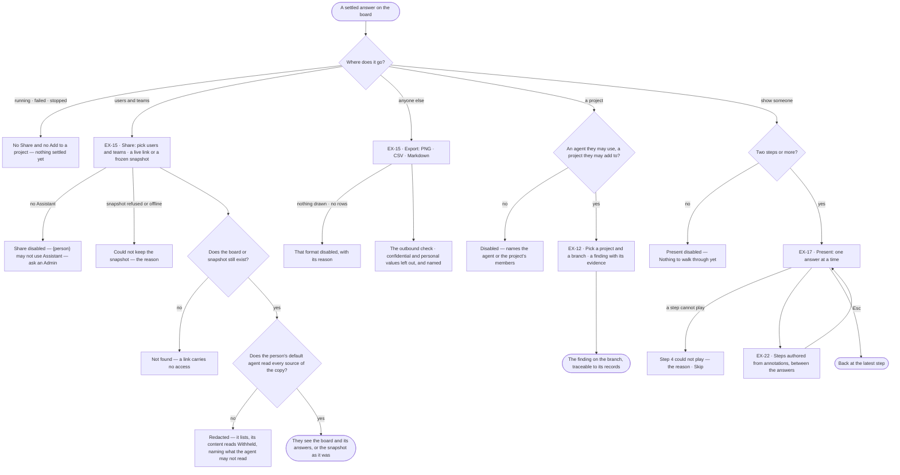

# Share and present an answer

> What an answer becomes once it holds up: shared with the users and teams who need it, exported for anyone else,
> shown step by step, or added to a project as evidence — so the person who decides sees what was found and how.
> The decision it helps make: *who needs to see this answer, and in which form, to decide on it?*

## User journey

Journeys this feature is a step of: [J02 · Ask and trust the answer](../../../../journeys/J02-ask-and-trust-the-answer.md)

## Stories

| ID | Story | Status |
|---|---|---|
| EX-15 | [Share an answer](stories/EX-15-share-an-answer/story.md) | idea |
| EX-12 | [Add an answer to a project](stories/EX-12-add-an-answer-to-a-project/story.md) | idea |
| EX-17 | [Present a board](stories/EX-17-present-a-board/story.md) | idea |
| EX-22 | [Tell a story in steps](stories/EX-22-tell-a-story-in-steps/story.md) | idea |

## Access

Who may do what is the [role table](../../../../os/access/features/AC-F02-access-policies/feature.md#the-role-table):
*share* is *Acts* for Operator, Modeller and Admin — through an agent granted to the person, within that agent's
Access Policies. A board is the organisation's, made by a person ([AC-F07](../../../../os/access/features/AC-F07-ownership/feature.md)); sharing it
tells the people and teams picked and gives them its link, and a link carries no access of its own.

| Act | Role ([the role table](../../../../os/access/features/AC-F02-access-policies/feature.md#the-role-table)) | Everyone else sees |
|---|---|---|
| Share a board's answer with users and teams — a live link or a frozen snapshot · stop sharing | Every role, with the Assistant | *Share* disabled — *{person} may not use Assistant — ask an Admin* |
| Open a shared link | Every signed-in person; what it shows reads through their default agent | *Not found* for a board or snapshot that does not exist |
| Export PNG, CSV or Markdown | Whoever opens the board — Operator, Modeller, Admin; an export leaves the platform, so it passes [the outbound check](../../../../os/access/features/AC-F09-what-left-the-platform/feature.md#engine) with lineage | Values at a level the person's default agent may not Read are not in the file, and the file names what was left out |
| Add an answer to a project as a finding | Anyone who may read the answer's run and add a finding to the project's branch ([PJ-F03](../../../projects/features/PJ-F03-branches-findings-and-decisions/feature.md)) | *Add to a project* disabled, naming what is missing — the project's members or the agent |
| Present a board | Whoever opens the board | — |
| Add, edit, move or remove an authored step | Every role, with the Assistant, as for any change to a board | No Assistant: *Add a step here* disabled — *{person} may not use Assistant — ask an Admin*; steps still read and play |

## States

| State | What the person sees |
|---|---|
| First use | A board with fewer than two steps: Present is disabled with *Nothing to walk through yet*; a board shared with nobody: the Share dialog's people list reads *No one yet* |
| Empty after a filter | Picking users and teams with no match: *No one matches "{words}"* |
| Loading | Keeping a snapshot: *Copy snapshot link* reads *Keeping…*, disabled, the dialog open |
| Has data | The Share dialog with who it is shared with; the presenter with its steps; the finding on its branch |
| Failed | *Could not keep the snapshot* with the reason · a step that cannot play, with *Skip* |
| Agent working or proposing | The answer still running: no Share and no Add to a project on the reply |
| No access | A link to a board or snapshot that does not exist is *Not found*; *Share* without the Assistant is disabled, naming the role or the agent; a shared answer whose sources the person's default agent may not read lists but its content reads *Withheld — your agent may not read {resource}* |

## Rules

| Rule | Detail |
|---|---|
| Only a settled answer travels | Share and Add to a project sit on a settled answer's reply line; a running, failed or stopped answer has neither |
| Shared with people, never with a link | A board, or one snapshot of it, is shared with named users and teams: each is told in the Inbox and the board lists under their *Shared with me*; a team share tells whoever is on the team then. The link gives no access of its own — it opens the board for any signed-in person, its content as far as their default agent reads |
| A copy shows as far as the person's agent reads | A shared board, a live link, a snapshot and a presented answer are copies: each records the resources it was read from ([lineage](../../../../os/graph/features/GP-F02-memory/feature.md#engine)). Whoever opens one sees its content only when their default agent may Read every source; otherwise it lists — what it is, when, who made it — and its content reads *Withheld — your agent may not read {resource}*, naming each. A copy's level is the highest of its sources' |
| Sharing opens no run | A shared board's answers read as copies, through lineage; the content of the runs behind them — queries and *How it got here* — stays with the person behind each run, as run privacy says ([AC-F09](../../../../os/access/features/AC-F09-what-left-the-platform/feature.md#rules) · [CP-F10](../../../../os/control/features/CP-F10-runs-and-how-the-agents-are-doing/feature.md)) |
| Outside people get a file | PNG, CSV or Markdown; an export carries only what the board and its runs already hold and never reads a graph database again. It passes the outbound check with lineage: confidential and personal values are left out and the file names what was left out |
| A snapshot is frozen | It keeps the board's records, the answer, its citations and the loads its records came from, and never re-reads them; pruning the run later changes nothing |
| A step is a reply that changed the board | Its title is the question, its words the assistant's message, whole; a table, chart or card stays in the thread. A reply that drew nothing is not a step; an expansion is one, titled *Expanded Acme Ltd* |
| Hand edits between replies are one step | Layout, hide, style and move made since the last step become one *Your changes* step when the next reply arrives or presenting starts |
| Presenting is read-only | An earlier step is only ever seen while presenting; nothing in it can be edited. Presenting writes no version and is not restored on reload |
| The walkthrough is the board's | It is saved and versioned with the board, so a reload, a live link and a snapshot carry it, and restoring a version restores its walkthrough |
| Leans on | EX-F01 — the board, who made it and its shares · RC-F07 — annotations that authored steps show · Projects — the branch a finding joins (PJ-F03) · the Directory — users and teams (AC-F03) · run privacy (CP-F10) |

## Data touched

| Record | Read or write |
|---|---|
| The answer's run and what it returned | Read |
| Snapshot — a frozen version of the answer's run board (Engine › Mechanisms *A snapshot*) | Write |
| Shares — the users and teams a board or a snapshot is shared with ([EX-F01 › Engine](../EX-F01-the-board-and-its-canvas/feature.md#engine)) | Write · read |
| Users and teams to share with (AC-F03) | Read |
| Loads the records came from (RC-F02) | Read |
| The board's walkthrough — its steps | Read · write, with the board |
| Finding on a project branch, with its evidence | Write |

## Engine

### Records

| Table | Columns | Notes |
|---|---|---|
| — | — | Stores nothing of its own: a snapshot is a board version, a share is a row of `explore_board_shares` and the walkthrough is in the board's `settings` ([EX-F01 › Engine](../EX-F01-the-board-and-its-canvas/feature.md#engine)) |

### Reads

| Record | Owner |
|---|---|
| Boards, their versions, shares and `settings`; who may open a board | [EX-F01 › Engine](../EX-F01-the-board-and-its-canvas/feature.md#engine) |
| Who made a board — the platform owns it | [AC-F07](../../../../os/access/features/AC-F07-ownership/feature.md#engine) |
| Users and teams, and who is on each team | [AC-F03](../../../../os/access/features/AC-F03-directory/feature.md#engine) |
| The answer's parts and their citations | [EX-F04 › Engine](../EX-F04-the-answer/feature.md#engine) |
| The answer's run · who may read its content | [CP-F10](../../../../os/control/features/CP-F10-runs-and-how-the-agents-are-doing/feature.md#engine) · [AC-F09](../../../../os/access/features/AC-F09-what-left-the-platform/feature.md#engine) |
| Loads — stable id, content hash, undone | [RC-F02 › Engine](../../../records/features/RC-F02-bring-records-in/feature.md#engine) |
| Lineage of a copy · `lineage.may_see(person, copy)` | [GP-F02 › Engine](../../../../os/graph/features/GP-F02-memory/feature.md#engine) |
| The outbound check an export passes | [AC-F09 › Engine](../../../../os/access/features/AC-F09-what-left-the-platform/feature.md#engine) |
| Findings on a branch — *Add to a project* writes one through `POST /{key}/branches/{n}/findings` | [PJ-F03 › Engine](../../../projects/features/PJ-F03-branches-findings-and-decisions/feature.md#engine) |

### Routes

| Route | Does | Story |
|---|---|---|
| — | None of its own: a snapshot is kept through EX-F01's `POST /boards/run/{run}/versions`, a share through EX-F01's `PUT /boards/{board}/shares`, a finding through PJ-F03's route | EX-15 · EX-12 |

### Events

| Event | When |
|---|---|
| — | None of its own: a kept snapshot and a walkthrough change are EX-F01's `explore.boards.update`; a share EX-F01's `explore.boards.share` |

### Refusals

| Status | When | Sentence | Criterion |
|---|---|---|---|
| — | None of its own; opening, sharing and keeping a snapshot meet EX-F01's (*Not found.* · *{person} may not use {agent} — ask an Admin.*), adding a finding PJ-F03's | — | EX-15.6 · EX-15.10 · EX-15.12 · EX-12.5 |
| — | A copy a person's default agent may not read is never refused: it is redacted, with the content reading *Withheld — your agent may not read {resource}* | — | EX-15.16 · EX-15.17 |

### CLI

| Command | Does |
|---|---|
| — | No command of its own |

### Mechanisms

| Mechanism | How |
|---|---|
| A snapshot | One `explore_board_versions` row on the answer's `run` board: `cause = report`, `label` *Snapshot — {the question}*, the reply's `message_id`. Studio composes the document in the browser; the engine stores it whole. Its link opens the page `run:{run}@{version}` |
| What a snapshot holds | A header — the question, the chip *Snapshot*, the graph databases it read, when it was taken · `narrative`, the answer's words · one panel per answer part: `table` · `metric` · `bars` · a `table` titled *Board* with the drawing's records and its node and relationship counts · `text` *No records* for an empty answer · `citations`, each query with its graph database, language and record count · `list` *Loads*, each load's id, content hash and whether it is undone |
| Lineage on a snapshot | A snapshot's version row records its sources — the resources the answer's queries read, in [Access Policies' grammar](../../../../os/access/features/AC-F02-access-policies/feature.md#mechanisms) with the level — through `lineage.record(copy, sources)`; opening a snapshot, a live link or a presented answer calls `lineage.may_see(person, copy)`, and a copy the person's agent may not read in full is returned redacted: its head, and each part's content *withheld* naming the resource |
| An export is checked | Each PNG, CSV or Markdown goes through `outbound.check(payload, target)` with lineage before it is sent to the browser's download: values at a confidential or personal level are left out, and the file's header names the properties left out and their levels |
| A share | `PUT /boards/{board}/shares` writes one `explore_board_shares` row per user or team, with the snapshot's `version_id` when a snapshot is shared; each person or team picked is notified through the Inbox, a team through who is on it then; a share is a notice and a list entry, never a gate |
| The walkthrough | `settings.walkthrough` on the board, autosaved and versioned with it. A step is `id` · `title` · `narration` · `data` (what its reply added to the drawing) · `view.focus` · `view.camera` · `meta.reply_id` (absent on an authored step) · `annotation_ids` (an authored step's) |

## System impact

| HLD section | Change | NFRs |
|---|---|---|
| § 12 Qualities | Privacy: a snapshot and a shared answer show only as far as the person's default agent reads; an export passes the outbound check | NFR-SEC-8 · NFR-SEC-11 |

## Decisions

| Decision | Detail |
|---|---|
| The live link is the conversation's own address | Sharing it writes who it is shared with and nothing else; it opens the same board and thread as they are when opened |
| The snapshot keeps the board as records | The answer's drawing is kept as a *Board* table — name, kind, id, graph database, with node and relationship counts — readable at any size and in either theme; the board's last picture is its thumbnail |
| PNG is the board as last drawn · CSV is the answer's rows | PNG is disabled while nothing is drawn; CSV takes every table's rows, else the drawing's nodes, else a chart's series — disabled only when the answer has none |
| Markdown is one file | The question as the heading, the answer, each part (tables capped at 200 rows, the rest counted), the queries as citations with their graph databases, the loads cited, the run and when it was exported |
| Loads are cited by id and content hash | A snapshot names each load by its stable id and content hash, so it still resolves after a later load; an undone load is flagged on it |
| Times read in the reader's own time | `Oct 2, 9:29 PM`; only the Markdown export says UTC, because it travels |
| Present is a mode | Present sits in the mode picker; with fewer than two steps it is disabled with *Nothing to walk through yet*. While presenting the row is the picker and `◀ n/N ▶`; the rail, the dock and the forms close |
| A step and its reply point at each other | While presenting, the current step's reply is marked and scrolled into view; every step's reply carries a `Step n` chip that starts presenting there |
| Authored steps sit between the answers | A person who may use the Assistant may add a step from annotations between two answers, word it, move it among the authored steps and remove it. Reply steps keep their reply's words and the thread's order |

## Open questions

| Question | Who answers |
|---|---|
| — | — |

## Not building

| Item | Why not |
|---|---|
| A public or anonymous link | Every link opens inside the platform, for signed-in people only; outside people get a file |
| A snapshot that refreshes | A frozen snapshot that changes is a live link |
| Sharing into Slack, email or a channel | Delivery is the Inbox's; a link can be pasted anywhere and opens only for a signed-in person |
| A share that grants more or less than the role and the default agent give | A share tells people and gives a link; what a person does is their role and their agents' |
| PDF export | Markdown and the browser's print cover it |
| Auto-play on a timer | A walkthrough is talked over; the presenter sets the pace |
| Rewording or reordering a reply's step | A reply step is its reply; rewording it would make the walkthrough disagree with the thread |
| The answer's tables and charts in the presenter | The board is the drawing; they stay in the thread |
| Exporting a walkthrough as slides or video | Share the board; it plays there |
