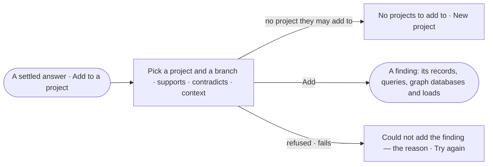

# EX-12 · Add an answer to a project

**As** an analyst **I want** to add an answer to a project branch as a finding **so that** what I found feeds a
decision, with its evidence attached.

Tasks: [task.md](task.md) · Feature: [EX-F02](../../feature.md)

## Who can

| Lens | Can | Otherwise sees |
|---|---|---|
| Admin | Add any settled answer they may read to a branch of any project | — |
| Operator | Add a settled answer whose run they may read to a branch of a project they may add findings to ([PJ-F03](../../../../../projects/features/PJ-F03-branches-findings-and-decisions/feature.md)); a Modeller the same | A project they may not add to is not offered; with none, *Add to a project* is disabled, naming the project's members |

## Flow

## Acceptance criteria

| # | Given | When | Then |
|---|---|---|---|
| EX-12.1 | A settled answer the person may read | they pick *Add to a project* on its reply line | they pick a project, a branch and whether it supports, contradicts or gives context; only projects they may add findings to are offered |
| EX-12.2 | The choice made | they add it | the branch holds a finding with the answer's records, queries, the graph databases they ran on and the loads they came from attached |
| EX-12.3 | A finding added from an answer | someone opens it in Projects | it shows the records behind it and the load they came from, by id and content hash |
| EX-12.4 | No project the person may add to | they pick *Add to a project* | it says *No projects to add to* with *New project* |
| EX-12.5 | Adding fails, or PJ-F03 refuses it | the engine answers | the person sees *Could not add the finding* with the reason and *Try again*; the answer is unchanged |
| EX-12.6 | An answer still running, failed or stopped | its reply line shows | there is no *Add to a project* |
| EX-12.7 | An Operator | they add a settled answer to a project they may add to | the finding is added, as for an Admin |

## Screens

| Surface | Lens | First use | Empty after a filter | Loading | Has data | Failed | Agent working or proposing | No access |
|---|---|---|---|---|---|---|---|---|
| Add to a project | Admin | explore.board · No projects | — | explore.board · Adding | explore.board · Add to a project | explore.board · Failed | explore.board · Agent working | — |
| Add to a project | Operator | explore.board · No projects | — | explore.board · Adding | explore.board · Add to a project | explore.board · Failed | explore.board · Agent working | explore.board · No access |
| The finding | Admin | — | — | projects.finding · Loading | projects.finding | — | — | — |
| The finding | Operator | — | — | projects.finding · Loading | projects.finding | — | — | — |
