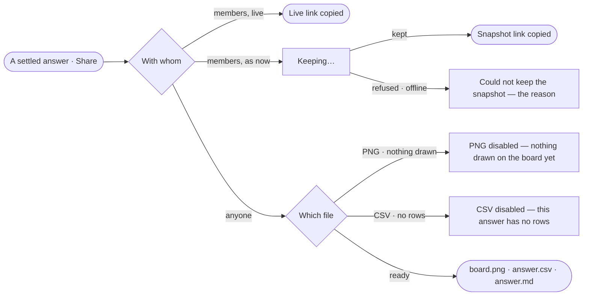

# EX-15 · Share an answer

**As** an analyst **I want** to share an answer as a live link or a frozen snapshot, or export it **so that** others
see what I found, with its citations.

Tasks: [task.md](task.md) · Feature: [EX-F02](../../feature.md)

## Who can

| Lens | Can | Otherwise sees |
|---|---|---|
| Admin | Copy a live link, keep a snapshot, export PNG · CSV · Markdown | — |
| Operator | As Admin — every member shares | A refusal the engine returns is shown in the dialog in its own words |

## Flow

## Acceptance criteria

| # | Given | When | Then |
|---|---|---|---|
| EX-15.1 | A settled answer | the person picks *Share* on its reply line | the dialog offers *With members* — Live link · Frozen snapshot, saying what a snapshot holds — and *Export* — PNG · CSV · Markdown, with the note that outside people get a file |
| EX-15.2 | An answer still running, failed or stopped | its reply line shows | there is no *Share* |
| EX-15.3 | The dialog | the person copies a live link | the conversation's own address is copied and nothing is written |
| EX-15.4 | The dialog | the person keeps a snapshot | *Copy snapshot link* reads *Keeping…* and is disabled until it is kept, then the link is copied |
| EX-15.5 | A snapshot | a member opens its link | they see the question, the answer, its records as a table, its citations and the loads its records came from, as it was then |
| EX-15.6 | A snapshot or a live link | a person who is not a member opens it | they get the Graph's not-found page |
| EX-15.7 | A board with nothing drawn | the dialog opens | PNG is disabled with *Nothing drawn on the board yet* |
| EX-15.8 | An answer with no rows | the dialog opens | CSV is disabled with *This answer has no rows*; the snapshot keeps the answer and says *No records* |
| EX-15.9 | The dialog | the person exports Markdown | one file holds the question, the answer, its rows capped at 200 with the rest counted, its queries as citations, the view of the graph, the loads cited and when it was shared, in UTC |
| EX-15.10 | Keeping a snapshot fails | the engine refuses or the network drops | the dialog stays open and says *Could not keep the snapshot* with the reason |
| EX-15.11 | A snapshot link | a member opens it | the frozen page opens — not the conversation — under *Graph › Conversations › the question* |

## Screens

| Surface | Lens | First use | Empty after a filter | Loading | Has data | Failed | Agent working or proposing | No access |
|---|---|---|---|---|---|---|---|---|
| Share | Admin | explore.share · Nothing drawn | — | explore.share · Keeping | explore.share | explore.share · Failed | — | — |
| Share | Operator | explore.share · Nothing drawn | — | explore.share · Keeping | explore.share | explore.share · Failed | — | — |
