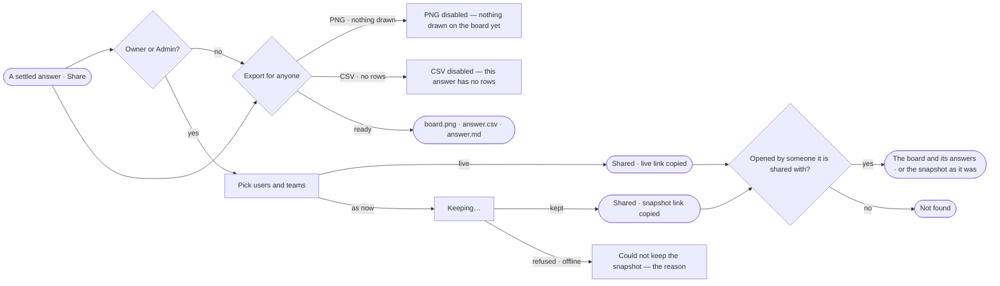

# EX-15 · Share an answer

**As** an analyst **I want** to share an answer with the users and teams who need it, as a live link or a frozen
snapshot, or export it for anyone else **so that** others see what I found, with its citations, and nobody I did not
pick does.

Tasks: [task.md](task.md) · Feature: [EX-F02](../../feature.md)

## Who can

| Lens | Can | Otherwise sees |
|---|---|---|
| Admin | Share any board's answer with users and teams, stop sharing, export PNG · CSV · Markdown; open any shared link | — |
| Operator | Share the answers of boards they own, stop sharing, export from any board they open; open a link shared with them or a team they are on; a Modeller the same | On a board they do not own: *Share with* disabled — *Only its owners or an Admin*; export still works. A link not shared with them: *Not found* |

## Flow

## Acceptance criteria

| # | Given | When | Then |
|---|---|---|---|
| EX-15.1 | A settled answer on a board the person owns | they pick *Share* on its reply line | the dialog offers *Share with* — a picker of users and teams, then Live link · Frozen snapshot, saying what a snapshot holds — and *Export* — PNG · CSV · Markdown, with the note that outside people get a file |
| EX-15.2 | An answer still running, failed or stopped | its reply line shows | there is no *Share* |
| EX-15.3 | Users and teams picked | the person copies a live link | the conversation's own address is copied and the board is shared with them; nothing else is written |
| EX-15.4 | Users and teams picked | the person keeps a snapshot | *Copy snapshot link* reads *Keeping…* and is disabled until it is kept, then the link is copied and that snapshot is shared with them |
| EX-15.5 | A snapshot | a person it is shared with opens its link | they see the question, the answer, its records as a table, its citations with their graph databases and the loads its records came from, as it was then |
| EX-15.6 | A snapshot or a live link | a person it is not shared with, who neither owns the board nor is an Admin, opens it | they get *Not found* — a link is never access |
| EX-15.7 | A board with nothing drawn | the dialog opens | PNG is disabled with *Nothing drawn on the board yet* |
| EX-15.8 | An answer with no rows | the dialog opens | CSV is disabled with *This answer has no rows*; the snapshot keeps the answer and says *No records* |
| EX-15.9 | The dialog | the person exports Markdown | one file holds the question, the answer, its rows capped at 200 with the rest counted, its queries as citations with their graph databases, the loads cited and when it was exported, in UTC |
| EX-15.10 | Keeping a snapshot fails | the engine refuses or the network drops | the dialog stays open and says *Could not keep the snapshot* with the reason |
| EX-15.11 | A snapshot link | a person it is shared with opens it | the frozen page opens — not the conversation — under *Conversations › the question* |
| EX-15.12 | A board the person does not own, and they are not an Admin | they open the dialog | *Share with* is disabled — *Only its owners or an Admin*; *Export* works |
| EX-15.13 | A board shared with a team | someone joins the team | the link opens for them; someone who leaves the team gets *Not found* |
| EX-15.14 | The dialog on a shared board | an owner reads *Shared with* | each user and team is listed with who shared it and when, each with *Stop sharing*; stopping makes the link *Not found* for them |
| EX-15.15 | A live link opened by a person it is shared with | they open an answer's *How it got here* | its steps, queries and records read as for the asker; nothing in it can be changed |

## Screens

| Surface | Lens | First use | Empty after a filter | Loading | Has data | Failed | Agent working or proposing | No access |
|---|---|---|---|---|---|---|---|---|
| Share | Admin | explore.share · Nothing drawn | explore.share · No one matches | explore.share · Keeping | explore.share | explore.share · Failed | — | — |
| Share | Operator | explore.share · Nothing drawn | explore.share · No one matches | explore.share · Keeping | explore.share | explore.share · Failed | — | explore.share · Not an owner |
| A shared link opened | Admin | — | — | explore.share · Opening | explore.share · Shared board | — | — | — |
| A shared link opened | Operator | — | — | explore.share · Opening | explore.share · Shared board | — | — | explore.share · Not found |
