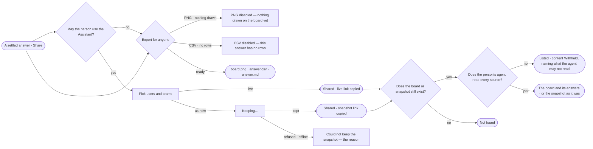

# EX-15 · Share an answer

**As** an analyst **I want** to share an answer with the users and teams who need it, as a live link or a frozen
snapshot, or export it for anyone else **so that** the people I pick are told and others see what I found, with its
citations, as far as their own agents may read.

Tasks: [task.md](task.md) · Feature: [EX-F02](../../feature.md)

## Who can

Sharing is *Acts* for Operator, Modeller and Admin ([the role table](../../../../../../os/access/features/AC-F02-access-policies/feature.md#the-role-table)); what an opened copy shows is as far as the person's default agent reads. A link carries no access.

| Lens | Can | Otherwise sees |
|---|---|---|
| Admin | Share any board's answer with users and teams, stop sharing, export PNG · CSV · Markdown; open any link | — |
| Operator | The same; a Modeller the same | Without the Assistant: *Share with* disabled — *{person} may not use Assistant — ask an Admin*; export still works. A link to a board or snapshot that does not exist: *Not found* |

## Flow

## Acceptance criteria

| # | Given | When | Then |
|---|---|---|---|
| EX-15.1 | A settled answer on a board, and a person who may use the Assistant | they pick *Share* on its reply line | the dialog offers *Share with* — a picker of users and teams, then Live link · Frozen snapshot, saying what a snapshot holds — and *Export* — PNG · CSV · Markdown, with the note that outside people get a file |
| EX-15.2 | An answer still running, failed or stopped | its reply line shows | there is no *Share* |
| EX-15.3 | Users and teams picked | the person copies a live link | the conversation's own address is copied, they are told in the Inbox and the board lists under their *Shared with me*; nothing else is written |
| EX-15.4 | Users and teams picked | the person keeps a snapshot | *Copy snapshot link* reads *Keeping…* and is disabled until it is kept, then the link is copied and they are told of that snapshot |
| EX-15.5 | A snapshot | a signed-in person opens its link | they see the question, the answer, its records as a table, its citations with their graph databases and the loads its records came from, as it was then |
| EX-15.6 | A snapshot or a live link to a board or snapshot that does not exist | a person opens it | they get *Not found* — a link carries no access, and what an existing one shows is as far as their default agent reads |
| EX-15.7 | A board with nothing drawn | the dialog opens | PNG is disabled with *Nothing drawn on the board yet* |
| EX-15.8 | An answer with no rows | the dialog opens | CSV is disabled with *This answer has no rows*; the snapshot keeps the answer and says *No records* |
| EX-15.9 | The dialog | the person exports Markdown | one file holds the question, the answer, its rows capped at 200 with the rest counted, its queries as citations with their graph databases, the loads cited and when it was exported, in UTC |
| EX-15.10 | Keeping a snapshot fails | the engine refuses or the network drops | the dialog stays open and says *Could not keep the snapshot* with the reason |
| EX-15.11 | A snapshot link | a person opens it | the frozen page opens — not the conversation — under *Conversations › the question* |
| EX-15.12 | A person who may not use the Assistant | they open the dialog | *Share with* is disabled — *{person} may not use Assistant — ask an Admin*; *Export* works |
| EX-15.13 | A board shared with a team | someone joins the team | it lists under their *Shared with me*; someone who leaves the team has it off that list, and the link still opens for them as for any signed-in person |
| EX-15.14 | The dialog on a shared board | a person reads *Shared with* | each user and team is listed with who shared it and when, each with *Stop sharing*; stopping takes it off their *Shared with me* |
| EX-15.15 | A live link opened by a person who was not behind its runs | they open an answer's *How it got here* | it reads that the answer ran, its agent, its status and its tokens — *Content withheld*; its steps and queries read only to the person behind the run; nothing in it can be changed |
| EX-15.16 | A shared answer, a live link or a snapshot | it is made | it records the resources it was read from — kind, graph database and level — as its sources, and its level is the highest of them |
| EX-15.17 | A shared answer or snapshot with a source the person's default agent may not Read | they open it | it lists — the question, when, who made it — and its content reads *Withheld — your agent may not read {resource}*, naming each resource; nothing of the withheld content loads, and an Admin meets the same rule through their own default agent |
| EX-15.18 | A shared answer or snapshot whose sources the person's default agent may Read in full | they open it | it shows as it was, in full |
| EX-15.19 | An export — PNG, CSV or Markdown — of an answer carrying a confidential or personal value | the person exports | the value is left out of the file, and the file and the dialog name each property and level left out; the export is recorded with its sources |
## Screens

| Surface | Lens | First use | Empty after a filter | Loading | Has data | Failed | Agent working or proposing | No access |
|---|---|---|---|---|---|---|---|---|
| Share | Admin | explore.share · Nothing drawn | explore.share · No one matches | explore.share · Keeping | explore.share | explore.share · Failed | — | — |
| Share | Operator | explore.share · Nothing drawn | explore.share · No one matches | explore.share · Keeping | explore.share | explore.share · Failed | — | explore.share · Not an owner |
| A shared link opened | Admin | — | — | explore.share · Opening | explore.share · Shared board | — | — | — |
| A shared link opened | Operator | — | — | explore.share · Opening | explore.share · Shared board | — | — | explore.share · Not found |
| A shared link opened, sources withheld | Admin | — | — | — | explore.share · Shared board · Redacted | — | — | — |
| A shared link opened, sources withheld | Operator | — | — | — | explore.share · Shared board · Redacted | — | — | explore.share · Shared board · Redacted |
| An export · values left out | Admin | — | — | — | explore.share · Export · Redacted | — | — | — |
| An export · values left out | Operator | — | — | — | explore.share · Export · Redacted | — | — | — |
