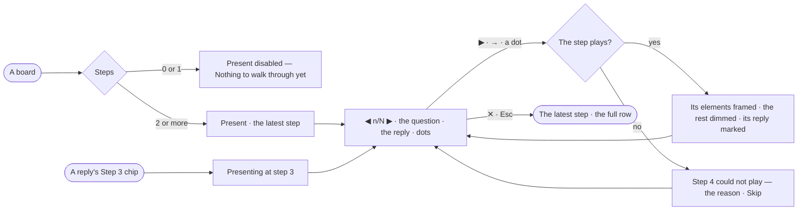

# EX-17 · Present a board

**As** an analyst **I want** to present a board one answer at a time, with the question and the reply **so that** I
can show someone how I got there and which question drew what.

Tasks: [task.md](task.md) · Feature: [EX-F02](../../feature.md)

## Who can

| Lens | Can | Otherwise sees |
|---|---|---|
| Admin | Present any board, from the first step or any reply's step | — |
| Operator | Present any board — presenting is read-only; a Modeller the same | A link to a board that does not exist: *Not found* |

## Flow

## Acceptance criteria

| # | Given | When | Then |
|---|---|---|---|
| EX-17.1 | A board whose conversation drew it in two or more replies | the person picks *Present* in the mode picker | presenting starts at the latest step: the row reads the picker and `◀ n/N ▶`, the rail, the dock and the forms close |
| EX-17.2 | A board with fewer than two steps | the mode picker opens | Present is disabled with *Nothing to walk through yet*, and no reply carries a step chip |
| EX-17.3 | Presenting | a step plays | the elements its reply drew are framed and the rest dimmed; the bar at the bottom centre shows the question, the assistant's message beside its avatar and one dot per step |
| EX-17.4 | Presenting | the step changes | that step's reply is marked in the thread and scrolled into view |
| EX-17.5 | A reply with a `Step 3` chip | the person clicks the chip | presenting starts at step 3 |
| EX-17.6 | Hand edits made between two replies | presenting starts | they are one *Your changes* step, between the two replies' steps |
| EX-17.7 | A step whose elements are gone from their graph database, or whose graph database is switched off | it plays | the presenter says which step could not play and why, naming the graph database, with *Skip*; missing elements are kept and marked |
| EX-17.8 | A step still settling | the person presses ▶ again | ◀ ▶ and the dots wait until the board settles; held keys do not queue |
| EX-17.9 | Presenting | the person presses ✕ or Esc | the board returns to the latest step and the full row; nothing was written |
| EX-17.10 | Presenting | the page reloads | the board opens at the latest step, not presenting |
| EX-17.11 | A frozen snapshot of the board | a person it is shared with presents it | it plays the walkthrough as it was when the snapshot was taken |

## Screens

| Surface | Lens | First use | Empty after a filter | Loading | Has data | Failed | Agent working or proposing | No access |
|---|---|---|---|---|---|---|---|---|
| Presenting | Admin | explore.board.present · Too few steps | — | explore.board.present · Step settling | explore.board.present | explore.board.present · Step failed | — | — |
| Presenting | Operator | explore.board.present · Too few steps | — | explore.board.present · Step settling | explore.board.present | explore.board.present · Step failed | — | — |
