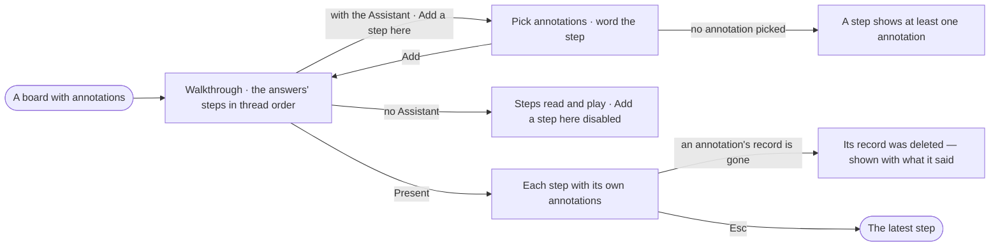

# EX-22 · Tell a story in steps

**As** an analyst **I want** to tell a story in steps — the answers that drew the board, and steps I author from
annotations — and present it **so that** someone else follows how I got there, one step and its annotations at a time.

Tasks: [task.md](task.md) · Feature: [EX-F02](../../feature.md)

## Who can

The board is *Acts* for Operator, Modeller and Admin ([the role table](../../../../../../os/access/features/AC-F02-access-policies/feature.md#the-role-table)); the walkthrough is part of the board.

| Lens | Can | Otherwise sees |
|---|---|---|
| Admin | Add, word, move and remove authored steps on any board; present them | — |
| Operator | The same; a Modeller the same | Without the Assistant: the steps read and play; *Add a step here* is disabled — *{person} may not use Assistant — ask an Admin* |

## Flow

## Acceptance criteria

| # | Given | When | Then |
|---|---|---|---|
| EX-22.1 | A board with annotations ([RC-13](../../../../../records/features/RC-F07-annotations/stories/RC-13-annotate-the-records-on-a-board/story.md)) | a person who may use the Assistant opens the walkthrough | it lists the answers' steps in thread order and offers *Add a step here* between any two |
| EX-22.2 | *Add a step here* | the person picks one or more annotations and words the step | an authored step is added there, framing the annotations' records |
| EX-22.3 | An authored step with no annotation picked | the person tries to add it | it is refused with *A step shows at least one annotation* |
| EX-22.4 | An authored step | the person rewords, moves or removes it | the change is saved with the board as a version; the answers' steps keep their words and order |
| EX-22.5 | Presenting an authored step | it plays | its annotations show in full whatever the Legend hides, and the bar shows the step's words |
| EX-22.6 | An authored step whose annotation's record is gone | it plays | the annotation shows as *its record was deleted*, with what it said, and the step still plays |
| EX-22.7 | A board with a single answer and one authored step | the mode picker opens | Present is enabled — two steps are enough |
| EX-22.8 | A person who may not use the Assistant | they open the walkthrough | its steps read and play; *Add a step here* is disabled — *{person} may not use Assistant — ask an Admin* — and nothing can be reworded, moved or removed |

## Screens

| Surface | Lens | First use | Empty after a filter | Loading | Has data | Failed | Agent working or proposing | No access |
|---|---|---|---|---|---|---|---|---|
| The walkthrough | Admin | explore.board.present · No annotations | — | — | explore.board.present · Authoring | explore.board.present · Refused | — | — |
| The walkthrough | Operator | explore.board.present · No annotations | — | — | explore.board.present · Authoring | explore.board.present · Refused | — | explore.board.present · Read only |
| Presenting an authored step | Admin | — | — | explore.board.present · Step settling | explore.board.present · Authored step | explore.board.present · Record gone | — | — |
| Presenting an authored step | Operator | — | — | explore.board.present · Step settling | explore.board.present · Authored step | explore.board.present · Record gone | — | — |
