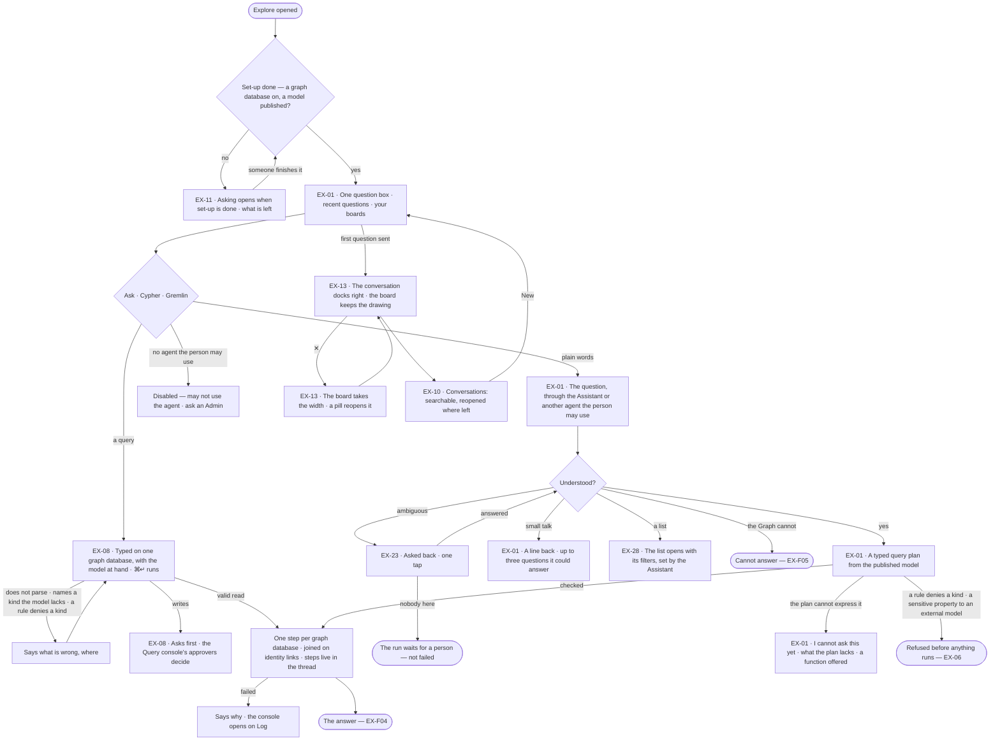
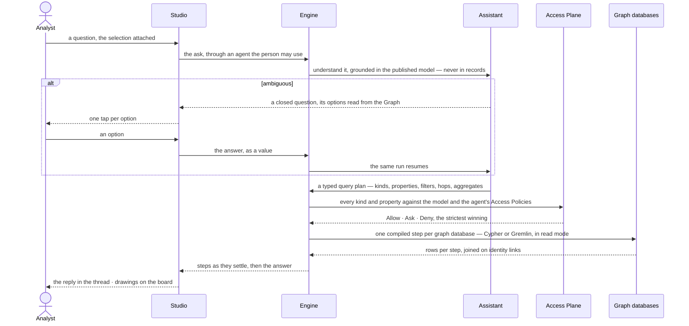

# Ask a question

> How a person puts a question to the Graph — every graph database, stitched — in plain words to the Assistant beside
> their work, or as a query they type themselves through the Query console; and gets asked back rather than guessed
> for. A question in words becomes a **typed query plan** written from the published model, checked against the model
> and the agent's Access Policies, and run one step per graph database in its own language — so the answer they decide
> on is to the question they meant, read only where the agent may read.
> The decision it helps make: *is this the question I mean to ask?*

## User journey

Journeys this feature is a step of: [J01 · From a fresh deployment to a first answer](../../../../journeys/J01-from-a-fresh-deployment-to-a-first-answer.md) · [J02 · Ask and trust the answer](../../../../journeys/J02-ask-and-trust-the-answer.md) · [J05 · Join a team](../../../../journeys/J05-join-a-team.md)

## Stories

| ID | Story | Status |
|---|---|---|
| EX-11 | [Know what opens asking](stories/EX-11-know-what-opens-asking/story.md) | idea |
| EX-01 | [Ask in plain words](stories/EX-01-ask-in-plain-words/story.md) | idea |
| EX-08 | [Write the query myself](stories/EX-08-write-the-query-myself/story.md) | idea |
| EX-23 | [Be asked back, not guessed for](stories/EX-23-be-asked-back-not-guessed-for/story.md) | idea |
| EX-13 | [The assistant beside the work](stories/EX-13-the-assistant-beside-the-work/story.md) | idea |
| EX-10 | [Pick up a conversation](stories/EX-10-pick-up-a-conversation/story.md) | idea |
| EX-28 | [The assistant opens a list](stories/EX-28-the-assistant-opens-a-list/story.md) | idea |

## Access

Who may do what is the [role table](../../../../os/access/features/AC-F02-access-policies/feature.md#the-role-table):
*Ask a question* is *Acts* for Operator, Modeller and Admin — within the agents the person may use
([AC-F03](../../../../os/access/features/AC-F03-directory/feature.md)) and those agents' Access Policies
([AC-F02](../../../../os/access/features/AC-F02-access-policies/feature.md)). A question reads only what the agent it
runs through may read.

| Act | Who | Everyone else sees |
|---|---|---|
| Ask in plain words · answer a question asked back | Anyone, through an agent they may use — the Assistant by default | No agent they may use: the composer disabled — *{person} may not use {agent} — ask an Admin* |
| Type a Cypher or Gremlin query | Anyone who may use the Query console | The query kinds disabled — *{person} may not use Query console — ask an Admin* |
| Write to a graph database from the composer | A typed write through the Query console asks first: its named approvers decide ([AC-F05](../../../../os/access/features/AC-F05-asks-and-approvals/feature.md)); the person's role must hold *Edit on the board* (Modeller · Admin) and the graph database must be read + write | An Operator: refused — *Edit on the board needs the Modeller role.* A read-only graph database: *{name} is read-only — {why}.* |
| Open, search, reopen, start, rename, pin, archive and delete their own conversations · pick the conversation's agent | The person who started it | Another person's conversations are not listed; an Admin reads their runs in Control Plane › Runs ([CP-F10](../../../../os/control/features/CP-F10-runs-and-how-the-agents-are-doing/feature.md)) |
| Read a conversation's content | The person who started it, those an answer in it is shared with ([EX-15](../EX-F02-share-and-present-an-answer/stories/EX-15-share-an-answer/story.md)) and Admins — run privacy | That it ran, its status and its tokens; content withheld |
| Set a conversation's token budget per run | The person who started it, up to the agent's own | Above the agent's: clamped, and the settings say so |
| Switch the Assistant off for themselves | Anyone, per browser | — |
| Have the Assistant open a list | Anyone; what it counts and opens is what the asker may read | Names it cannot resolve under the asker's rights are said as not found |
| Finish set-up — connect a graph database, publish a model — which opens asking | An Admin connects ([CP-F05](../../../../os/control/features/CP-F05-graph-databases/feature.md)); a Modeller or an Admin publishes ([SE-F02](../../../semantics/features/SE-F02-change-and-publish-a-model/feature.md)) | The lock with *Ask an Admin* in place of the step's act |

## States

| State | What the person sees |
|---|---|
| First use | A deployment never asked anything: one question box — *What do you want to know?* — and the deployment's line, nothing invented under it. Before set-up is done: the lock alone |
| Empty after a filter | A search of conversations that matches none: *No conversation matches "late orders"* · *Clear* |
| Loading | The reply is the run's live steps; the board stays usable; elapsed time and *Cancel* on a slow query |
| Has data | The conversation docked right, its turns in order, each naming the graph databases its plan read |
| Failed | The reply says why in a sentence and the next act; a failed query opens the console on Log; the board is untouched |
| Agent working or proposing | The agent working through its steps, asking back with options to tap, or a typed write waiting on its approvers |
| No access | No agent the person may use: the composer disabled, naming the agent and *ask an Admin*; a question a rule refuses says which rule; the lock without the right to finish set-up offers *Ask an Admin* |

## Rules

| Rule | Detail |
|---|---|
| One assistant | One surface on the right of every mode — Explore, Model, Projects, and over Agents — the same thread and composer. Not a page, not a drawer: it moves the work over, never covers it |
| The open surface is the context | Asking from a board asks about its selection; from Model about the model; from a task about the task. The assistant does not change, what it carries does |
| The attachment is in words | What is attached is named in the composer, removable before asking, and goes into the question as words, so the thread records what was asked |
| Through an agent the person may use | Every question runs as one agent — the Assistant by default, or another the person may use ([AG-F02](../../../agents/features/AG-F02-the-agents-catalogue/feature.md)); a typed query runs as the Query console. The agent's Access Policies decide what the question may read |
| One question, one run | A follow-up is its own run in the same conversation; the last 20 turns go with it, so *only the top 5* means something. Nothing reaches an AI model or a graph database outside a run of a plan ([AG-F06](../../../agents/features/AG-F06-plans-and-workflows/feature.md)) |
| Recall before planning | The plan step reads what the thinking graph recalls for this intent — what served and what to avoid ([AG-F09](../../../agents/features/AG-F09-thinking-graph-and-memory/feature.md)); a conversation itself carries no memory beyond its last 20 turns |
| A typed query plan, never a raw query | The agent's AI model writes a typed query plan — kinds, properties, filters, hops, aggregates — from the published model, never from records. The engine validates it against the model and the agent's Access Policies, then compiles one step per graph database in its own language. The AI model never writes Cypher or Gremlin |
| Across graph databases | A question is asked of the Graph, not of one database: a plan whose kinds live in several graph databases runs one step in each and joins the steps' rows on identity links ([SE-F06](../../../semantics/features/SE-F06-links-and-mappings/feature.md)). No record is copied between them |
| A gap is said, never patched | A question the plan grammar cannot express is answered *I cannot ask this yet*, naming what the plan lacks, and offers a function from the catalogue that does it — or, when none does, *Write the query myself* for a person who may use the Query console. The agent never runs a query it wrote outside the grammar |
| Checked before it runs | A kind, relationship or property the published model lacks, a Deny on `data/<graph database>/<kind>`, a graph database switched off or down, or a sensitive property bound for an external model ends the run as refused before any step reads ([EX-06](../EX-F05-when-it-cannot-answer-and-how-it-reasons/stories/EX-06-a-refusal-or-a-failure-that-says-why/story.md)); an Ask waits on the agent's named approvers |
| Grounded in the published model | A question is read against the published model, its descriptions and its identity links; a kind the model lacks is never named in a plan |
| Asked back, never assumed | An ambiguous question becomes a closed question with grounded options; only a person answers it |
| Reads read | Every step of a question runs in the driver's read mode or Gremlin's `ReadOnlyStrategy` ([CP-F05](../../../../os/control/features/CP-F05-graph-databases/feature.md)). Only a typed query through the Query console may write, and it asks first |
| The ask kind | One switch in the composer: Ask · Cypher · Gremlin. A query names its graph database, and the kinds offered are the languages that database speaks. In a query ⌘↵ runs and ↵ is a newline; in Ask ↵ sends. The keys are named in the status bar |
| Small talk is answered | *Thanks*, *what can you do?* get a line or two in the agent's voice, never *cannot answer*; it claims nothing about the data |
| Closing never cancels | A run goes on while the assistant is closed and is read in the thread on reopening |
| The user menu's two switches are per browser | *Assistant* (on by default) and *Tools always shown* (off by default — on starts the board's manual tools on, rather than off until *Tools* is pressed) are kept in the browser, not on the account; where the browser keeps nothing, each reads its default. The theme sits in the same menu |
| Off is the person's | The user menu's *Assistant* switches it off in every mode, per browser: no header button, no docked thread, no pill, no *Ask the Assistant* in ⌘K, no *Ask about* on a record |
| Leans on | The published model and its descriptions (SE-F02) · identity links (SE-F06) · sensitive properties (SE-F03) · AI models, local or external (CP-F01) · graph databases and their modes (CP-F05) · agents, the catalogue and the built-in agents (AG-F01 · AG-F02) · plans and the function catalogue (AG-F06) · the thinking graph (AG-F09) · Access Policies (AC-F02) · runs and run privacy (CP-F10) · the ledger (AC-F09) · EX-F01 — the board and the console · EX-F04 — the answer · EX-F05 — cannot answer and refusals |

## Data touched

| Record | Read or write |
|---|---|
| Conversation — title, agent, token budget per run, pinned, archived | Read · write |
| Turn — the question, its attachment in words, its ask kind, its typed query plan or typed query, the run it started | Write · read |
| Run — its steps, the plan's compiled step per graph database, a question asked back and the answer to it | Write · read ([CP-F10](../../../../os/control/features/CP-F10-runs-and-how-the-agents-are-doing/feature.md)) |
| The published model, its descriptions, identity link rules and sensitive properties | Read |
| Records — the option rows of a question asked back, the counts behind a list | Read, under the agent's Access Policies |
| Lists — Runs · Agents · Inbox › Needs you · Inbox › History — and their filters | Read |
| Ledger rows — every call to an AI model and a graph database | Write, by the engine ([AC-F09](../../../../os/access/features/AC-F09-what-left-the-platform/feature.md)) |

## Engine

The low-level design: what this feature stores, serves and refuses. Conventions — naming, errors, lists, events — are
[system-design.md](../../../../system-design.md) §§ 6–8; this section only fills them in. This feature is the home of
the typed query plan ([system-design § 10](../../../../system-design.md#10-ai-and-agents)).

### Records

| Table | Columns | Notes |
|---|---|---|
| `explore_sessions` | `created_by_id` · `surface` · `agent_id?` · `max_tokens_run?` · `title` · `pinned` · `archived` · `message_count` · `node_count` · `edge_count` · `last_status` · `forked_from_session_id?` · `forked_from_message_id?` · `forked_seq?` | A conversation, the asker's. The three fork columns are EX-27's ([EX-F05](../EX-F05-when-it-cannot-answer-and-how-it-reasons/feature.md#engine)), both links `ON DELETE SET NULL` |
| `explore_session_messages` | `session_id` · `seq` · `role` (`user` · `assistant`) · `content` · `status` · `operation?` (`load` — a draw the system asked for) · `mode` (`ask` · `cypher` · `gremlin`) · `via?` (what was attached, in words) · `graph_database?` (a typed query's) · `source_query?` (a typed query as written) · `query_plan?` (the typed query plan) · `compiled?` (`[{graph_database, language, query}]`) · `canvas_plan?` · `plan_gap?` (`{lacks, offered[]}`) · `rationale` · `clarification_options` · `clarification_descriptions` · `row_count` · `node_count` · `edge_count` · `run_id` | A turn. Unique (`session_id`, `seq`). Exactly one of `query_plan` · `source_query` on a turn that read |

### Reads

| Record | Owner |
|---|---|
| Runs, their steps, stream frames and prompts (`control_run_prompts` — a question asked back) · run privacy | [CP-F10](../../../../os/control/features/CP-F10-runs-and-how-the-agents-are-doing/feature.md#engine) |
| An agent — its budget, `max_tokens_run`, `max_clarifications` · the default agent (the Assistant) · the built-in agents | [AG-F01](../../../agents/features/AG-F01-build-an-agent/feature.md#engine) · [AG-F02](../../../agents/features/AG-F02-the-agents-catalogue/feature.md#engine) |
| Which agents the person may use | [AC-F03](../../../../os/access/features/AC-F03-directory/feature.md#engine) |
| `decide(agent, person, verb, resource)` — every kind of a plan, every Write of a typed query | [AC-F02](../../../../os/access/features/AC-F02-access-policies/feature.md#engine) |
| The built-in workflows `nl-single` · `ql-direct` · `board-open`, the function catalogue and the plan check | [AG-F06](../../../agents/features/AG-F06-plans-and-workflows/feature.md#engine) |
| Recall — what served and what to avoid for an intent | [AG-F09](../../../agents/features/AG-F09-thinking-graph-and-memory/feature.md#engine) |
| Published model versions — kinds, relationship kinds, properties, descriptions, which graph database holds each kind | [SE-F02](../../../semantics/features/SE-F02-change-and-publish-a-model/feature.md#engine) |
| Identity link rules and the links materialised in the system graph | [SE-F06](../../../semantics/features/SE-F06-links-and-mappings/feature.md#engine) |
| Sensitive properties | [SE-F03](../../../semantics/features/SE-F03-meaning/feature.md#engine) |
| AI models and their local or external mark | [CP-F01](../../../../os/control/features/CP-F01-ai-models/feature.md#engine) |
| Graph databases — language, mode, switches, health · set-up | [CP-F05](../../../../os/control/features/CP-F05-graph-databases/feature.md#engine) |
| The sensitive check and a ledger row per call | [AC-F09](../../../../os/access/features/AC-F09-what-left-the-platform/feature.md#engine) |
| The board a conversation draws on | [EX-F01 › Engine](../EX-F01-the-board-and-its-canvas/feature.md#engine) |
| A `prompt` projection template that draws a question asked back | [EX-F04 › Engine](../EX-F04-the-answer/feature.md#engine) |

### Routes

| Route, after `/api/v1/explore` | Does | Story |
|---|---|---|
| `GET /sessions` · `POST /sessions` | The asker's conversations — `archived` · `surface` · `agent` · `sort` · start one, with an optional first ask | EX-10 · EX-01 |
| `GET /sessions/{session}` · `PATCH /sessions/{session}` · `DELETE /sessions/{session}` | Open · rename, pin, archive, set its agent or tokens per run · delete it and its turns | EX-10 |
| `POST /sessions/{session}/messages` | Ask, in words (`mode = ask`) or as a typed query (`mode` · `graph_database` · `source_query`); answers the question asked back when one waits | EX-01 · EX-08 · EX-23 |
| `POST /sessions/{session}/operations` | Log a *Load to canvas* turn | EX-02 |
| `POST /sessions/{session}/messages/{message}/run` | Re-run a reply as a new run | EX-14 |
| `GET /sessions/{session}/messages/{message}/context` | What the AI model was given for a turn, and the plan it wrote | EX-04 |

### Events

| Event | When |
|---|---|
| `explore.sessions.create` · `explore.sessions.update` · `explore.sessions.delete` | A conversation is started · changed · deleted |
| `explore.plans.write` | A question in words becomes a typed query plan — kinds, graph databases, the plan's hash |
| `explore.plans.gap` | A plan cannot express a question — what it lacks, what was offered |

### Refusals

| Status | When | Sentence | Criterion |
|---|---|---|---|
| 404 | Another person's conversation, its turns or their context, read by anyone but its asker, those it is shared with and Admins | *Not found.* | EX-10.13 |
| 409 `setup_incomplete` | An ask before set-up is done — CP-F05's gate | *Asking opens when {step}.* | EX-11.6 |
| 403 | An ask through an agent the person may not use | *{person} may not use {agent} — ask an Admin.* | EX-10.11 · EX-10.23 · EX-08.16 |
| 422 | An ask through an agent whose policies allow Read on no kind of the published model; never re-routed | *{agent} cannot read the Graph — pick another agent for this conversation.* | EX-10.18 |
| 422 | A typed query in a Model conversation | *A Model conversation authors a model — ask in words.* | API only — Studio's Model composer offers no query kind |
| 422 | A typed query naming a kind or property the model lacks, or one that does not parse | *{name} is not in the model — it has {kinds}.* · *{the parser's message}, at {line}:{column}.* | EX-08.5 · EX-08.4 |
| 422 | A typed query in a language its graph database does not speak | *{graph database} speaks {language}.* | API only — Studio offers only its languages (EX-08.1) |
| refused | A plan naming a kind, relationship kind or property the published model lacks, still invalid after its one repair — never run | *The plan names {name}, which the model does not have.* | EX-01.13 |
| refused | A plan reading a kind the agent's policies deny — before compile | *{agent} may not Read data/{graph database}/{kind} — {rule} on {policy}, set by {person}.* | EX-06.1 · EX-08.15 |
| refused `plan_gap` | A question the plan grammar cannot express; outcome `cannot_answer`, never a raw query | *I cannot ask this yet — a plan cannot {what it lacks}.* | EX-01.16 |
| refused | A plan needing a graph database switched off, or one that does not answer | *{name} is off — switched off by {person} {when}.* · *{name} is not answering.* | EX-01.18 |
| 403 | A typed write by a person whose role does not hold *Edit on the board* | *Edit on the board needs the Modeller role.* | EX-08.13 |
| 409 | A typed write to a read-only graph database | *{name} is read-only — {why}.* | EX-08.14 |
| 403 | An agent answers a question asked back | *Only a person answers a question asked back.* | EX-23.11 |

### CLI

| Command | Does |
|---|---|
| — | No command of its own |

### Mechanisms

| Mechanism | How |
|---|---|
| A conversation is a thread of runs | Each ask opens one root run, `triggered_by = user`, the asker the person behind it; the turn keeps its `run_id`. A conversation never runs and has no outcome |
| The agent that answers | A conversation's `agent_id`, else the deployment's default agent (the Assistant). A typed query runs as the Query console whatever the conversation's agent. The agent is never swapped for another when it cannot read |
| Tokens per run | Stored as `min(asked, the agent's max_tokens_run)`; the run freezes the same `min`; the conversation's read carries the agent's cap so Studio can say it was clamped |
| The question's steps | The built-in workflow `nl-single`: `understand` → `plan` → `check` → `compile` → `execute` (one lane per graph database) → `join` → `project` → `verify`, each streaming its state and its parts as they arrive. How a step ends a run is [EX-F05 › Engine](../EX-F05-when-it-cannot-answer-and-how-it-reasons/feature.md#engine); `project` and `verify` are [EX-F04 › Engine](../EX-F04-the-answer/feature.md#engine) |
| The typed query plan | `{targets[{alias, kind}], hops[{from, relationship, to, direction (out · in · both), min (1), max (≤ 4)}], filters[{alias, property, op (= · != · < · <= · > · >= · in · contains · starts_with · exists · not_exists), value? \| argument?}], returns[{alias, property?}], aggregates[{fn (count · sum · avg · min · max · collect), alias, property?, as}], group_by[], order_by[{field, dir}], limit (≤ 10,000, default 100), distinct, arguments[{name, type, value}]}`. Every name is a kind, relationship kind or property of the published model; every literal from the question is an argument, never spliced into a query |
| Validate | The engine checks every alias, kind, relationship kind and property against the published model version; resolves which graph database holds each kind; then calls `decide()` with Read on `data/<graph database>/<kind>` for each pair, the strictest winning — a Deny refuses before compile, an Ask parks the run on the agent's named approvers. Validating and compiling take ≤ 50 ms p95 (NFR-PERF-6) |
| Compile | Per graph database, the connector's compiler turns its share of the plan into one query in its language — Cypher or Gremlin — with the arguments as parameters; never through an AI model. The compiled step is kept on the turn's `compiled` and on its step |
| Join on identity links | A plan spanning graph databases runs the step that narrows most first; the record IDs it returns are mapped through the identity links in the system graph to the next database's records, which bound the next step. At most 1,000 rows a step cross a join; more says it is a sample. The join adds ≤ 200 ms p95 (NFR-PERF-6) |
| The plan gap | `understand` or `plan` returns `plan_gap {lacks, offered[]}` when the question needs what the grammar has no form for — a shortest path, a hop deeper than 4, a graph algorithm, full-text scoring, a subquery, a write. `offered` lists the catalogue's functions the agent may run that do it (AG-F06), each runnable from the reply; with none, the reply offers *Write the query myself* to a person who may use the Query console. The run settles `cannot_answer` with `cannot.kind = plan_gap` |
| The grounding block | Every AI-model step gets one: the published model's kinds, unioned across graph databases, and the identity links. Node kind: `(:Customer) — description` · relationship kind: `[:PLACED] (Customer)->(Order) — description` · property: `placed_at:datetime (description)` inside its kind · identity link: `crm.Customer.email ≡ sales.Customer.email`. A kind or property every rule reaching the agent denies is not listed; a kind the model lacks never is |
| What reaches the AI model | Writing the plan is a schema-only call: the question, the grounding block and the last 20 turns' questions and plans — never a record. Writing the answer's words is data-bearing ([EX-F04](../EX-F04-the-answer/feature.md#engine)). Every call is a ledger row ([AC-F09](../../../../os/access/features/AC-F09-what-left-the-platform/feature.md#engine)) |
| The history sent | The last 20 turns: each ask, and the plan that answered it. Rows are never sent; a `load` turn is skipped |
| Every exchange is recorded | An answer, a cannot answer and a question asked back each keep their prompt and completion on the step |
| The understood intent | `kind` · `summary` · `refs` · `expects` · `confidence` · `prefer` (`graph` · `table` · `chart` · empty) · `needs_outside` · `what_if` |
| Understanding ends five ways | `understood` · `clarify` · `cannot_answer` · `plan_gap` · `converse`. `converse` carries the reply and up to three questions it could answer, and the run settles `served` with outcome `conversed` and no answer part; a converse with no reply fails the step |
| The canvas twin | `plan` returns `query_plan` and `canvas_plan` — the same filter, order and limit returning whole records — or none when the rows are not things. *Load to canvas* asks the twin as a `load` turn |
| A typed query | The built-in workflow `ql-direct`, as the Query console: parse in the graph database's language; every label and property against the published model; `decide()` Read on each kind; a write clause matched as words — never substrings, never inside a literal — makes the step a Write on each kind it names, which the Query console's policy sets to Ask; the run waits on its approvers, then runs on a read + write graph database only. Every query it runs is a ledger row |
| Asked back | `understand` loops, each round an iteration of the same step of the same run, bounded by `max_clarifications`. The question is a `control_run_prompts` row (`kind = clarification`, `options`, who answered, `answer`, `answered_at`); option descriptions ride beside the options, `""` where the label says enough, and are kept on the turn |
| Options read under the agent's policies | An options plan is checked and run like any plan of the run and recorded; a refusal or a failure falls back to the fixed options |
| A parked run | The run waits with its context; nothing expires a question asked back. A `clarification.requested` frame — `question` · `options` · `option_descriptions` · `round` · the assistant's message — ends the stream until the answer resumes the same run |
| An ask for a list | `understand` classifies it `open_list`; `refs` carries the words as `<key>: <words>` pairs — keys `list` · `agent` · `status` · `since` · `started_by` · `origin` · `verdict`. The lists are `runs` · `agents` · `approvals` · `history`; any other list is answered as an ordinary question. The intent maps to the built-in workflow `board-open` |
| `board.open` | The function a `board-open` run calls. In: `{list, filters}` in words. Out: `{path, params, chips[{field, title, value, label}], total, unresolved[]}` and the id of the `link` part it emits. Names resolve to ids under the asker's rights; a word that does not resolve is an `unresolved` row with its reason, said in the reply, and the link carries the rest. `total` is the list's own count |

## System impact

| HLD section | Change | NFRs |
|---|---|---|
| § 6 Data and storage | Two tables in Postgres; no new store | — |
| § 8 APIs and events | The routes and events above, under `explore` | — |
| § 10 AI and agents | The typed query plan — written from the model, validated against the model and the agent's Access Policies, compiled per graph database, joined on identity links; the plan gap; one grounding block per AI-model step; a parked run that waits on a person; the `board.open` function | NFR-SEC-5 · NFR-PERF-6 |
| § 12 Qualities | Privacy: writing a plan is schema-only; records reach an AI model only in the answer step, never a sensitive property to an external one | NFR-SEC-8 |

## Decisions

| Decision | Detail |
|---|---|
| It starts centred | With no conversation open the board is one question box on the dotted ground — no strip, no tabs — headed *What do you want to know?* and the deployment's line. Under it: the person's three most recent distinct questions, each asked again in one click, and *Your boards* — their kept boards, pinned first. A deployment never asked anything shows the box alone |
| It docks right | The first question moves the conversation to the right; the board keeps the drawing. Docked with nothing drawn, the board is the empty ground — one question box on screen, never two |
| The header | The assistant's mark · the agent's name · the open conversation's title, then Conversations · settings · ✕. It opens 440 px wide, no narrower than 320 |
| Closing is reversible from two places | The header's *Assistant* button, and a pill over the board — *Assistant · <conversation title>* — while a conversation is open and the assistant is not |
| The right side has no memory | Opening the assistant replaces what was on the right; closing it closes the region |
| Every composer control is one inline select | Ask kind (with the graph database for a query) and agent share one trigger and one menu; the token budget per run is in the conversation's settings, not a menu |
| No model picker | The agent names which AI model answers; the composer never offers one |
| A conversation has its own address | Opening, starting or leaving a conversation rewrites the Explore address in place, without redrawing the board; a reload or a shared link reopens the conversation with its answer. Crumbs: *Explore › Conversations › <title>* |
| New is a blank thread | *New* in the header and in the history shows a blank thread with the composer focused on a question; no conversation exists until the first question |
| Archiving hides, deleting removes | An archived conversation leaves the list and comes back with *Show archived*. Deleting removes the conversation and its turns; its runs stay in Control Plane › Runs and its forks stay whole |
| A question asked back waits | Nobody answering parks the run as waiting, never failed and never expired; answering resumes the same run |
| Options are described only when the label is not enough | Each option is one line; a second line only where the person would be unsure which to pick. Options read from the Graph are their own label |
| A list opens through its own filters | The assistant sets the same filters a person would; the list reads, reloads and clears like any other, and counts with its own query |
| The plan is the AI model's only query | The AI model writes a typed plan or nothing; compiling is code. A person who wants a query the grammar cannot express types it in the Query console, where it is theirs and ledgered |
| Lock | Until set-up is done, Explore is the lock alone: *Asking opens when {step}*, what is left, and the act that does it |

## Open questions

| Question | Who answers |
|---|---|
| The assistant opening a list (EX-28) is planned in the engine and Studio but not built. Keep it in Explore, or move it to Agents with the lists it opens? Recommend: keep it here — it is the assistant's act, the lists are only its targets | Ravi |

## Not building

| Item | Why not |
|---|---|
| A separate chat page · an assistant per surface with its own memory | One surface, or people learn two |
| A raw query written by an AI model | A typed plan is checked before it runs; what it cannot express is said so |
| The assistant writing to a graph database | It asks; writes are Edit on the board (EX-F06), a typed write through the Query console, and loads (RC-F02) |
| A model picker in the composer | The agent names the model |
| A saved-query library | A conversation keeps its queries; a schedule makes one recurring |
| Query formatting or linting beyond checking it | The editor is for asking, not for authoring code |
| Translating a typed query between languages | A typed query runs on one graph database, in its language; a question across databases is asked in words |
| Copying records between graph databases to answer a question | Stitched, never copied: the engine joins on identity links |
| Free-text answers to a question asked back by default | A closed answer stores a value; prose stores a guess |
| An agent answering a question asked back | That is assuming, with extra steps |
| Expiring an unanswered question | The run shows it is waiting; a silent timeout hides work |
| Follow-up questions the model invents after an answer | A follow-up is the person's move; a reply offers only what its result allows (EX-F04) |
| The assistant composing new boards | It opens the lists and boards that exist, with filters |
| Parameters on a typed query | A query is asked as written; the same query with other values is another question, and a recurring one is a schedule |
| A skill picker in the composer | An agent's skills are offered to its steps; the composer offers the ask kind, the agent and *Act as* |
| Rating a reply up or down | Whether an answer holds is read from its trace; marking thinking good or bad is the thinking graph's (AG-F09) |
