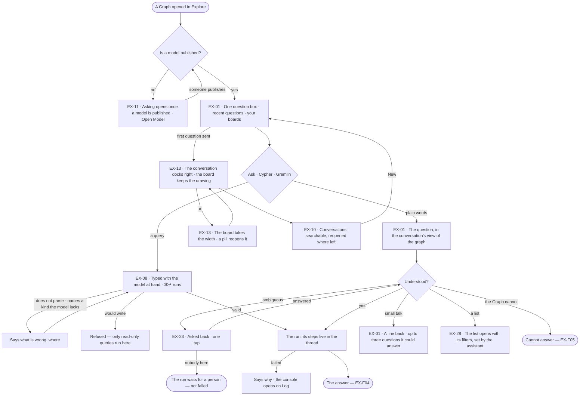
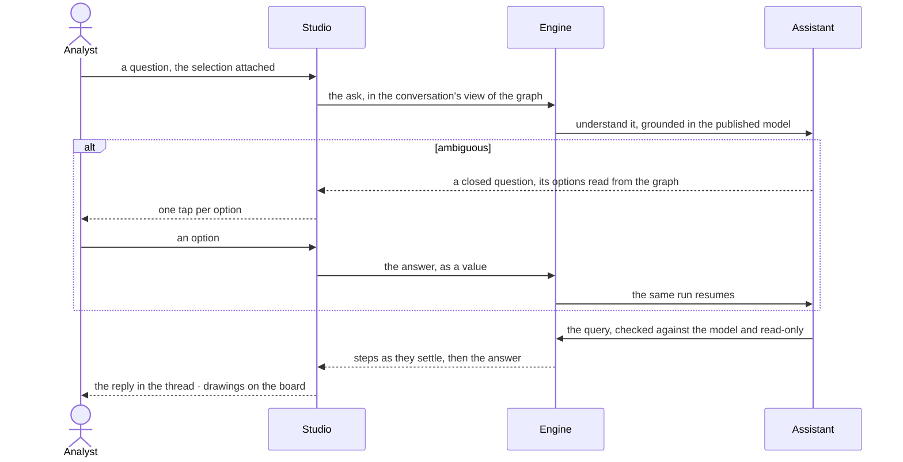

# Ask a question

> How a person puts a question to the Graph — in plain words to the one assistant beside their work, or as a query
> they type themselves — and gets asked back rather than guessed for, so the answer they decide on is to the question
> they meant.
> The decision it helps make: *is this the question I mean to ask?*

## User journey

Journeys this feature is a step of: [J01 · From an empty install to a first answer](../../../../journeys/J01-from-an-empty-install-to-a-first-answer.md) · [J02 · Ask and trust the answer](../../../../journeys/J02-ask-and-trust-the-answer.md) · [J05 · Join a Graph someone set up](../../../../journeys/J05-join-a-graph-someone-set-up.md)

## Stories

| ID | Story | Status |
|---|---|---|
| EX-11 | [Know what opens asking](stories/EX-11-know-what-opens-asking/story.md) | idea |
| EX-01 | [Ask in plain words](stories/EX-01-ask-in-plain-words/story.md) | idea |
| EX-08 | [Write the query myself](stories/EX-08-write-the-query-myself/story.md) | idea |
| EX-23 | [Be asked back, not guessed for](stories/EX-23-be-asked-back-not-guessed-for/story.md) | idea |
| EX-13 | [The assistant beside the work](stories/EX-13-the-assistant-beside-the-work/story.md) | idea |
| EX-10 | [Pick up a conversation](stories/EX-10-pick-up-a-conversation/story.md) | idea |
| EX-28 | [The assistant opens a list](stories/EX-28-the-assistant-opens-a-list/story.md) | idea |

## Access

| Act | Role (`.claude/team/TEAM.md` §7) | Everyone else sees |
|---|---|---|
| Ask in plain words · type a query · answer a question asked back | Operator — every member | A non-member: the Graph's not-found page |
| Open, search, reopen and start conversations of their own | Operator — every member | Another member's conversations are not listed |
| Pick a view of the graph for a conversation or one question | Operator — every member | A view whose version is not published: disabled with its reason |
| Set a conversation's token budget per run | Operator — every member, up to the agent's own | Above the agent's: clamped, and the settings say so |
| Switch the assistant off for themselves | Operator — every member, per browser | — |
| Have the assistant open a list | Operator — every member; what it counts and opens is what the asker may read | Names it cannot resolve under the asker's rights are said in the reply |
| Write to the graph from the composer | Nobody — only read-only queries run here | *That query would write to the graph — only read-only queries run here*; writes are Edit mode (EX-F06) |
| Publish the first model, which opens asking | `modeller` · shown as *Can shape the model* | The lock with *Ask Priya (owner)* in place of *Open Model* |

## States

| State | What the person sees |
|---|---|
| First use | A Graph never asked anything: one question box — *What do you want to know about airways?* — and the Graph's line, nothing invented under it. Before a model is published: the lock alone |
| Empty after a filter | A search of conversations that matches none: *No conversation matches "fuel"* · *Clear* |
| Loading | The reply is the run's live steps; the board stays usable; elapsed time and *Cancel* on a slow query |
| Has data | The conversation docked right, its turns in order, each tagged with the view of the graph it ran in |
| Failed | The reply says why in a sentence and the next act; a failed query opens the console on Log; the board is untouched |
| Agent working or proposing | The assistant working through its steps, or asking back with options to tap |
| No access | Every member asks; the lock without the grant offers *Ask Priya (owner)*; a refused query says why |

## Rules

| Rule | Detail |
|---|---|
| One assistant | One surface on the right of every mode — Explore, Model, Projects, and over Agents — the same thread and composer. Not a page, not a drawer: it moves the work over, never covers it |
| The open surface is the context | Asking from a board asks about its selection; from Model about the model; from a task about the task. The assistant does not change, what it carries does |
| The attachment is in words | What is attached is named in the composer, removable before asking, and goes into the question as words, so the thread records what was asked |
| One question, one run | A follow-up is its own run in the same conversation; the last 20 turns go with it, so *only the top 5* means something |
| Grounded in the published model | A question is read against the published models, their descriptions and the links between them; a kind the model lacks is never named in a query |
| A view of the graph bounds it | The conversation's view of the graph decides what the assistant may see and send; what it leaves out is never described to the model, so the answer is *cannot answer*, not a refusal |
| Asked back, never assumed | An ambiguous question becomes a closed question with grounded options; only a person answers it |
| Read-only | Every query from the composer, typed or written by the assistant, reads only; a write clause is refused before it runs, and a word like *offset* or *dataset* is not mistaken for one |
| The ask kind | One switch in the composer: Ask · Cypher · Gremlin — only the languages the connection speaks. In a query ⌘↵ runs and ↵ is a newline; in Ask ↵ sends. The keys are named in the status bar |
| Small talk is answered | *Thanks*, *what can you do?* get a line or two in the agent's voice, never *cannot answer*; it claims nothing about the data |
| Closing never cancels | A run goes on while the assistant is closed and is read in the thread on reopening |
| Off is the person's | The user menu's *Assistant* switches it off in every mode, per browser: no header button, no docked thread, no pill, no *Ask the assistant* in ⌘K, no *Ask about* on a record |
| Leans on | Model — the published model every question is grounded in · Settings › AI models — an LLM to understand plain words · EX-F01 — the board answers draw on and the console · EX-F04 — the answer · EX-F05 — cannot answer and refusals |

## Data touched

| Record | Read or write |
|---|---|
| Conversation — title, its view of the graph, its token budget per run | Read · write |
| Turn — the question, its attachment in words, the run it started | Write |
| Run — its steps, its queries, a question asked back and the answer to it | Write · read |
| The published models, their descriptions and the links between them | Read |
| Graph records — the option rows of a question asked back, the counts behind a list | Read, under the conversation's view of the graph |
| Lists — Runs · Agents · Inbox › Needs you · Inbox › History — and their filters | Read |

## Decisions

| Decision | Detail |
|---|---|
| It starts centred | With no conversation open the board is one question box on the dotted ground — no strip, no tabs — headed *What do you want to know about airways?* and the Graph's line. Under it: the person's three most recent distinct questions, each asked again in one click, and *Your views* — their kept boards, pinned first. A Graph never asked anything shows the box alone |
| It docks right | The first question moves the conversation to the right; the board keeps the drawing. Docked with nothing drawn, the board is the empty ground — one question box on screen, never two |
| The header | The assistant's mark · *Assistant* · the open conversation's title, then Conversations · settings · ✕. It opens 440 px wide, no narrower than 320 |
| Closing is reversible from two places | The header's *Assistant* button, and a pill over the board — *Assistant · <conversation title>* — while a conversation is open and the assistant is not |
| The right side has no memory | Opening the assistant replaces what was on the right; closing it closes the region |
| The view of the graph is set in the composer | Between the ask kind and the agent. It reads the open conversation's view; picking one sets it for the conversation, or with *Next ask only* for one question. A new conversation starts in *Everything*. Each turn is tagged with the view it ran in |
| Every composer control is one inline select | Ask kind, view of the graph and agent share one trigger and one menu; the token budget per run is in the conversation's settings, not a menu |
| No model picker | The view of the graph names which AI model answers; the composer never offers one |
| A conversation has its own address | Opening, starting or leaving a conversation rewrites the Explore address in place, without redrawing the board; a reload or a shared link reopens the conversation with its answer. Crumbs: *airways ▾ › Conversations › <title>* |
| New is a blank thread | *New* in the header and in the history shows a blank thread with the composer focused on a question; no conversation exists until the first question |
| A question asked back waits | Nobody answering parks the run as waiting, never failed and never expired; answering resumes the same run |
| Options are described only when the label is not enough | Each option is one line; a second line only where the person would be unsure which to pick. Options read from the graph are their own label |
| A list opens through its own filters | The assistant sets the same filters a person would; the list reads, reloads and clears like any other, and counts with its own query |
| Lock | Until a model is published, Explore is the lock alone: *Asking opens once a model is published*, what is true now, and *Open Model* |

## Open questions

| Question | Who answers |
|---|---|
| The assistant opening a list (EX-28) is planned in the engine and Studio but not built. Keep it in Explore, or move it to Agents with the lists it opens? Recommend: keep it here — it is the assistant's act, the lists are only its targets | Ravi |

## Not building

| Item | Why not |
|---|---|
| A separate chat page · an assistant per surface with its own memory | One surface, or people learn two |
| The assistant writing to the graph | It asks; writes are Edit mode (EX-F06) and loads (Data) |
| A model picker in the composer | The view of the graph names the model |
| A saved-query library | A conversation keeps its queries; a schedule makes one recurring |
| Query formatting or linting beyond checking it | The editor is for asking, not for authoring code |
| Translating a query between languages | The connection speaks one language; so does the editor |
| Free-text answers to a question asked back by default | A closed answer stores a value; prose stores a guess |
| An agent answering a question asked back | That is assuming, with extra steps |
| Expiring an unanswered question | The run shows it is waiting; a silent timeout hides work |
| Follow-up questions the model invents after an answer | A follow-up is the person's move; a reply offers only what its result allows (EX-F04) |
| The assistant composing new boards | It opens the lists and boards that exist, with filters |
