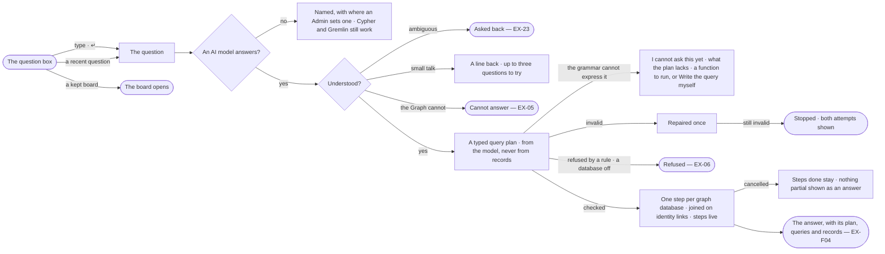

# EX-01 · Ask in plain words

**As** an analyst who knows the business but not the query language **I want** to ask the Graph plainly, from one
question box, and have the agent turn my question into a plan it checks against the model before anything runs —
across every graph database the answer needs **so that** I start by asking, not configuring, and get an answer I can
check before I act on it.

Tasks: [task.md](task.md) · Feature: [EX-F03](../../feature.md)

## Who can

| Lens | Can | Otherwise sees |
|---|---|---|
| Admin | Ask through any agent they may use, ask again from a recent question, open a kept board from the start, run a function a plan gap offers | — |
| Operator | The same, through the agents they may use; a Modeller the same ([role table](../../../../../../os/access/features/AC-F02-access-policies/feature.md#the-role-table) › *Ask a question*) | No agent they may use: the composer disabled — *{person} may not use Assistant — ask an Admin*. A function the agent may not run: offered disabled, naming the rule |

## Flow

## Acceptance criteria

| # | Given | When | Then |
|---|---|---|---|
| EX-01.1 | Set-up done and no conversation open | the person opens Explore | one question box is centred — *What do you want to know?* — with the deployment's line, their three most recent distinct questions and *Your boards*, pinned first |
| EX-01.2 | A deployment never asked anything | the person opens Explore | the box shows alone, with nothing under it |
| EX-01.3 | A recent question under the box | the person clicks it | it is asked again, as a new question |
| EX-01.4 | A question in plain words | the person sends it | the conversation docks right and the reply shows the run's steps as they settle |
| EX-01.5 | A question the model can answer | it is answered | its typed query plan names only kinds, relationship kinds and properties the published model has, and *How it got here* shows the plan and the query compiled from it for each graph database |
| EX-01.6 | A follow-up such as *only the top 5* | the person sends it | it is read with the conversation's earlier questions and plans, as its own run |
| EX-01.7 | *Thanks*, or *what can you do?* | the person sends it | a line or two comes back in the agent's voice, under *Try asking* up to three questions it could answer, never *cannot answer* and never a number from the data |
| EX-01.8 | An agent whose policies allow Read on no kind | the person makes small talk | the reply comes alone, with no questions to try |
| EX-01.9 | A question to try under a reply | the person taps it | it is asked as a new question; only the latest reply's can be tapped |
| EX-01.10 | No AI model answering | the person asks in plain words | the reply names it and where an Admin sets one; Cypher and Gremlin still run for a person who may use the Query console |
| EX-01.11 | A question across two kinds with no identity link declared between their graph databases | it is asked | the reply names the two kinds and their graph databases, and that no identity link joins them (SE-F06) |
| EX-01.12 | A run on its way | the person cancels it | the steps done stay in the thread and nothing partial is shown as an answer |
| EX-01.13 | A plan that does not validate against the model | it is repaired once and fails again | the run stops before any graph database is read — *The plan names {name}, which the model does not have.* — showing both attempts and their errors |
| EX-01.14 | An answered question | the person opens *How it got here* | it shows the steps, what the AI model was given — the model's kinds and the question, never a record — the typed plan and each compiled query |
| EX-01.15 | Questions already asked in the conversation | the person presses ↑ in an empty composer | their earlier questions come back, newest first, to edit and send |
| EX-01.16 | A question the plan grammar cannot express — a shortest path, a hop deeper than 4, a graph algorithm | it is asked | the reply reads *I cannot ask this yet — a plan cannot {what it lacks}*; no query runs and none is written for the person |
| EX-01.17 | A plan gap, and a function in the catalogue that does it | the reply shows | it offers *Run {function}*; running it opens a run of that function through the same agent and its checks. With none, it offers *Write the query myself* (EX-08) to a person who may use the Query console |
| EX-01.18 | A plan needing a graph database that is switched off, or not answering | it is checked | it is refused before anything runs, naming the graph database — *{name} is off — switched off by {person} {when}* or *{name} is not answering* |
| EX-01.19 | A question whose kinds live in two graph databases joined by an identity link | it runs | one step runs in each graph database in its own language, the rows are joined on the identity links, and the answer cites the records of both |
| EX-01.20 | The person may use no agent | they open Explore | the question box is disabled — *{person} may not use Assistant — ask an Admin*; their kept boards still open |

## Screens

| Surface | Lens | First use | Empty after a filter | Loading | Has data | Failed | Agent working or proposing | No access |
|---|---|---|---|---|---|---|---|---|
| The question box | Admin | explore.ask · Never asked | — | explore.ask · Loading | explore.ask | explore.ask · No AI model | — | — |
| The question box | Operator | explore.ask · Never asked | — | explore.ask · Loading | explore.ask | explore.ask · No AI model | — | explore.ask · No agent to ask through |
| The reply in the thread | Admin | — | — | explore.board · Working | explore.board | explore.board.cannot · Failed | explore.board · Working | — |
| The reply in the thread | Operator | — | — | explore.board · Working | explore.board | explore.board.cannot · Failed | explore.board · Working | — |
| A plan gap | Admin | — | — | — | explore.board.cannot · Plan gap | — | — | — |
| A plan gap | Operator | — | — | — | explore.board.cannot · Plan gap | — | — | explore.board.cannot · Plan gap, function not allowed |
| Small talk | Admin | — | — | — | explore.board · Small talk | — | — | — |
| Small talk | Operator | — | — | — | explore.board · Small talk | — | — | — |
