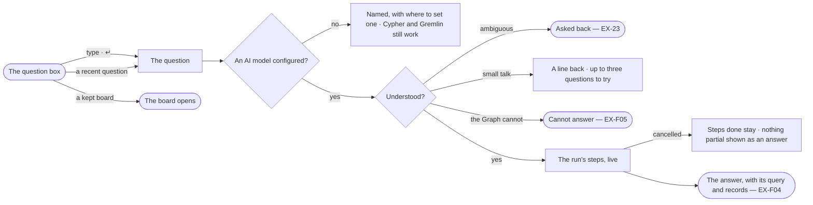

# EX-01 · Ask in plain words

**As** an analyst who knows the domain but not the query language **I want** to ask the Graph plainly, from one
question box, and have it read my question against the model **so that** I start by asking, not configuring, and get
an answer I can check before I act on it.

Tasks: [task.md](task.md) · Feature: [EX-F03](../../feature.md)

## Who can

| Lens | Can | Otherwise sees |
|---|---|---|
| Admin | Ask, ask again from a recent question, open a kept board from the start | — |
| Operator | The same — every member asks | — |

## Flow

## Acceptance criteria

| # | Given | When | Then |
|---|---|---|---|
| EX-01.1 | A Graph with a published model and no conversation open | the person opens Explore | one question box is centred — *What do you want to know about airways?* — with the Graph's line, their three most recent distinct questions and *Your views*, pinned first |
| EX-01.2 | A Graph never asked anything | the person opens Explore | the box shows alone, with nothing under it |
| EX-01.3 | A recent question under the box | the person clicks it | it is asked again, as a new question |
| EX-01.4 | A question in plain words | the person sends it | the conversation docks right and the reply shows the run's steps as they settle |
| EX-01.5 | A question the model can answer | it is answered | the query it ran names only kinds and properties the published model has |
| EX-01.6 | A follow-up such as *only the top 5* | the person sends it | it is read with the conversation's earlier questions and queries, as its own run |
| EX-01.7 | *Thanks*, or *what can you do?* | the person sends it | a line or two comes back in the agent's voice, under *Try asking* up to three questions it could answer, never *cannot answer* and never a number from the data |
| EX-01.8 | A view of the graph that shuts the graph | the person makes small talk | the reply comes alone, with no questions to try |
| EX-01.9 | A question to try under a reply | the person taps it | it is asked as a new question; only the latest reply's can be tapped |
| EX-01.10 | No AI model configured | the person asks in plain words | the reply names it and where an Admin sets one; Cypher and Gremlin still run |
| EX-01.11 | A question that spans two models with no link between them | it is asked | the reply names the two models and that no link between them is declared |
| EX-01.12 | A run on its way | the person cancels it | the steps done stay in the thread and nothing partial is shown as an answer |
| EX-01.13 | The query the assistant wrote does not check against the model | it is repaired once and fails again | the run stops, showing both attempts and their errors |
| EX-01.14 | An answered question | the person opens *How it got here* | it shows the steps, the query and what the model was given |
| EX-01.15 | Questions already asked in the conversation | the person presses ↑ in an empty composer | their earlier questions come back, newest first, to edit and send |

## Screens

| Surface | Lens | First use | Empty after a filter | Loading | Has data | Failed | Agent working or proposing | No access |
|---|---|---|---|---|---|---|---|---|
| The question box | Admin | explore.ask · Never asked | — | explore.ask · Loading | explore.ask | explore.ask · No AI model | — | — |
| The question box | Operator | explore.ask · Never asked | — | explore.ask · Loading | explore.ask | explore.ask · No AI model | — | — |
| The reply in the thread | Admin | — | — | explore.board · Working | explore.board | explore.board.cannot · Failed | explore.board · Working | — |
| The reply in the thread | Operator | — | — | explore.board · Working | explore.board | explore.board.cannot · Failed | explore.board · Working | — |
| Small talk | Admin | — | — | — | explore.board · Small talk | — | — | — |
| Small talk | Operator | — | — | — | explore.board · Small talk | — | — | — |
