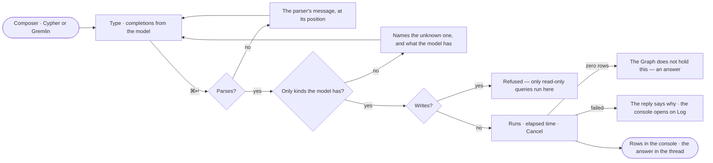

# EX-08 · Write the query myself

**As** an analyst fluent in Cypher or Gremlin **I want** to type the query in the assistant's composer with the model
at hand, and read its rows in the console **so that** nothing is out of reach and I am not negotiating with a
translator for a query I could type.

Tasks: [task.md](task.md) · Feature: [EX-F03](../../feature.md)

## Who can

| Lens | Can | Otherwise sees |
|---|---|---|
| Admin | Type and run read-only queries in the language the connection speaks | A write: refused — *only read-only queries run here* |
| Operator | The same — every member | The same refusal |

## Flow

## Acceptance criteria

| # | Given | When | Then |
|---|---|---|---|
| EX-08.1 | A connection that speaks Cypher | the person opens the ask kind | it offers Ask · Cypher, and not Gremlin |
| EX-08.2 | The ask kind on Cypher | the person types a node label | completions offer the model's kinds, relationship kinds and property keys |
| EX-08.3 | A query in the composer | the person presses ↵ | a new line is added; ⌘↵ runs it, and the status bar names both keys |
| EX-08.4 | A query that does not parse | the person runs it | the parser's message is shown at its position and nothing runs |
| EX-08.5 | A query naming a kind or property the model lacks | the person runs it | it is refused before it runs, naming the unknown one and what the model has |
| EX-08.6 | A query with a write clause | the person runs it | it is refused before it runs — *That query would write to the graph — only read-only queries run here* |
| EX-08.7 | A read-only query that mentions *offset*, *dataset* or a quoted *merge* | the person runs it | it runs |
| EX-08.8 | A valid query | it runs | the query and its outcome are turns in the thread, and its rows are in the console's Data |
| EX-08.9 | A query that returns zero rows | it finishes | the reply says the Graph does not hold this, as an answer, not an error |
| EX-08.10 | A slow query | it runs | the elapsed time shows with *Cancel* |
| EX-08.11 | A very large result | it runs | it is counted first, and capped with the cap stated |
| EX-08.12 | A query that fails in the graph database | it fails | the reply states the error's first line and *Open the log*; the console opens on Log at the failing step; the board is untouched |

## Screens

| Surface | Lens | First use | Empty after a filter | Loading | Has data | Failed | Agent working or proposing | No access |
|---|---|---|---|---|---|---|---|---|
| The composer in a query | Admin | explore.board.console · Empty query | — | explore.board.console · Running | explore.board.console | explore.board.console · Query error | — | explore.board.console · Write refused |
| The composer in a query | Operator | explore.board.console · Empty query | — | explore.board.console · Running | explore.board.console | explore.board.console · Query error | — | explore.board.console · Write refused |
| The rows in the console | Admin | — | explore.board.console · Zero rows | explore.board.console · Running | explore.board.console | explore.board.console · Log | — | — |
| The rows in the console | Operator | — | explore.board.console · Zero rows | explore.board.console · Running | explore.board.console | explore.board.console · Log | — | — |
