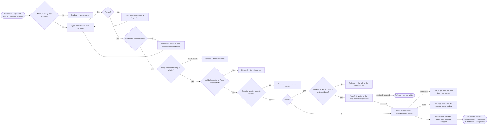

# EX-08 · Write the query myself

**As** an analyst fluent in Cypher or Gremlin **I want** to type the query on one graph database in the assistant's
composer with the model at hand, and read its rows in the console **so that** nothing is out of reach — even what a
typed plan cannot express — and every query I run is still checked and recorded.

Tasks: [task.md](task.md) · Feature: [EX-F03](../../feature.md)

## Who can

A typed query runs as the built-in **Query console** agent: it reads, asks first before a write, and records every
query it runs ([AG-F02](../../../../../agents/features/AG-F02-the-agents-catalogue/feature.md)). It is granted like any
agent. It passes four layers — a static check, a read-only session, a result filter, and for Gremlin steps only —
which are [GP-05](../../../../../../os/graph/features/GP-F01-data/stories/GP-05-run-a-raw-query-within-what-the-agent-may-read/story.md)'s.

| Lens | Can | Otherwise sees |
|---|---|---|
| Admin | Type and run read queries on any graph database the Query console may read; send a write, which waits on the Query console's approvers and runs only on a read + write graph database | A write to a read-only graph database: refused — *{name} is read-only — {why}* |
| Operator | Type and run read queries, when they may use the Query console; a Modeller also sends a write, as Admin | A write: refused — *Edit on the board needs the Modeller role* ([role table](../../../../../../os/access/features/AC-F02-access-policies/feature.md#the-role-table)). Not granted the Query console: Cypher and Gremlin disabled — *{person} may not use Query console — ask an Admin* |

## Flow

## Acceptance criteria

| # | Given | When | Then |
|---|---|---|---|
| EX-08.1 | A person who may use the Query console and a graph database that speaks Cypher | they open the ask kind and pick it | it offers Ask · Cypher, and not Gremlin |
| EX-08.2 | The ask kind on Cypher | the person types a node label | completions offer the kinds, relationship kinds and property keys the published model places in that graph database |
| EX-08.3 | A query in the composer | the person presses ↵ | a new line is added; ⌘↵ runs it, and the status bar names both keys |
| EX-08.4 | A query that does not parse | the person runs it | the parser's message is shown at its position and nothing runs |
| EX-08.5 | A query naming a kind or property the model lacks | the person runs it | it is refused before it runs, naming the unknown one and what the model has |
| EX-08.6 | A query with a write clause, from a Modeller or an Admin, on a read + write graph database | the person runs it | it asks first: the run waits on the Query console's named approvers in the Inbox; approved, it runs; declined or expired, nothing is written and the reply says who decided |
| EX-08.7 | A read query that mentions *offset*, *settings* or a quoted *merge* | the person runs it | it runs, in a read-only session (GP-04), without asking |
| EX-08.8 | A valid query | it runs | the query and its outcome are turns in the thread, its rows are in the console's Data, and the call is recorded in *What left the platform* (AC-F09), naming the Query console and the person |
| EX-08.9 | A query that returns zero rows | it finishes | the reply says the Graph does not hold this, as an answer, not an error |
| EX-08.10 | A slow query | it runs | the elapsed time shows with *Cancel* |
| EX-08.11 | A very large result | it runs | it is counted first, and capped with the cap stated |
| EX-08.12 | A query that fails in the graph database | it fails | the reply states the error's first line and *Open the log*; the console opens on Log at the failing step; the board is untouched |
| EX-08.13 | An Operator | they run a query with a write clause | it is refused before it runs — *Edit on the board needs the Modeller role* — and nothing is asked |
| EX-08.14 | A query with a write clause on a read-only graph database | the person runs it | it is refused before it runs — *{name} is read-only — {why}* — and nothing is asked |
| EX-08.15 | A query reading a kind the Query console's policies deny | the person runs it | it is refused before it runs — *Query console may not Read data/{graph database}/{kind} — {rule} on {policy}, set by {person}* |
| EX-08.16 | A person not granted the Query console | they open the ask kind | Cypher and Gremlin are disabled — *{person} may not use Query console — ask an Admin*; Ask still works |
| EX-08.17 | A query with a node or relationship pattern that has no label, and a Query console that may not Read `data/{graph database}/*` | the person runs it | it is refused before it runs, naming the rule — *An unlabelled pattern reaches every kind* (GP-05.3) |
| EX-08.18 | A Gremlin query with a Groovy script, a lambda or `eval` | the person runs it | it is refused before it runs, naming the construct — a Gremlin query is steps only; nothing is sent (GP-05.9) |
| EX-08.19 | A read whose result holds kinds or property levels the Query console may not Read | the person runs it | they are dropped, never shown; the console and the reply say how many were withheld and name the kinds and levels (GP-05.7) |
| EX-08.20 | A read whose result is all withheld | the person runs it | the reply says everything was withheld and how many, never *the Graph does not hold this* (GP-05.8) |

## Screens

| Surface | Lens | First use | Empty after a filter | Loading | Has data | Failed | Agent working or proposing | No access |
|---|---|---|---|---|---|---|---|---|
| The composer in a query | Admin | explore.board.console · Empty query | — | explore.board.console · Running | explore.board.console | explore.board.console · Query error | explore.board.console · Write waiting on approvers | explore.board.console · Write refused |
| The composer in a query | Operator | explore.board.console · Empty query | — | explore.board.console · Running | explore.board.console | explore.board.console · Query error | — | explore.board.console · Write refused |
| A query refused before it runs | Admin | — | — | — | explore.board.console · Query refused | explore.board.console · Query refused | — | — |
| A query refused before it runs | Operator | — | — | — | explore.board.console · Query refused | explore.board.console · Query refused | — | explore.board.console · Query console not granted |
| The rows in the console | Admin | — | explore.board.console · Zero rows | explore.board.console · Running | explore.board.console · Withheld count | explore.board.console · Log | — | — |
| The rows in the console | Operator | — | explore.board.console · Zero rows | explore.board.console · Running | explore.board.console · Withheld count | explore.board.console · Log | — | explore.board.console · Query console not granted |
