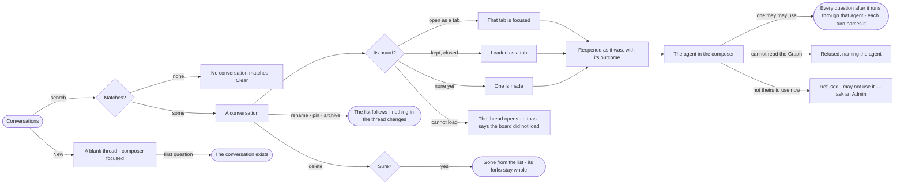

# EX-10 · Pick up a conversation

**As** an analyst **I want** every question I asked kept in conversations I can search and reopen where I left them,
each asking through the agent I chose for it **so that** work is never lost and every answer says which agent read
what to reach it.

Tasks: [task.md](task.md) · Feature: [EX-F03](../../feature.md)

## Who can

A conversation is its asker's. Its content reads for the asker, those an answer in it is shared with
([EX-15](../../../EX-F02-share-and-present-an-answer/stories/EX-15-share-an-answer/story.md)) and Admins; anyone else
sees in Control Plane › Runs that its runs ran, their status and their tokens ([CP-F10](../../../../../../os/control/features/CP-F10-runs-and-how-the-agents-are-doing/feature.md)).

| Lens | Can | Otherwise sees |
|---|---|---|
| Admin | Open, search, reopen, start, rename, pin, archive and delete their own conversations; pick the agent per conversation among those they may use; set a token budget per run; read any conversation's runs in Control Plane › Runs | — |
| Operator | The same, for their own conversations, through the agents they may use; a Modeller the same | Another person's conversations are not listed. An agent they may not use is not offered. A budget above the agent's: clamped, and the settings say so |

## Flow

## Acceptance criteria

| # | Given | When | Then |
|---|---|---|---|
| EX-10.1 | A docked conversation | the person opens *Conversations* in its header | every conversation of theirs is listed newest first — its outcome's dot, title, when, and *failed* when its last reply did — with *New* and a search |
| EX-10.2 | The history open | the person searches for *late orders* and nothing matches | it says *No conversation matches "late orders"* with *Clear* |
| EX-10.3 | A conversation in the history | the person opens it | it reopens as it was, with each run's outcome, and the board keeps its drawing while the history shows |
| EX-10.4 | An open conversation | the person reloads, or opens a shared link to it they may read | the same conversation reopens with its answer |
| EX-10.5 | Any open conversation | the person clicks *New* | a blank thread shows with the composer focused on a question; no conversation is listed until the first question |
| EX-10.6 | A new conversation | its first question is asked | it runs through the deployment's default agent, the Assistant, unless the person picks another they may use |
| EX-10.7 | The agent in the composer | the person picks one they may use | every later question in the conversation runs through it, and each turn names the agent it ran through |
| EX-10.8 | The agent's Access Policies change between two questions | the next question runs | it is checked against the policies in force then; earlier turns keep what they read |
| EX-10.9 | A turn | the person reads it | it names the graph databases its plan read |
| EX-10.10 | The conversation's settings | the person sets a token budget per run above the agent's | it is clamped to the agent's, and the settings say so |
| EX-10.11 | A conversation whose agent the person may not use now | they ask in it | it is refused before it runs — *{person} may not use {agent} — ask an Admin* — and the composer offers the agents they may use |
| EX-10.12 | An Admin | they open Control Plane › Runs | every conversation's runs list, with their content |
| EX-10.13 | Two people on one deployment | one opens the history | they see only their own conversations; another's conversation opened by address reads *Not found* unless an answer in it is shared with them |
| EX-10.14 | A conversation in the history | the person renames it | the new title shows in the list, the header and the crumbs |
| EX-10.15 | A conversation in the history | the person pins it | it lists first, before the newest, until unpinned |
| EX-10.16 | A conversation in the history | the person archives it | it leaves the list, *Show archived* brings it back, and unarchiving restores it; its thread and board are unchanged |
| EX-10.17 | A conversation in the history | the person deletes it and confirms | it is gone from the list; its runs stay in Control Plane › Runs and its forks keep their turns |
| EX-10.18 | The agent in the composer | the person picks an agent whose policies let it read no kind of the published model | the question is refused before it runs, naming the agent; it is never sent to another agent |
| EX-10.19 | A conversation whose board is open as a tab | the person opens it from the history or from a recent question | that tab is focused; the page that was in front steps behind it and nothing is closed |
| EX-10.20 | A conversation whose board is kept but not open | the person opens it | its board is loaded as a tab and focused; nothing else is closed |
| EX-10.21 | A conversation with no board yet | the person opens it | a board is made for it and opened as a tab |
| EX-10.22 | A conversation whose board cannot be loaded | the person opens it | its thread still opens, and a toast says the board could not be loaded |
| EX-10.23 | An agent the person may not use | they open the composer's agent menu | it is not offered; a question sent through it by the API is refused — *{person} may not use {agent} — ask an Admin* |

## Screens

| Surface | Lens | First use | Empty after a filter | Loading | Has data | Failed | Agent working or proposing | No access |
|---|---|---|---|---|---|---|---|---|
| Conversations | Admin | explore.ask · No conversations | explore.board · No conversation matches | explore.board · Loading conversations | explore.board · Conversations | explore.board · Conversations failed | — | — |
| Conversations | Operator | explore.ask · No conversations | explore.board · No conversation matches | explore.board · Loading conversations | explore.board · Conversations | explore.board · Conversations failed | — | — |
| The agent in the composer | Admin | explore.board · Default agent | — | — | explore.board · Agent picked | explore.board · Agent cannot read | — | — |
| The agent in the composer | Operator | explore.board · Default agent | — | — | explore.board · Agent picked | explore.board · Agent cannot read | — | explore.board · Agent not theirs to use |
| Opening a conversation | Admin | — | — | explore.board · Loading conversations | explore.board · Conversations | explore.board · Board not loaded | — | — |
| Opening a conversation | Operator | — | — | explore.board · Loading conversations | explore.board · Conversations | explore.board · Board not loaded | — | — |
| Conversation settings | Admin | — | — | — | explore.board · Settings | — | — | explore.board · Budget clamped |
| Conversation settings | Operator | — | — | — | explore.board · Settings | — | — | explore.board · Budget clamped |
