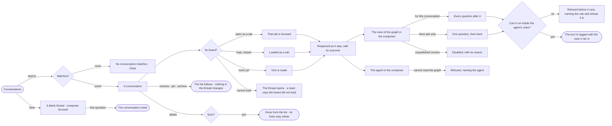

# EX-10 · Pick up a conversation

**As** an analyst **I want** every question I asked kept in conversations I can search and reopen where I left them,
each asking in the view of the graph I chose for it **so that** work is never lost and every answer says what it was
allowed to see.

Tasks: [task.md](task.md) · Feature: [EX-F03](../../feature.md)

## Who can

| Lens | Can | Otherwise sees |
|---|---|---|
| Admin | Open, search, reopen, start, rename, pin, archive and delete their own conversations; pick the agent and a view of the graph per conversation, or a view per question; set a token budget per run | — |
| Operator | The same — every member, for their own conversations | A view whose version is unpublished: disabled with its reason. A budget above the agent's: clamped, and the settings say so |

## Flow

## Acceptance criteria

| # | Given | When | Then |
|---|---|---|---|
| EX-10.1 | A docked conversation | the person opens *Conversations* in its header | every conversation of theirs on this Graph is listed newest first — its outcome's dot, title, when, and *failed* when its last reply did — with *New* and a search |
| EX-10.2 | The history open | the person searches for *fuel* and nothing matches | it says *No conversation matches "fuel"* with *Clear* |
| EX-10.3 | A conversation in the history | the person opens it | it reopens as it was, with each run's outcome, and the board keeps its drawing while the history shows |
| EX-10.4 | An open conversation | the person reloads, or opens a shared link to it | the same conversation reopens with its answer |
| EX-10.5 | Any open conversation | the person clicks *New* | a blank thread shows with the composer focused on a question; no conversation is listed until the first question |
| EX-10.6 | A new conversation | its first question is asked | it runs in *Everything*, never in the last conversation's view of the graph |
| EX-10.7 | The view of the graph in the composer | the person picks one for this conversation | every later question in it runs in that view, and each turn is tagged with the view it ran in |
| EX-10.8 | *Next ask only* ticked | the person asks | that question runs in the picked view and the composer returns to the conversation's view after it |
| EX-10.9 | A view whose version is not published | the person opens the picker | it is disabled with its reason |
| EX-10.10 | A view that casts what the agent's own rules forbid | the person asks | it is refused before it runs, naming the rule and that it is the agent's |
| EX-10.11 | The conversation's view of the graph is deleted | the person reopens it | the composer reads *Everything* and says the view is gone; earlier turns keep the name they ran in |
| EX-10.12 | The conversation's settings | the person sets a token budget per run above the agent's | it is clamped to the agent's, and the settings say so |
| EX-10.13 | Two members on one Graph | one opens the history | they see only their own conversations |
| EX-10.14 | A conversation in the history | the person renames it | the new title shows in the list, the header and the crumbs |
| EX-10.15 | A conversation in the history | the person pins it | it lists first, before the newest, until unpinned |
| EX-10.16 | A conversation in the history | the person archives it | it leaves the list, *Show archived* brings it back, and unarchiving restores it; its thread and board are unchanged |
| EX-10.17 | A conversation in the history | the person deletes it and confirms | it is gone from the list; its runs stay in Agents › Runs and its forks keep their turns |
| EX-10.18 | The agent in the composer | the person picks an agent that cannot read the graph | the question is refused before it runs, naming the agent; it is never sent to another agent |
| EX-10.19 | A conversation whose board is open as a tab | the person opens it from the history or from a recent question | that tab is focused; the page that was in front steps behind it and nothing is closed |
| EX-10.20 | A conversation whose board is kept but not open | the person opens it | its board is loaded as a tab and focused; nothing else is closed |
| EX-10.21 | A conversation with no board yet | the person opens it | a board is made for it and opened as a tab |
| EX-10.22 | A conversation whose board cannot be loaded | the person opens it | its thread still opens, and a toast says the board could not be loaded |

## Screens

| Surface | Lens | First use | Empty after a filter | Loading | Has data | Failed | Agent working or proposing | No access |
|---|---|---|---|---|---|---|---|---|
| Conversations | Admin | explore.ask · No conversations | explore.board · No conversation matches | explore.board · Loading conversations | explore.board · Conversations | explore.board · Conversations failed | — | — |
| Conversations | Operator | explore.ask · No conversations | explore.board · No conversation matches | explore.board · Loading conversations | explore.board · Conversations | explore.board · Conversations failed | — | — |
| The view of the graph | Admin | explore.board · Everything | — | — | explore.board · View picked | explore.board · Refused by a rule | — | explore.board · View unpublished |
| The view of the graph | Operator | explore.board · Everything | — | — | explore.board · View picked | explore.board · Refused by a rule | — | explore.board · View unpublished |
| Opening a conversation | Admin | — | — | explore.board · Loading conversations | explore.board · Conversations | explore.board · Board not loaded | — | — |
| Opening a conversation | Operator | — | — | explore.board · Loading conversations | explore.board · Conversations | explore.board · Board not loaded | — | — |
| Conversation settings | Admin | — | — | — | explore.board · Settings | — | — | explore.board · Budget clamped |
| Conversation settings | Operator | — | — | — | explore.board · Settings | — | — | explore.board · Budget clamped |
