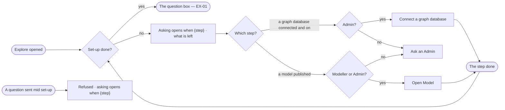

# EX-11 · Know what opens asking

**As** an analyst on a new deployment **I want** to be told which set-up step opens asking, and who can take it **so that** I know who to ask instead of facing a box that cannot answer.

Tasks: [task.md](task.md) · Feature: [EX-F03](../../feature.md)

## Who can

| Lens | Can | Otherwise sees |
|---|---|---|
| Admin | Read the lock and what is left; open the step that does it — *Connect a graph database* or *Open Model* to publish the model | — |
| Operator | Read the lock and what is left. A Modeller also opens *Open Model* to publish the model | *Ask an Admin* in place of the step's act; a step only an Admin takes names the Admin role ([role table](../../../../../../os/access/features/AC-F02-access-policies/feature.md#the-role-table)) |

## Flow

## Acceptance criteria

| # | Given | When | Then |
|---|---|---|---|
| EX-11.1 | A deployment whose set-up is not done — no graph database on, or no published model | anyone opens Explore | the board is the lock alone — *Asking opens when {step}* — with what is left, and no question box |
| EX-11.2 | The lock on *a model is published*, and a Modeller or an Admin | they click *Open Model* | Model mode opens on the draft |
| EX-11.3 | The lock on *a graph database is connected and on*, and an Admin | they click *Connect a graph database* | Control Plane › Graph databases opens on *Connect* ([CP-F05](../../../../../../os/control/features/CP-F05-graph-databases/feature.md)) |
| EX-11.4 | The lock, and an Operator | they read it | the lock offers *Ask an Admin* where the step's act would be, naming the role the step needs |
| EX-11.5 | The lock is showing | someone finishes the last step | the next visit opens on the question box, and the ready step says asking is open and offers the first question |
| EX-11.6 | Set-up not done | a question is sent by any path | it is refused before it runs — *Asking opens when {step}.* |

## Screens

| Surface | Lens | First use | Empty after a filter | Loading | Has data | Failed | Agent working or proposing | No access |
|---|---|---|---|---|---|---|---|---|
| The lock | Admin | explore.ask · Locked | — | explore.ask · Loading | start.setup | explore.ask · Set-up not finished | — | — |
| The lock | Operator | explore.ask · Locked | — | explore.ask · Loading | start.setup | explore.ask · Set-up not finished | — | explore.ask · Locked, ask the owner |
