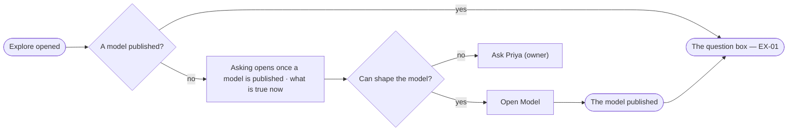

# EX-11 · Know what opens asking

**As** an analyst on a new Graph **I want** to be told which set-up step opens asking, and who can take it **so that**
I know who to ask instead of facing a box that cannot answer.

Tasks: [task.md](task.md) · Feature: [EX-F03](../../feature.md)

## Who can

| Lens | Can | Otherwise sees |
|---|---|---|
| Admin | Read the lock and *Open Model* to publish the first model | — |
| Operator | Read the lock and what is true now | *Ask Priya (owner)* in place of *Open Model*. With *Can shape the model*: as Admin |

## Flow

## Acceptance criteria

| # | Given | When | Then |
|---|---|---|---|
| EX-11.1 | A Graph with no published model | anyone opens Explore | the board is the lock alone — *Asking opens once a model is published* — with what is true now, and no question box |
| EX-11.2 | The lock, and a person with *Can shape the model* | they click *Open Model* | Model mode opens on the draft |
| EX-11.3 | The lock, and an Operator without *Can shape the model* | they read it | the lock offers *Ask Priya (owner)* where *Open Model* would be |
| EX-11.4 | The lock is showing | someone publishes the Graph's first model | the next visit opens on the question box |
| EX-11.5 | A Graph just created | its last set-up step completes | the ready step says asking is open and offers the first question |

## Screens

| Surface | Lens | First use | Empty after a filter | Loading | Has data | Failed | Agent working or proposing | No access |
|---|---|---|---|---|---|---|---|---|
| The lock | Admin | explore.ask · Locked | — | explore.ask · Loading | start.new_graph.ready | — | — | — |
| The lock | Operator | explore.ask · Locked | — | explore.ask · Loading | start.new_graph.ready | — | — | explore.ask · Locked, ask the owner |
