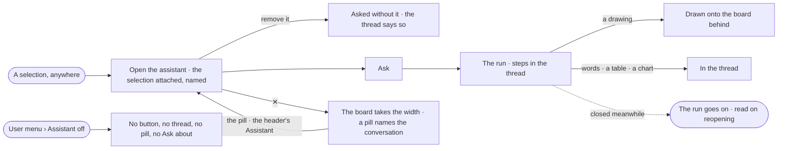

# EX-13 · The assistant beside the work

**As** an analyst looking at something **I want** to ask about *this* from an assistant beside my work, and close it
when I work by hand **so that** I never describe what is already on my screen, and the board gets the whole width
when I need it.

Tasks: [task.md](task.md) · Feature: [EX-F03](../../feature.md)

## Who can

| Lens | Can | Otherwise sees |
|---|---|---|
| Admin | Open, close and reopen the assistant; attach or remove the selection; switch it off for themselves | — |
| Operator | The same — every member | — |

## Flow

## Acceptance criteria

| # | Given | When | Then |
|---|---|---|---|
| EX-13.1 | Nodes selected on a board | the person opens the assistant | the selection is named in the composer, directly above the input, with a remove |
| EX-13.2 | The selection attached | the person removes it and asks | the question is asked without it and the thread records that |
| EX-13.3 | An attached selection | the person asks | the question as recorded in the thread names what was attached, in words |
| EX-13.4 | The assistant opened from Model or from a task | the person asks | the question is about the model or the task; the assistant itself is the same |
| EX-13.5 | An answer that draws | it settles | it draws onto the board behind the assistant, not into the thread |
| EX-13.6 | An answer that draws, and no board open | it settles | the reply offers to open one |
| EX-13.7 | A conversation docked | the person clicks ✕ | the board takes the width and a pill — *Assistant · <conversation title>* — shows over it |
| EX-13.8 | The assistant closed | the person clicks the pill or the header's *Assistant* | it reopens on the same conversation |
| EX-13.9 | A run on its way | the person closes the assistant | the run is not cancelled; reopening shows its outcome |
| EX-13.10 | The user menu's *Assistant* switched off | the person moves between modes | no header button, no docked thread, no pill, no *Ask the assistant* in ⌘K and no *Ask about* on a record; Explore's start keeps *Your views* and says how to turn asking back on |
| EX-13.11 | The assistant docked | it opens | it is 440 px wide and cannot be dragged narrower than 320 px; the board moves over, never under it |

## Screens

| Surface | Lens | First use | Empty after a filter | Loading | Has data | Failed | Agent working or proposing | No access |
|---|---|---|---|---|---|---|---|---|
| The docked assistant | Admin | explore.board · New conversation | — | explore.board · Working | explore.board | explore.board · Failed | explore.board · Working | — |
| The docked assistant | Operator | explore.board · New conversation | — | explore.board · Working | explore.board | explore.board · Failed | explore.board · Working | — |
| The board with it closed | Admin | — | — | — | explore.board.left_closed · Assistant closed | — | explore.board.left_closed · Running behind | — |
| The board with it closed | Operator | — | — | — | explore.board.left_closed · Assistant closed | — | explore.board.left_closed · Running behind | — |
| Assistant switched off | Admin | explore.ask · Assistant off | — | — | explore.ask · Assistant off | — | — | — |
| Assistant switched off | Operator | explore.ask · Assistant off | — | — | explore.ask · Assistant off | — | — | — |
