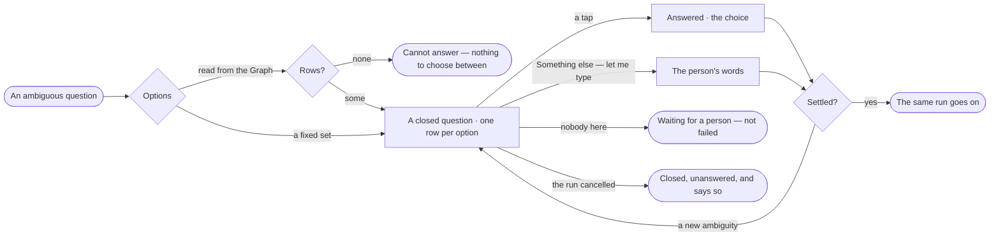

# EX-23 · Be asked back, not guessed for

**As** an analyst who asked something ambiguous **I want** the assistant to ask me one specific question I can answer
with a tap **so that** I get the answer I meant, not a confident answer to a different question.

Tasks: [task.md](task.md) · Feature: [EX-F03](../../feature.md)

## Who can

| Lens | Can | Otherwise sees |
|---|---|---|
| Admin | Answer a question asked back on their own run, in the thread or in Inbox › Needs you, or type something else | — |
| Operator | The same, on their own runs; a Modeller the same — only a person answers ([role table](../../../../../../os/access/features/AC-F02-access-policies/feature.md#the-role-table) › *Ask a question*) | A question asked back on another person's run is not shown to them |

## Flow

## Acceptance criteria

| # | Given | When | Then |
|---|---|---|---|
| EX-23.1 | A question the assistant cannot settle | it is understood | the reply asks one closed question — a choice, several choices or yes/no — and no answer is given yet |
| EX-23.2 | Options read from the Graph | the question is asked | the options are the rows a checked plan returned, read only where the agent's Access Policies allow; none is invented |
| EX-23.3 | Options read from the Graph return no rows | the question would be asked | no empty picker is shown; the reply is *cannot answer — nothing to choose between* |
| EX-23.4 | Options whose labels say enough | the question is drawn | each option is one line; a second line shows only on an option written with a description |
| EX-23.5 | A question asked back | the person taps an option | it folds to *Answered · <choice>* and the same run goes on with it, not a new run |
| EX-23.6 | A folded answer | the person opens it | the question shows with the options not taken dimmed |
| EX-23.7 | An answer that opens a new ambiguity | the run goes on | it may ask again; *How it got here* shows each round under the one understanding step, and nothing answered is asked twice |
| EX-23.8 | The assistant has asked as many times as it may | it is still unsure | it says what it still does not know and answers on the reading it can defend |
| EX-23.9 | A question asked back and nobody answering | time passes | the run reads as waiting, its steps stop at understanding, and it never expires |
| EX-23.10 | A question asked back on a scheduled run | it is answered in Inbox › Needs you | the same run resumes; each firing's answer stays its own |
| EX-23.11 | A question asked back | an agent tries to answer it | it is refused — only a person answers |
| EX-23.12 | The run is cancelled while a question waits | it cancels | the question closes as unanswered and says so |
| EX-23.13 | A question asked back with choices | it is shown | one choice is marked as the assistant's recommendation, with its reason in a line; the person answers with one click |
| EX-23.14 | A question asked back with choices | none fits | *Something else — let me type* takes a line in the person's words, and the same run goes on with it |

## Screens

| Surface | Lens | First use | Empty after a filter | Loading | Has data | Failed | Agent working or proposing | No access |
|---|---|---|---|---|---|---|---|---|
| The question in the thread | Admin | — | explore.board.cannot · Nothing to choose | explore.board · Working | explore.board · Answered | explore.board · Closed unanswered | explore.board · Asks back | — |
| The question in the thread | Operator | — | explore.board.cannot · Nothing to choose | explore.board · Working | explore.board · Answered | explore.board · Closed unanswered | explore.board · Asks back | — |
